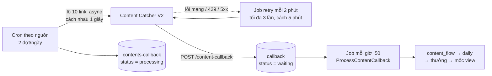

# Crawl view: rà soát điểm yếu và đề xuất nâng cấp

**Ngày:** 2026-11-27
**Phạm vi:** luồng crawl view content của Ambassador: cron ở backend public → Content Catcher V2 → callback → flow, daily, thưởng.
**Cơ sở:** mã nguồn nhánh `develop` của `AT-Core/ambassador` (commit `bcab4165`, 27/11/2026). Đường dẫn trong tài liệu tính từ thư mục `backend/`.

---

## Mục đích tài liệu

Hiện có hai vấn đề:

1. **Crawl lỗi thì không ai biết.** Không có tín hiệu nào báo cho vận hành.
2. **Lỗi rồi thì không có cách xử lý.** Không có công cụ để lấy lại dữ liệu của những ngày bị lỡ.

Tài liệu này mô tả hệ thống đang chạy thế nào, chỉ ra điểm yếu kèm vị trí trong code, rồi đề xuất phần cần bổ sung theo mức ưu tiên. Tài liệu không phân tích nguyên nhân của một sự cố cụ thể nào.

---

## 1. Luồng hiện tại

### Lịch crawl

Cron dùng `robfig/cron` có trường giây, múi giờ Asia/Ho_Chi_Minh (`pkg/public/schedule/schedule.go:13`).

| Giờ | Job | Nguồn |
| --- | --- | --- |
| 04:00 / 16:00 | `CrawlDataContentFacebook` | Facebook, FB Reels |
| 05:30 / 17:30 | `CrawlDataContentThreads` | Threads |
| 07:00 / 19:00 | `CrawlDataContent` | YouTube, Shorts |
| 08:30 / 20:30 | `CrawlDataContentFacebookPost` | Facebook Post |
| 10:00 / 22:00 | `CrawlDataContentTiktokSelf` | TikTok của user đã liên kết tài khoản |
| 11:30 / 23:30 | `CrawlDataContentTiktok` | TikTok còn lại |
| mỗi 2 phút | `RetryFailedCrawlRequests` | gửi lại request lỗi |
| mỗi giờ, phút 50 | `ProcessContentCallback` | xử lý kết quả trả về |
| mỗi 3 giờ | `RecheckVideoNotFound` | kiểm lại video không tìm thấy |

Instagram và Shopee **không có cron**. Hai nguồn này chỉ được cập nhật bằng tay qua `add-statistic`.

### Những điểm chính

- **Chỉ crawl event đang chạy:** `status = active`, `startAt ≤ now < endAt` (`pkg/public/service/schedule.go:103-112` và các job tương tự). Event kết thúc là content của nó không được crawl nữa.
- **Gọi Content Catcher kiểu async.** Mỗi link ghi một dòng `contents-callback` ở trạng thái `processing` (`schedule.go:2501`). Content Catcher trả kết quả về `/content-callback`, và job mỗi giờ xử lý tiếp.
- **Giới hạn tốc độ:** mọi request crawl đều đi qua gateway V2, nên giới hạn cần tuân là 120 request/phút/path của gateway. Code giãn mỗi request cách nhau 1 giây (`crawlRequestInterval`, `schedule.go:530`), tức 60 request/phút.
- **Retry:** chỉ lỗi mạng, HTTP 429 và 5xx được gửi lại. Tối đa 3 lần, mỗi lần cách 5 phút (`internal/module/social/content_catcher/request_log.go:24-25, 152`). Chỉ gửi lại link của event còn chạy.
- **Ghi số:** view mới trừ tổng view đã ghi thành `content_flow` của ngày crawl (`internal/service/content_flow.go:234`). Daily, thưởng statistic và mốc view tính tiếp từ đó.

---

## 2. Điểm yếu

### A. Không phát hiện được lỗi

| Mã | Điểm yếu | Vị trí |
| --- | --- | --- |
| A1 | **Không có cảnh báo nào cho lỗi crawl.** Các trường hợp sau đều không phát sinh cảnh báo: gateway lỗi, retry hết 3 lần, một đợt không gửi được request nào, tỉ lệ callback `failed` tăng, cả ngày không có view mới. Lỗi chỉ được in ra stdout (`fmt.Println`). | `schedule.go`, `schedule_crawl_retry.go:163-166` |
| A2 | **Mẫu tin cảnh báo đã viết sẵn nhưng không chỗ nào gửi:** `MsgRequestCountTikFailed`, `MsgRequestYoutubeFailed`, `MsgContentNotFound`. | `internal/module/telegram/telegram.go:15-21` |
| A3 | **Cảnh báo "view về 0" không bao giờ chạy tới.** Callback có view = 0 bị đánh `failed` và dừng ở `schedule.go:2298`, trước khi tới chỗ gửi Telegram trong `content_flow.go:46-55`. | như cột trái |
| A4 | **Không có "lần crawl cuối"** cho từng content hay event, và admin không có màn nào cho biết crawl đang khoẻ hay không. `nextCrawlAt` được ghi khi tạo content nhưng không chỗ nào đọc. | `internal/model/mg/content.go:42`, `pkg/public/service/content.go:165` |
| A5 | **Log không đủ để điều tra lại.** Lịch sử crawl `content-crawl-histories` bị xoá sau 3 ngày. Log request `crawl-request-logs` giữ 30 ngày. Còn lại chỉ có stdout. | `pkg/admin/service/shedule.go:459`, `internal/module/database/mongodb/index.go:129` |

### B. Job có thể dừng mà không để lại dấu vết

| Mã | Điểm yếu | Vị trí |
| --- | --- | --- |
| B1 | **Gọi HTTP sang Content Catcher không đặt timeout.** `resty.New()` dùng mặc định, không giới hạn thời gian. Nếu một request treo, job giữ cờ "đang chạy", và các lần chạy sau của job đó thoát ngay mà không ghi log. | `content_catcher/client.go:205`, `schedule.go:576-595` |
| B2 | **Retry có giới hạn, và hết lượt là im lặng.** Sau 3 lần trong khoảng 15 phút, request bị đánh `failed` và không ai biết. Nếu giới hạn tốc độ kéo dài hơn khoảng thời gian đó, các lô này mất cho đến đợt crawl sau. | `schedule_crawl_retry.go:163-166` |
| B3 | **Callback không về thì kẹt mãi ở `processing`.** Không có job nào quét callback quá hạn. | `schedule.go:2501` |
| B4 | **Cron không bắt panic.** `cron.New` không có `cron.Recover`, nên một panic trong job làm sập cả process public. | `pkg/public/schedule/schedule.go:13` |
| B5 | **Lỗi đăng ký job bị bỏ qua.** Kết quả `AddFunc` không được kiểm. Hai job hoa hồng dùng cú pháp 5 trường trong khi cron yêu cầu 6 trường, nên không đăng ký được mà không ai biết. | `pkg/public/schedule/schedule.go:47, 50` |
| B6 | **Token TikTok hết hạn thì user bị loại khỏi crawl vĩnh viễn.** Gặp 401 lặp lại trong 24 giờ thì `isTokenExpired = true`, và job TikTok self bỏ qua user đó. Hệ thống không thông báo cho vận hành lẫn creator. | `schedule.go:2232, 482-483` |
| B7 | **Khoá chạy chỉ có hiệu lực trong từng instance** (cờ bool + mutex). Cron chỉ chạy ở instance chính (IS MAIN) nên các job định kỳ không chồng nhau. Tuy nhiên, các trigger tay `/schedules/*` đi qua API như request thông thường, có thể được xử lý ở instance khác và chạy song song với cron trên instance chính. `ProcessContentCallback` không có khoá, chỉ tự dừng sau 55 phút. | `schedule.go:576`, `pkg/public/router/schedule.go:12-30`, `schedule.go:2084, 2147` |

### C. Thiếu công cụ khắc phục

| Mã | Điểm yếu | Vị trí |
| --- | --- | --- |
| C1 | **Event kết thúc là ngừng crawl**, không có giai đoạn chốt số. Lỗi xảy ra vào cuối chiến dịch thì không có lần crawl nào bù lại. Job retry cũng bỏ qua event đã hết hạn. | `schedule.go:103-112`, `schedule_crawl_retry.go:181-205` |
| C2 | **Mọi công cụ tay đều ghi số vào hôm nay.** Crawl lại một content (`POST /contents/:id/crawl-info`), nhập view (`POST /contents/:id/add-statistic`) và nhập view thủ công (`content-manual-flows`) đều ghi vào ngày chạy. Không có cách ghi cho đúng ngày bị lỡ. | `pkg/admin/service/content.go:105, 1013`, `content_manual_flow.go:186` |
| C3 | **`add-statistic` không hỗ trợ TikTok, YouTube và Facebook Post.** | `pkg/admin/service/content.go:79-88` |
| C4 | **Các trigger tay `/schedules/*` chỉ crawl "bây giờ"** và chỉ cho event đang chạy. | `pkg/public/handler/schedule.go` |
| C5 | **Không có gì phát hiện ngày trống.** `AuditContentAnalytic` chỉ so daily với flow của chính nó, không tìm ngày bị thiếu. | `pkg/admin/service/shedule.go:269` |
| C6 | **Không có quy trình xử lý sự cố crawl:** không runbook cho vận hành, không người trực, không SLA. | — |

### D. Hệ quả nghiệp vụ khi crawl bị lỡ ngày

- **View dồn vào ngày crawl lại.** `content_flow` lấy view hiện tại trừ tổng đã ghi (`content_flow.go:234`), nên toàn bộ phần tăng của các ngày bị lỡ rơi vào một ngày. Biểu đồ theo ngày bị lệch.
- **Thưởng mốc view ghi theo ngày chạy**, và không được tính nếu schema đã hết hạn lúc crawl lại.
- **Ngân sách cấp theo thứ tự xử lý**, không theo ngày view thật sự phát sinh. Với chiến dịch có ngân sách, content được xử lý trước sẽ nhận ngân sách trước.
- **View giảm không bị chặn**, nên có thể sinh flow và daily âm (`content_flow.go:234`).

---

## 3. Đề xuất

Định hướng: cảnh báo được xây dựng thành **một chức năng theo dõi trong admin**. Đội vận hành mở màn hình là biết content nào đang không được crawl, vì sao, và cần lấy view thủ công ở đâu. Xử lý xong, content tự rời danh sách.

### P0: Phát hiện lỗi kịp thời

| # | Việc | Giải quyết |
| --- | --- | --- |
| 1 | **Ghi trạng thái crawl cho từng content:** `lastCrawledAt`, `lastCrawlStatus`, `lastCrawlError`, số lần lỗi liên tiếp. Ghi ở mọi điểm của luồng: gửi request, retry, nhận callback, xử lý callback. Đây là dữ liệu nền cho màn theo dõi. | A4, A5 |
| 2 | **Màn "Theo dõi crawl", phần tổng quan:** xem theo event và nguồn (mục 3.1). | A1, B1, B2 |
| 3 | **Màn "Theo dõi crawl", danh sách cần xử lý:** mỗi dòng là một content cần lấy view thủ công, kèm lý do và thao tác (mục 3.2). | A1, A3, B2, B3, B6 |
| 4 | **Không để job chết lặng lẽ:** timeout cho mọi request ra ngoài; thêm `cron.Recover`; kiểm lỗi `AddFunc` và sửa 2 job dùng cú pháp 5 trường. Đợt crawl nào không chạy, hoặc chạy mà không gửi được request nào, phải hiện thành "Sự cố" ở phần tổng quan. | B1, B4, B5 |
| 5 | **Content trả view = 0 hoặc rỗng vào danh sách cần xử lý**, thay vì chỉ đánh `failed` rồi bỏ đó. Gỡ các mẫu tin Telegram không dùng (`telegram.go:15-21`). | A2, A3 |
| 6 | **Token TikTok hết hạn:** content của user đó vào danh sách cần xử lý với lý do riêng, và creator được nhắc kết nối lại. | B6 |

#### 3.1. Phần tổng quan

Mỗi dòng là một cặp **event × nguồn** đang chạy.

| Cột | Ý nghĩa |
| --- | --- |
| Đợt crawl gần nhất | Thời điểm bắt đầu và kết thúc. Quá giờ dự kiến mà chưa chạy thì báo "Không chạy". |
| Đã gửi / thành công / lỗi | Số link trong đợt gần nhất. |
| Retry hết lượt | Số link đã gửi lại đủ 3 lần vẫn lỗi. |
| Callback đang chờ | Số link đã gửi mà chưa có kết quả, kèm thời gian chờ lâu nhất. |
| % cập nhật 24 giờ | Số content được cập nhật view trong 24 giờ qua, chia cho số content đang chạy. |
| Trạng thái | **Bình thường / Cần chú ý / Sự cố**, tính theo ngưỡng do vận hành cấu hình. |

Menu admin hiện số đếm event × nguồn đang ở trạng thái "Sự cố", để đội vận hành thấy ngay khi đăng nhập.

#### 3.2. Danh sách cần xử lý

Mỗi dòng là một content. Content vào danh sách khi gặp một trong các lý do sau, và tự rời khi lần crawl kế tiếp thành công hoặc người xử lý đánh dấu đã xong.

| Lý do | Điều kiện vào danh sách | Cách xử lý |
| --- | --- | --- |
| Retry hết lượt | Request lỗi đủ 3 lần | Crawl lại; vẫn lỗi thì lấy view thủ công |
| Callback quá hạn | Đã gửi quá thời gian cấu hình mà chưa có kết quả | Crawl lại |
| View = 0 hoặc rỗng | Callback trả view 0 hoặc không có view | Mở link kiểm tra, nhập view thủ công |
| Không tìm thấy video | `totalNotFound` tăng | Kiểm tra link, xác nhận reject hay giữ |
| Token TikTok hết hạn | `isTokenExpired = true` | Nhắc creator kết nối lại, trong lúc đó nhập view thủ công |
| Trễ cập nhật | Quá 24 giờ chưa có view mới, dù không có lỗi rõ ràng | Crawl lại, kiểm tra |
| Ngày trống trong chiến dịch | Có ngày thiếu daily (việc 10) | Bù view theo ngày (việc 12) |

Cột của danh sách: content, link, creator, event, nguồn, lý do, lần crawl thành công cuối, lỗi gần nhất, số ngày chưa cập nhật, **hạn xử lý**, người xử lý, ghi chú.

- **Hạn xử lý** lấy ngày nào sớm hơn trong hai ngày: ngày kết thúc event, hoặc ngày chốt kỳ đối soát. Danh sách mặc định xếp theo hạn này, để content của event sắp kết thúc lên đầu.
- **Thao tác trên từng dòng:** crawl lại; nhập view thủ công (theo ngày hiệu lực khi có việc 13); đánh dấu đã xử lý hoặc bỏ qua, có ghi chú. Chọn nhiều dòng để crawl lại hàng loạt.
- **Lọc** theo event, nguồn, lý do, ADV. Danh sách tuân theo phạm vi ADV của người xem, giống các màn admin khác.
- **Lưu lịch sử xử lý** (ai, lúc nào, làm gì) để đối chiếu khi có khiếu nại về view.

### P1: Tự phục hồi, giảm thao tác thủ công

| # | Việc | Giải quyết |
| --- | --- | --- |
| 7 | **Job dọn callback treo:** callback ở `processing` quá thời gian cấu hình thì chuyển `failed`, đưa vào retry, và hiện ở danh sách cần xử lý nếu vẫn không về. | B3 |
| 8 | **Retry theo nhịp dài hơn khi bị giới hạn tốc độ** (tăng dần khoảng cách, nhiều lượt hơn), thay vì 3 lần trong 15 phút. Giảm số content phải xử lý tay. | B2 |
| 9 | **Giai đoạn chốt số sau khi chiến dịch kết thúc:** tiếp tục crawl **5 ngày** sau `endAt`, cấu hình được theo từng event. Content lỗi trong 5 ngày này vẫn vào danh sách cần xử lý. | C1 |
| 10 | **Job phát hiện ngày trống:** tìm content có ngày thiếu trong thời gian chiến dịch và đưa vào danh sách cần xử lý. | C5 |
| 11 | **Khoá chạy dùng chung giữa các instance** (khoá trên DB), để trigger tay `/schedules/*` không chạy chồng với cron trên instance chính. Thêm khoá cho `ProcessContentCallback`. | B7 |

### P2: Chuẩn hoá việc khắc phục

| # | Việc | Giải quyết |
| --- | --- | --- |
| 12 | **Bù view theo ngày thành tính năng có giao diện:** chọn event và khoảng ngày; hệ thống tự crawl lấy số hiện tại; chia phần view bị dồn về các ngày bị lỡ. Có xem trước, duyệt, apply và hoàn tác. Mở được từ danh sách cần xử lý. | C2, D |
| 13 | **Nhập view và crawl lại được chọn ngày hiệu lực**, và hỗ trợ đủ các nguồn. Đây là thao tác chính của danh sách cần xử lý. | C2, C3 |
| 14 | **Chặn view giảm:** không sinh flow âm; đưa content vào danh sách cần xử lý để đội vận hành kiểm tra. | D |
| 15 | **Giữ log crawl 90 ngày**, gồm cả lịch sử crawl và log request. | A5 |
| 16 | **Runbook xử lý danh sách và phân công:** ai xử lý danh sách của ADV nào, trong bao lâu. | C6 |

---

## 4. Đo thành công

| Chỉ số | Hiện tại | Mục tiêu |
| --- | --- | --- |
| Thời gian từ lúc crawl hỏng đến lúc hiện trên màn theo dõi | không có màn theo dõi | < 2 giờ |
| Thời gian từ lúc content vào danh sách đến lúc được xử lý | không đo được | < 24 giờ, và trước hạn xử lý |
| % content đang chạy được cập nhật view trong 24 giờ | không đo được | ≥ 98% |
| Content quá hạn xử lý mà vẫn còn trong danh sách | không đo được | 0 |
| Cách khắc phục khi lỡ ngày crawl | cần viết migration riêng | thao tác trên admin |
