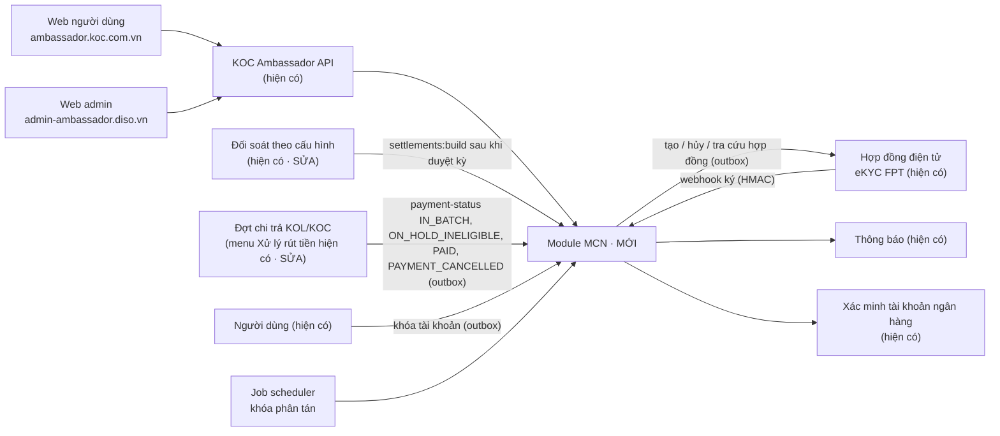
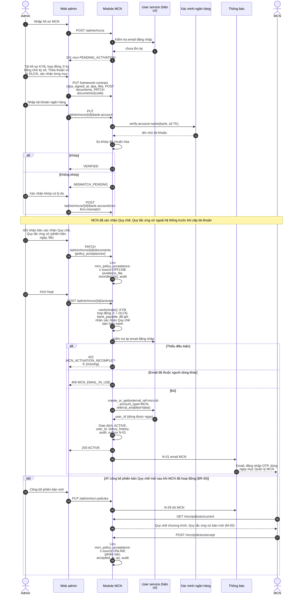
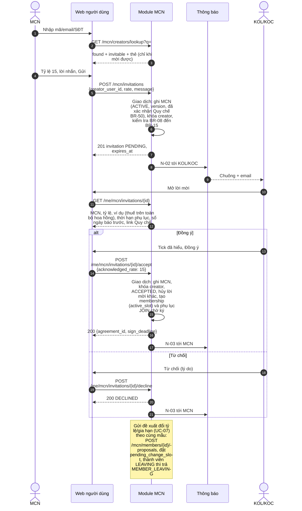
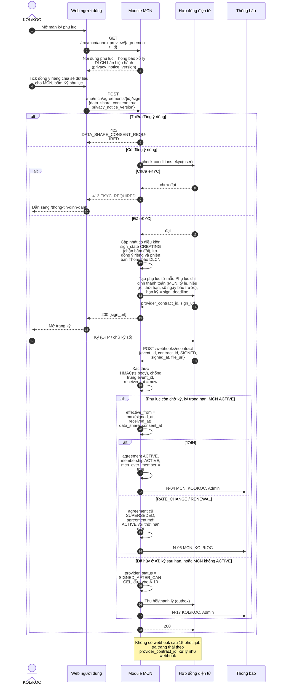
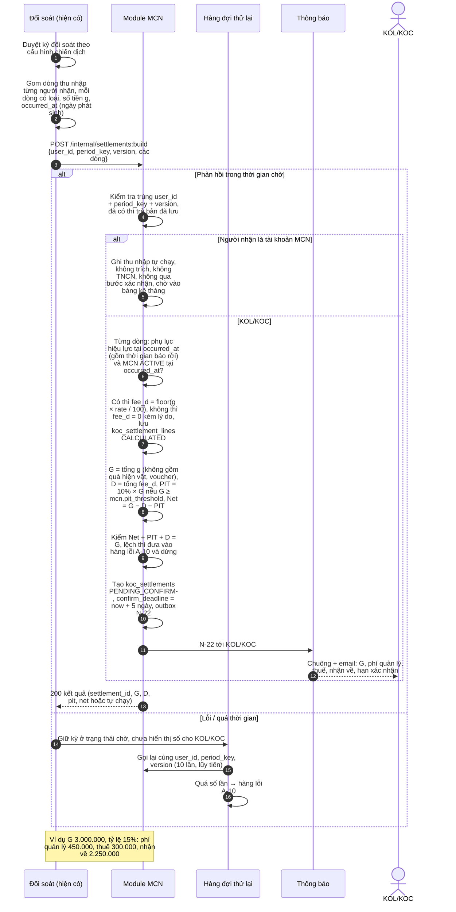
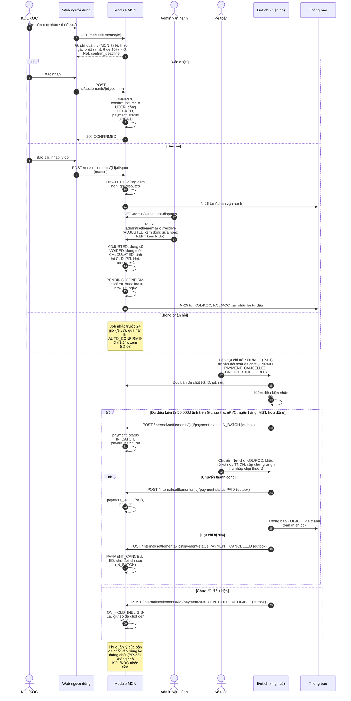
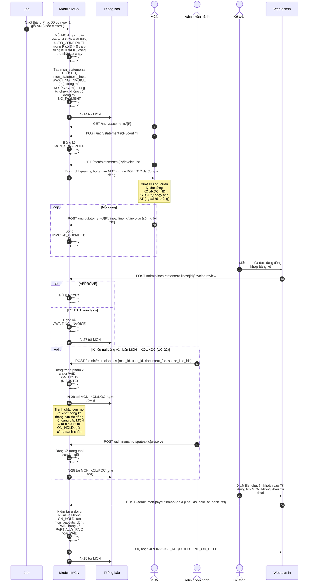
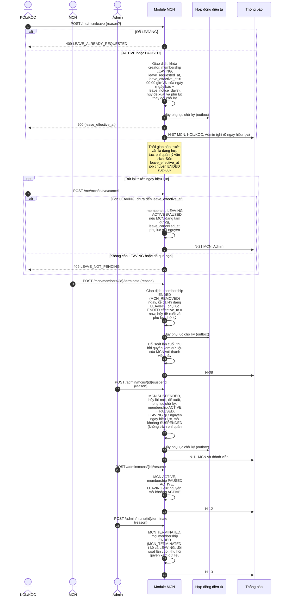
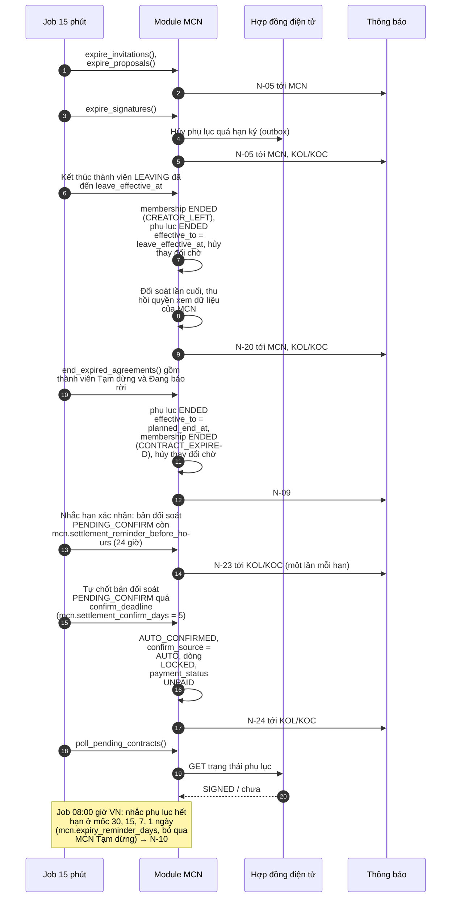

<!-- Chuyển đổi từ 08-Sequence.pdf. Sơ đồ được dựng lại bằng Mermaid từ hình trong PDF; số bước khớp bản gốc. -->

# 08 · Sequence

| Mã | Phiên bản | Ngày | Người soạn | Căn cứ |
| --- | --- | --- | --- | --- |
| MCN-SEQ | 3.0 (final) | 22/10/2026 | PO (Trần Tiến Đạt) | Tài liệu 01 (BR), tài liệu 02 (luồng đối soát), phản hồi Legal 21/10/2026, quyết định PO 21/10/2026, sổ mã `_bao-tri/So-ma-tai-lieu.md` |

Tài liệu liên quan: 05 (use case), 06 (đặc tả chức năng), 07 (state machine), 09 (API), 10 (database).

Tài liệu gồm sơ đồ thành phần (Hình 0) và 8 sơ đồ tuần tự (SD-01…SD-08) cho các điểm tích hợp: hợp đồng điện tử, luồng đối soát, đợt chi trả KOL/KOC, bảng kê và hóa đơn MCN, thông báo, job. Tên API khớp tài liệu 09; trạng thái khớp tài liệu 07.

Quy ước chung cho mọi sơ đồ:

- Mọi lệnh gọi sang hệ thống khác có thể thất bại giữa chừng (hợp đồng điện tử, thông báo, kết quả đợt chi) được ghi vào outbox cùng giao dịch nghiệp vụ rồi gửi đi.
- API nội bộ idempotent theo mã nghiệp vụ: `user_id + period_key + version` cho `settlements:build`, `event_id` cho `payment-status` và webhook hợp đồng.
- Mốc thời gian nghiệp vụ lấy từ dữ liệu đã lưu (`leave_effective_at`, `planned_end_at`, `confirm_deadline`), không lấy giờ job chạy.

| Sơ đồ | Nội dung | Use case |
| --- | --- | --- |
| Hình 0 | Thành phần và ranh giới tích hợp | — |
| SD-01 | Tạo và kích hoạt MCN, xác nhận Quy chế | UC-01, UC-23 |
| SD-02 | Mời và phản hồi lời mời | UC-03, UC-05, UC-07 |
| SD-03 | Ký Phụ lục chỉ định thanh toán | UC-06, UC-08 |
| SD-04 | Đối soát, tách theo ngày phát sinh, lập bản đối soát | UC-13 |
| SD-05 | KOL/KOC xác nhận số và AT chi trả | UC-14, UC-21 |
| SD-06 | Chốt bảng kê, hóa đơn và thanh toán MCN | UC-15, UC-16, UC-17, UC-22 |
| SD-07 | Báo rời có báo trước, kết thúc quan hệ, đổi trạng thái MCN | UC-02, UC-09, UC-10, UC-20 |
| SD-08 | Job hết hạn, nhắc và tự chốt | UC-09, UC-14, UC-18 |

## 1. Thành phần (Hình 0)

**Chú thích.** Module MCN có thể là service riêng hoặc module trong backend hiện có; tài liệu chỉ ràng buộc ranh giới API. Hai luồng hiện có phải sửa: luồng đối soát theo cấu hình gửi dòng thu nhập kèm ngày phát sinh sang module (SD-04); luồng đợt chi (menu "Xử lý rút tiền", giữ tên theo OQ-T1) lập đợt từ bản đối soát đã chốt và báo kết quả về module (SD-05).

## 2. SD-01 · Tạo và kích hoạt MCN

Admin tạo hồ sơ, hoàn tất KYB, hợp đồng khung ①, Thỏa thuận xử lý DLCN, tài khoản ngân hàng và ghi nhận bản xác nhận Quy chế, Quy tắc ứng xử mà MCN đã ký ngoài hệ thống; sau đó kích hoạt, hệ thống tạo tài khoản MCN dùng được ngay.

**Chú thích.**

- Quy chế và Quy tắc ứng xử được MCN xác nhận ngoài hệ thống trước khi cấp tài khoản; Admin ghi nhận ở A-03 (BR-03 điều kiện 4) **[Đã chốt]** (PO 21/10).
- Tài khoản MCN được tạo lúc kích hoạt và dùng được ngay; thao tác lại sau lỗi dùng lại user đã tạo theo `external_ref`.
- Khi AT công bố bản Quy chế mới sau khi MCN đã hoạt động (`PUT /admin/mcn-policies`), N-29 gửi MCN; chưa xác nhận lại trên M-00 thì mời, đề xuất trả `POLICY_NOT_ACCEPTED` **[Giả định]** (OQ-L5). M-00 không dùng lúc PENDING_ACTIVATION.

## 3. SD-02 · Mời và phản hồi lời mời

MCN tìm KOL/KOC, gửi lời mời; KOL/KOC xem nội dung theo BR-11 rồi đồng ý hoặc từ chối.

**Chú thích.**

- MCN chưa xác nhận phiên bản Quy chế mới công bố sau kích hoạt (M-00): `POLICY_NOT_ACCEPTED`.
- Người không mời được (thuộc MCN khác, kể cả đang chờ ký hoặc đang báo rời, BR-09) chỉ nhận câu chung, không lộ lý do (BR-10).
- Ví dụ trong lời mời dùng số chuẩn: thu nhập 3.000.000đ, tỷ lệ 15%: phí quản lý 450.000đ, thuế TNCN 300.000đ, nhận về 2.250.000đ.

## 4. SD-03 · Ký Phụ lục chỉ định thanh toán (vào mới, đổi tỷ lệ, gia hạn)

KOL/KOC xem Thông báo xử lý DLCN, đồng ý riêng chia sẻ dữ liệu cho MCN, ký phụ lục qua FPT eContract; module nhận kết quả qua webhook.

**Chú thích.**

- Phụ lục thuộc hợp đồng AT – KOL/KOC ②; Publisher cũ không ký lại hợp đồng gốc (BR-17).
- `privacy_notice_version` khác bản hiện hành: 409 `CONFLICT`, KOL/KOC xem lại Thông báo DLCN bản mới. Quá hạn ký 7 ngày: `AGREEMENT_SIGN_EXPIRED`.
- Webhook không tìm thấy phụ lục: lưu orphan, trả 200, cảnh báo.
- Hiệu lực phụ lục và chuyển trạng thái theo ST-04, ST-05 (tài liệu 07).

## 5. SD-04 · Đối soát, tách theo ngày phát sinh, lập bản đối soát

Luồng đối soát hiện có duyệt kỳ rồi gửi các dòng thu nhập kèm ngày phát sinh sang module; module tính phí quản lý theo ngày phát sinh, thuế, số nhận về và lập bản đối soát chờ KOL/KOC xác nhận.

**Chú thích.**

- Xét theo **ngày phát sinh** của từng khoản, không theo ngày đối soát (BR-26). Thời gian báo rời vẫn là đang hợp tác nên vẫn trích.
- Thuế TNCN = 10% × G (toàn bộ hoa hồng) khi G ≥ `mcn.pit_threshold` **[Đã chốt]** (Legal 21/10); ngưỡng chờ OQ-T9. Quà hiện vật, voucher không tính vào G **[Đã chốt]** (PO 21/10); quà, voucher, hoa hồng affiliate không trích phí quản lý (BR-25).
- Gọi lại cùng `user_id + period_key + version` trả bản đã lưu, không tính lại. Version mới khi bản chưa chốt thì tính lại, dòng cũ VOIDED (ST-06).
- Dữ liệu ngày phát sinh từng loại khoản chờ Tech lead xác nhận **[Giả định]** (OQ-T6).
- Ví dụ số: 2.250.000 + 300.000 + 450.000 = 3.000.000.

## 6. SD-05 · KOL/KOC xác nhận số và AT chi trả

KOL/KOC xác nhận hoặc báo sai số đối soát trong 5 ngày; Admin vận hành xử lý báo sai; Kế toán lập đợt chi từ số đã chốt và luồng đợt chi báo trạng thái về module.

**Chú thích.**

- KOL/KOC không bấm rút; AT chủ động chi trả theo đợt (BR-47), menu admin hiện có "Xử lý rút tiền" giữ tên (OQ-T1).
- Mã lỗi: xác nhận khi đã quá hạn `SETTLEMENT_CONFIRM_EXPIRED`; bản đang báo sai `SETTLEMENT_NOT_PENDING`; thao tác trên bản đã chốt `SETTLEMENT_ALREADY_FINAL`; báo sai không có lý do `DISPUTE_REASON_REQUIRED`.
- Dừng đếm khi báo sai (OQ-T7), giữ số khi chưa đủ điều kiện (OQ-T8), trả MCN không chờ KOL/KOC nhận tiền (OQ-T3) là **[Giả định]**.
- Chuyển trạng thái `status` và `payment_status` theo ST-07 (tài liệu 07).

## 7. SD-06 · Chốt bảng kê, hóa đơn và thanh toán MCN

Job chốt bảng kê tháng; MCN xác nhận bảng kê, xuất hóa đơn trước và khai báo từng dòng; Kế toán kiểm tra từng dòng rồi mới trả; Admin vận hành tạm dừng dòng có tranh chấp.

**Chú thích.**

- Khai hóa đơn trước khi xác nhận bảng kê: `STATEMENT_NOT_CONFIRMED`. Thiếu hóa đơn dòng nào chỉ giữ dòng đó; dòng khác vẫn trả (BR-35).
- Tranh chấp còn mở thì dòng phí quản lý mới của cùng cặp MCN – KOL/KOC cũng tự ON_HOLD **[Đã chốt]** (PO 21/10). Tranh chấp không ảnh hưởng số nhận về của KOL/KOC (BR-48).
- Phí quản lý là khoản AT thanh toán theo chỉ định của KOL/KOC (BR-30). Không có bảng kê âm, không chuyển kỳ (BR-34). VAT dòng tự chạy chờ OQ-T4.
- Ví dụ bảng kê tháng 10/2026: Linh Trần 450.000 + Quang Vũ 250.000 + Hà My 420.000 + tự chạy 1.200.000 = 2.320.000 (chi tiết ở tài liệu 02).

## 8. SD-07 · Báo rời có báo trước, kết thúc quan hệ và đổi trạng thái MCN

KOL/KOC báo rời (hiệu lực sau N ngày, rút lại được), MCN chấm dứt thành viên ngay, Admin tạm dừng, mở lại, chấm dứt MCN.

**Chú thích.**

- Báo rời ghi nhận tại thời điểm máy chủ nhận yêu cầu; rời có hiệu lực lúc 00:00 giờ VN của ngày (ngày báo + `leave_notice_days`), mặc định 15 ngày (Legal cho phép 15–30, OQ-L2). Ví dụ Quang Vũ báo rời 05/10/2026, rời có hiệu lực 00:00 20/10/2026.
- Được báo rời cả khi thành viên PAUSED (MCN đang tạm dừng) **[Đã chốt]** (PO 21/10). MCN tạm dừng khi thành viên đang báo rời: giữ LEAVING, ngày hiệu lực không đổi, không trích phí quản lý ngày dừng (ST-05, tài liệu 07).
- MCN chấm dứt thành viên và Admin chấm dứt MCN có hiệu lực ngay tại thời điểm máy chủ nhận yêu cầu, kể cả khi thành viên đang báo rời (BR-22).
- Phí quản lý phát sinh trước khi kết thúc vẫn vào bảng kê và trả cho MCN (BR-06, BR-23).

## 9. SD-08 · Job hết hạn, nhắc và tự chốt

Các job định kỳ xử lý hết hạn lời mời, đề xuất, hạn ký, rời có hiệu lực, phụ lục hết hạn, nhắc và tự chốt bản đối soát.

**Chú thích.**

- Mỗi job chạy theo lô, idempotent, có khóa phân tán; mốc thời gian lấy từ dữ liệu đã lưu (`leave_effective_at`, `planned_end_at`, `confirm_deadline`), không lấy giờ chạy job.
- Bản đối soát `DISPUTED` không tự chốt **[Giả định]** (OQ-T7). Tự chốt theo khoản 2 Điều 393 BLDS và hợp đồng ②; căn cứ cho KOL/KOC không thuộc MCN chờ OQ-L3.
- Phụ lục hết hạn trước ngày rời có hiệu lực thì kết thúc theo `CONTRACT_EXPIRED` (ST-04, ST-05).
