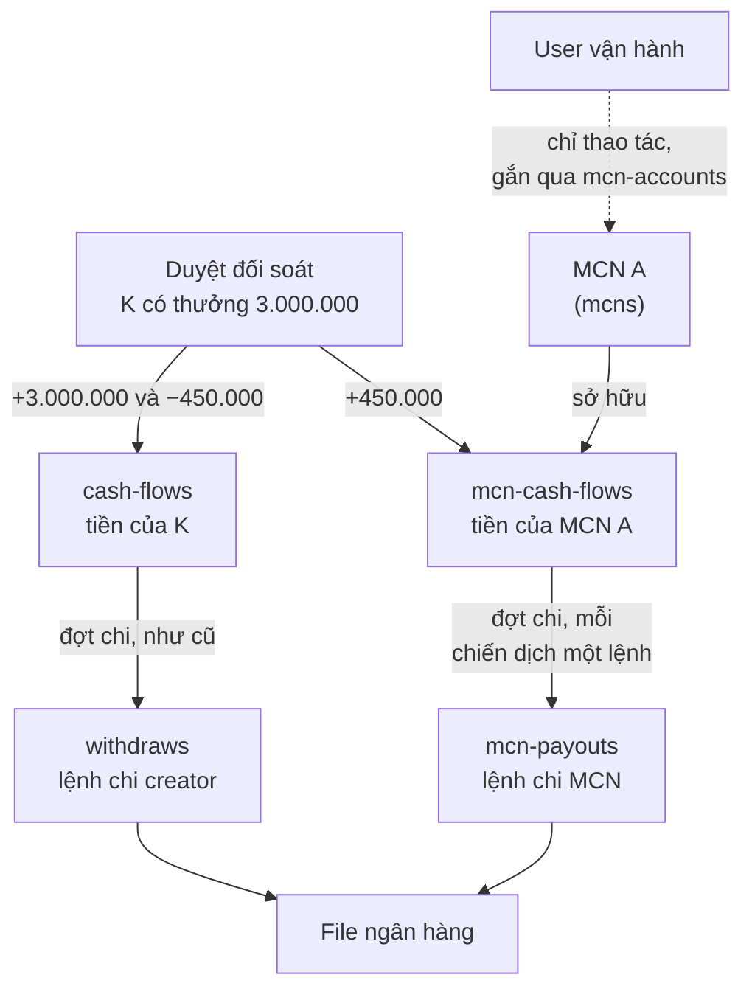
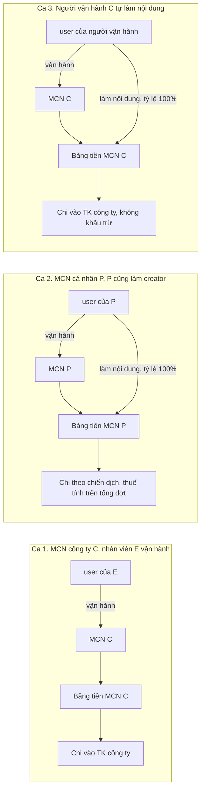
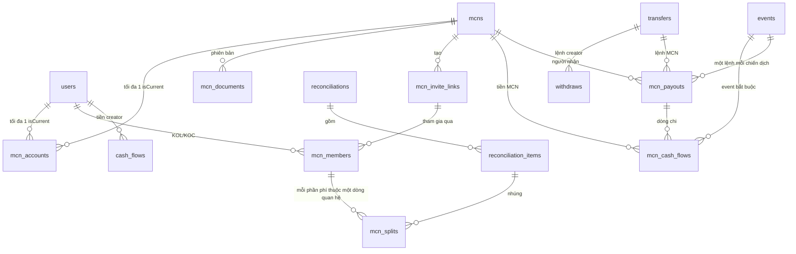
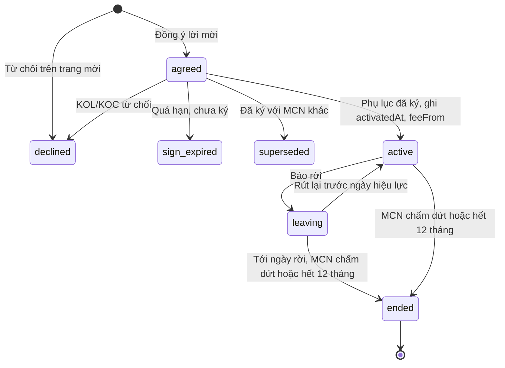
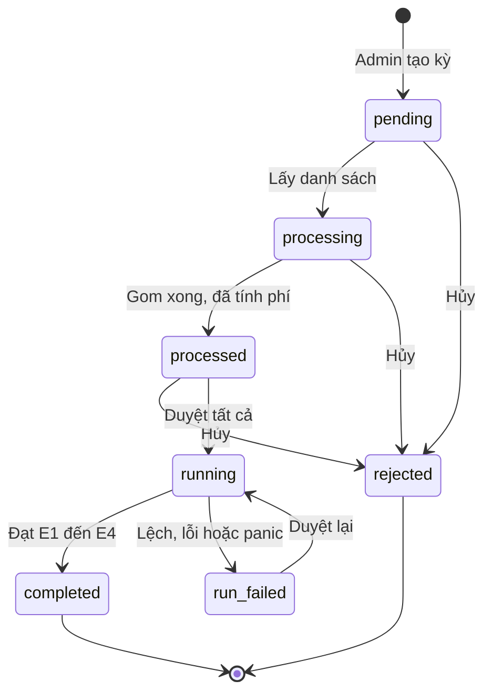
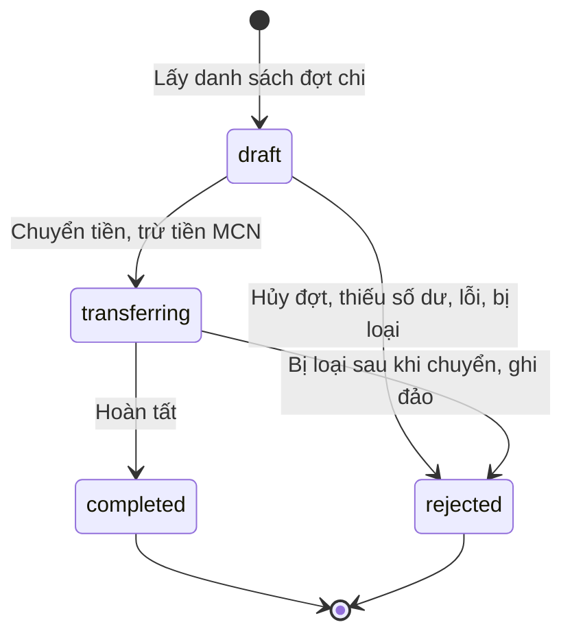

# Tech spec: MCN trên KOC Ambassador — Phase 1

| Mục | Giá trị |
|---|---|
| Dự án | KOC Ambassador, module MCN (Multi-Channel Network) |
| Ngày | 2026-11-11 |
| Người viết | Nguyễn Đăng Định |
| Người review | Thành Trung, Vinh Nguyễn |
| Version | 3.0 |
| Trạng thái | Draft, chờ review |
| PRD | [prd-mcn-phase1-2026-11-04.md](./prd-mcn-phase1-2026-11-04.md). Bản v1.1 nằm ở PR #41 (nhánh `docs/mcn-phase1-prd-decisions-261109`), cần merge trước hoặc cùng PR này |
| Tài liệu khác | [08-Sequence.md](./08-Sequence.md) (BA, 22/10, mô hình cũ); [meeting-261103.md](./meeting-261103.md); biên bản họp 10/11 (chưa đưa lên repo); bản mẫu BA (artifact `BVwnmqnqNZhjnX6pbXDikV`) |
| Code | Repo `ambassador`, nhánh `feat/mcn-phase1`, head `9a599f27c` |

Bản này gộp toàn bộ nội dung các bản trước (1.0, 2.0, 2.1) thành một bản. Đường dẫn code tính từ gốc repo `ambassador/`.

## 1. Tóm tắt

### 1.1 MCN phase 1 là gì

MCN là công ty hoặc cá nhân quản lý một nhóm KOL/KOC. Phase 1 cho MCN đưa KOL/KOC của mình lên KOC Ambassador và nhận phí quản lý ngay trên hệ thống, thay vì tự thu bên ngoài.

```
AccessTrade tạo hồ sơ MCN, kích hoạt, gắn tài khoản vận hành
  → MCN tạo link mời kèm tỷ lệ phí (0–100%), gửi cho KOL/KOC
  → KOL/KOC đồng ý, ký phụ lục 12 tháng → thành viên của MCN
  → Khoản thưởng phát sinh trong thời gian hợp tác được gắn MCN và tỷ lệ
  → Duyệt đối soát: trích phí các khoản đã gắn, cộng vào số dư MCN
  → Đợt chi: MCN nhận cùng đợt với KOL/KOC; lệnh KOL/KOC như cũ, lệnh MCN tách mỗi chiến dịch một lệnh
```

Ví dụ: K thuộc MCN A, tỷ lệ 15%, có thưởng 3.000.000đ. K nhận 2.550.000đ, A nhận 450.000đ.

PRD mô tả yêu cầu nghiệp vụ. Tech spec này mô tả cách làm trên code: dữ liệu, luồng tiền, API, màn hình đọc dữ liệu từ đâu, cách lên prod.

### 1.2 Chỗ khó

Hệ thống hiện tại coi một user là một người: user đó đăng nhập, có số dư, nhận tiền và chịu thuế. MCN thì khác. MCN ký hợp đồng với AccessTrade; người đăng nhập chỉ vận hành MCN. Nếu cộng phí MCN vào số dư của người vận hành:

- Đổi người vận hành thì tiền vẫn nằm ở người cũ.
- Người vận hành bị khóa vì lỗi creator thì MCN không được chi.
- Phí MCN và thu nhập creator lẫn vào một số dư, thuế tính sai.

Ngoài ra, Duyệt đối soát hiện tại không chạy trong transaction. Lỗi giữa chừng thì tiền ghi dở; thêm phần trích phí MCN vào thì càng dễ lệch (§4.2).

### 1.3 Thiết kế chính

Tiền đi như sau, lấy ví dụ K thuộc MCN A, tỷ lệ 15%:



Câu 1–5 là câu hỏi của tech lead. Câu 6–9 là các điểm còn lại của thiết kế.

1. MCN là đối tượng gì?
   Công ty (MST) hoặc cá nhân (CCCD) ký hợp đồng với AccessTrade. Lưu ở bản ghi `mcns`, không phải user. MCN sở hữu số dư, nhận tiền và chịu thuế. Xem §5.1.

2. Tài khoản MCN khác tài khoản creator thế nào?
   Tài khoản đăng nhập của MCN là một user bình thường, được gắn quyền vận hành qua `mcn-accounts`. User đó không sở hữu tiền của MCN: đổi người vận hành thì tiền vẫn ở MCN. Người vận hành vẫn làm creator được như mọi user. Xem §5.2.

3. Số dư MCN và số dư creator tách thế nào?
   Hai bảng riêng, như sơ đồ trên: `cash-flows` của K ghi `+3.000.000` và `−450.000`; `mcn-cash-flows` của A ghi `+450.000`. Số dư mỗi bên là tổng bảng của bên đó. Xem §6, §7.

4. Database thay đổi gì?
   Thêm 2 collection: `mcn-cash-flows` (chỉ ghi thêm, không sửa, không xóa) và `mcn-payouts`. Thêm một số trường vào collection có sẵn. Không thêm loại tài khoản vào `users`. Xem §6.

5. Thuế của MCN khi người đứng MCN cũng làm creator?
   Tài khoản creator của họ tham gia chính MCN với tỷ lệ 100% (gọi là tài khoản nhà). Thu nhập nội dung chuyển hết vào số dư MCN, nên chỉ có một lần chi và một lần xét thuế trên tổng các lệnh của MCN trong đợt.
   - MCN cá nhân P: phí 3.000.000 + nội dung 2.500.000 = 5.500.000, khấu trừ 10% là 550.000.
   - MCN công ty C: phí 8.000.000 + nội dung 6.000.000 = 14.000.000, không khấu trừ.

   Xem §5.3, §8.2.

6. Phí trích trên khoản thưởng nào?
   Chỉ chiến dịch bắt đầu từ ngày go-live (dự kiến 01/12/2026), theo ngày phát sinh của từng khoản thưởng, trong những ngày KOL/KOC là thành viên. Ví dụ K ký ngày 05/12, thưởng view 300.000/ngày từ 01/12 đến 10/12: chỉ 6 ngày 05–10/12 bị trích, phí 270.000. Xem §7.

7. Duyệt đối soát lỗi giữa chừng thì sao?
   Mỗi item ghi trong một transaction: dòng tiền creator, dòng tiền MCN và trạng thái item cùng ghi hoặc cùng không ghi. Mỗi dòng tiền có khóa `idemKey` nên chạy lại không cộng trùng. Kỳ lỗi chuyển `run_failed`, gửi Telegram, Admin Duyệt lại. Xem §7.3, §7.4.

8. Chi theo chiến dịch thế nào?
   MCN nhận trong cùng đợt chi với KOL/KOC, không có đợt riêng. Mỗi dòng tiền của MCN ghi kèm chiến dịch; trong đợt đó, MCN có một lệnh cho mỗi chiến dịch còn số dư. P có 3.000.000 ở chiến dịch C1 và 2.500.000 ở C2: hai lệnh; thuế 550.000 tính trên tổng rồi chia 300.000 và 250.000. MCN công ty không khấu trừ. Xem §8.1.

9. Làm sao không nhầm số của creator và MCN trên màn hình?
   Mỗi màn hình chỉ đọc một bảng. Trang Số dư của creator đọc `cash-flows`; trang Quản lý MCN đọc `mcn-cash-flows`. Không màn hình nào cộng hai số. Xem §9.3.

### 1.4 Câu hỏi còn mở

Không còn câu hỏi chặn code. Các câu ở bản trước đã đóng theo họp 10/11 (§12.3). Với những điểm PRD và biên bản họp chưa nói, tài liệu chọn sẵn cách làm, phần lớn giữ như hệ thống hiện nay (§12.4). Ai muốn khác thì báo khi review.

Chỉ còn chờ AT gửi mã mẫu phụ lục (dự kiến ký 17/11).

## 2. Thuật ngữ

| Thuật ngữ | Nghĩa |
|---|---|
| MCN | Công ty hoặc cá nhân ký hợp đồng MCN với AccessTrade. Bản ghi `mcns`, định danh bằng MST hoặc CCCD. Không phải user |
| Tài khoản vận hành | User được gắn vào MCN qua `mcn-accounts`. Chỉ có quyền thao tác, không sở hữu tiền. "Tài khoản MCN" trong PRD là khái niệm này |
| Người đứng MCN | Chủ MCN cá nhân, hoặc người được MCN công ty giao tài khoản vận hành |
| KOL/KOC, creator | User làm nội dung, có thu nhập ghi vào `cash-flows` |
| Tài khoản nhà | Dòng `mcn-members` có `rate = 100`, `house = true`: user làm nội dung cho chính MCN mình. Không phải loại tài khoản mới |
| Chiến dịch | Bản ghi `events`. "Campaign" trong biên bản họp 10/11 là chiến dịch, không phải ADV |
| Mốc áp dụng (ngày go-live) | 00:00 giờ VN của ngày MCN đầu tiên được kích hoạt, đọc từ `mcns.activatedAt`. Chỉ chiến dịch có `events.startAt` từ ngày này mới bị trích phí; chiến dịch đã chạy trước go-live thì không |
| Dòng quan hệ | Một bản ghi `mcn-members`, ở mọi trạng thái |
| Thành viên | Dòng quan hệ `active` hoặc `leaving` (`isMember = true`). Người Chờ ký (`agreed`) chưa là thành viên |
| Khoản thưởng (reward) | Một bản ghi `event-rewards` (thưởng view, thưởng mốc) hoặc `event-bonus` (Thưởng thêm) |
| Item đối soát | Một bản ghi `reconciliation-items`. Item gộp nhiều khoản thưởng của cùng (user, content), có thể trải nhiều ngày |
| Phần phí | Phần phí của một dòng quan hệ trên một item, lưu ở mảng `mcnSplits` của item |
| Ngày phát sinh | Thưởng view: ngày có view (`event-rewards.date`). Thưởng mốc: ngày đạt mốc. Thưởng thêm: ngày Admin tạo |
| Cửa sổ phí | Khoảng ngày `[feeFrom, effTo)` giờ Việt Nam mà dòng quan hệ được tính phí |
| G | Tổng thưởng của một item, trước khi trừ phí (`totalCash`) |
| Đợt chi, lệnh chi | Đợt chi là `transfers`. Lệnh creator là `withdraws`, lệnh MCN là `mcn-payouts` |
| `taxpayerKey` | Khóa người chịu thuế trên lệnh: `mst:<số>`, `cccd:<số>` hoặc `user:<id>`. Kế toán dùng để tổng hợp |
| `idemKey` | Khóa duy nhất của một dòng tiền. Ghi lại cùng khóa không tạo dòng thứ hai |
| CAS | Cập nhật có điều kiện: chỉ ghi khi trạng thái hiện tại đúng trạng thái nguồn (`updateOne` lọc theo `status`). Hai bên cùng chuyển một bản ghi thì chỉ một bên thành công |
| Hợp đồng MCN, hợp đồng creator, phụ lục | Hợp đồng MCN: hợp đồng khung giữa AT và MCN. Hợp đồng creator: `B2C_AMBASSADOR` giữa AT và KOL/KOC. Phụ lục: phụ lục chỉ định thanh toán gắn với hợp đồng creator, ghi tỷ lệ phí |

Thao tác trên admin dùng trong tài liệu:

| Màn hình | Thao tác và trạng thái |
|---|---|
| Đối soát | Lấy danh sách: `pending → processing → processed`. Duyệt tất cả: `processed → running → completed`, lỗi thì `run_failed`. Duyệt lại: `run_failed → running` |
| Xử lý rút tiền (đợt chi) | Lấy danh sách: `new → processing → processed`. Chuyển tiền: `→ transferring → transferred`. Hoàn tất: `→ finished` |

## 3. Phạm vi

### 3.1 Làm trong phase 1

- Admin tạo, kích hoạt hồ sơ MCN; gắn tài khoản vận hành.
- MCN tạo link mời; KOL/KOC đồng ý, ký phụ lục, báo rời; MCN chấm dứt quan hệ.
- Tài khoản nhà 100%.
- Trích phí ở đối soát, bảng tiền MCN, chi MCN theo chiến dịch, thuế, file ngân hàng.
- Màn xem đối soát cho MCN và KOL/KOC; thông báo.

### 3.2 Không làm ở phase 1

- Tạm dừng, chấm dứt cả MCN; đổi tỷ lệ giữa chừng; gia hạn phụ lục.
- KOL/KOC xác nhận hoặc báo sai đối soát; Admin thao tác thay MCN.
- MCN tự rút tiền; bảng kê, hóa đơn trong hệ thống.
- UI điều chỉnh tiền; duyệt hai người khi đổi TK ngân hàng MCN.
- Luồng riêng cho rời, vào lại, đổi MCN khi chiến dịch đang chạy (họp 10/11 để phase 2).
- Gộp ngưỡng thuế theo CCCD giữa lệnh MCN và lệnh creator.
- Chi theo chiến dịch cho lệnh creator ngoài MCN.
- MCN cho partner khác Ambassador.

### 3.3 Ràng buộc kỹ thuật

- MongoDB replica set. Wrapper transaction hiện tại (`backend/internal/module/database/mongodb/transaction.go`) không retry và che lỗi gốc khi commit lỗi. Code mới dùng hàm `RunInTransaction` bọc `session.WithTransaction` của driver. Callback có thể chạy lại nên chỉ chứa thao tác DB.
- Tiền trong code cũ là `float64`. Phần mới dùng `int64` (VND).
- Econtract không có webhook, trạng thái phụ lục lấy bằng polling.
- Repo không có metrics, cảnh báo gửi Telegram.

## 4. Hiện trạng cần biết

### 4.1 Vì sao không cộng phí vào số dư user

| Tình huống | Nếu cộng phí vào `cash-flows` của người vận hành | Thiết kế này |
|---|---|---|
| MCN cá nhân P, trong đợt có thu nhập creator 2.500.000 và phí 3.000.000 | Một lệnh 5.500.000, không tách được đâu là phí, thuế không đúng loại thu nhập | Tài khoản nhà 100%: cả 5.500.000 vào số dư MCN P, thuế 550.000 tính một lần |
| Đổi người vận hành U1 → U2 rồi chạy lại kỳ | 3.000.000 nằm ở U1; chạy lại cộng thêm cho U2 (cộng trùng) | Số dư gắn với `mcns`; khóa chống trùng theo (item, dòng quan hệ) |
| Người vận hành bị `banned` vì lỗi creator | Đợt chi lọc `banned:false`, MCN không được chi | Điều kiện chi MCN dựa trên hợp đồng MCN và TK ngân hàng |
| Màn số dư creator của người vận hành | Số dư tăng thêm phí MCN, lịch sử lẫn phí | Không chứa phí MCN |

Số dư, lệnh chi và thuế hiện đều tính theo `user`, nên phải tách bảng. Sửa một hàm không đủ.

### 4.2 Đường Duyệt đối soát hiện tại có thể ghi dở

Duyệt hiện ghi dòng tiền, reward, item bằng các lệnh rời, không có transaction (`backend/pkg/admin/service/reconciliation_running.go`). Có ba trường hợp ghi dở, đều không có cảnh báo:

| Lỗi ở bước | Kết quả |
|---|---|
| Ghi dòng tiền (lỗi bị bỏ qua) | Item, reward đã completed nhưng KOL/KOC không được cộng tiền |
| Ghi content-analytic | Đã cộng tiền, item vẫn pending; lần Duyệt sau đánh item rejected |
| Ghi reward | Đã cộng tiền, reward vẫn pending; kỳ sau gom lại và cộng trùng |

Khoản có phí MCN phải ghi hai bảng cùng lúc, nên không giữ được đường này. Thiết kế mới ghi mỗi item trong một transaction, áp cho kỳ có khoản gắn MCN (`reconciliations.ledgerV2`, §7.3).

### 4.3 Đợt chi hiện tại

- Đợt chi (`transfers`) lọc theo partner và khoảng ngày, rút toàn bộ số dư của user, gộp mọi chiến dịch.
- Thuế: lệnh từ 5.000.000đ thì khấu trừ 10%, xét từng lệnh (`backend/internal/service/withdraw.go`).
- Chuyển tiền ghi dòng trừ tiền nhưng bỏ qua lỗi. Ghi lỗi thì lệnh vẫn được chi mà số dư không bị trừ.
- Khi đặt Max, user có số dư dưới Max bị loại khỏi đợt (OQ-10).

## 5. Tài khoản: MCN, người vận hành, creator

### 5.1 MCN

- Bản ghi `mcns`: `type` (company hoặc individual), `name`, `identityNumber` (MST 10 hoặc 13 số, CCCD 12 số; unique), `loginEmail`, `status` (`pending → active` khi đủ 5 hồ sơ). Hồ sơ MCN không gắn partner/ADV (PRD không có): Admin có quyền xem MCN thì thấy toàn bộ, không lọc theo ADV.
- MCN sở hữu số dư, là người nhận tiền và người chịu thuế. Công ty: không khấu trừ. Cá nhân: khấu trừ 10% TNCN nếu tổng các lệnh của MCN trong đợt từ 5.000.000đ (họp 10/11).
- Sau khi `active`, không sửa `type`, `identityNumber`; chỉ đổi bằng script có ticket. Đổi `name` thì TK ngân hàng phải xác minh lại.
- Hồ sơ pháp lý và TK ngân hàng ở `mcn-documents`, có phiên bản. Lệnh chi chép TK hiện hành lúc tạo lệnh.

### 5.2 Tài khoản vận hành

- Bảng `mcn-accounts`: `mcn`, `email`, `user`, `status` (`invited`, `active`, `revoked`), `isCurrent`.
- User đăng nhập Google có email khớp thì được gắn vào MCN (`BindAccountOnLogin`). Có hơn một user cùng email thì không gắn, gửi Telegram.
- Mỗi MCN tối đa một tài khoản hiện hành; mỗi user vận hành tối đa một MCN.
- Tài khoản vận hành chỉ có quyền thao tác. Đổi người vận hành bằng script `cmd/mcn-rebind`: dòng cũ sang `revoked`, mời email mới. Tiền không di chuyển.
- Email MCN được trùng email tài khoản creator (PRD Q12, họp 10/11). Người vận hành vẫn đăng bài như creator bình thường.
- Không gọi `EnsureUserPartner` cho user vận hành, để user đó chỉ được đếm là creator khi tự tham gia partner.

### 5.3 Người đứng MCN làm creator: tài khoản nhà

Họp 10/11 chốt: người đứng MCN được làm creator trên cùng portal; tiền của hai vai gộp một lần chi, một lần tính thuế, để không chia nhỏ dưới 5.000.000đ.

Cách làm:

- Tài khoản creator của họ nhận link 100% của chính MCN, đồng ý và ký phụ lục như KOL/KOC khác. Dòng quan hệ có `rate = 100`, `house = true`.
- Đối soát tạo phần phí 100%: `cash-flows` của user ghi `+G` và `−G`; `mcn-cash-flows` ghi `+G`. Không thêm loại dòng tiền mới.
- Hệ thống tự đặt `house = true` khi user là tài khoản vận hành của chính MCN đó, hoặc CCCD của user trùng CCCD của MCN cá nhân.
- Tài khoản nhà nhận link dưới 100% của chính MCN thì bị từ chối (`MCN_HOUSE_RATE_REQUIRED`). Link của MCN khác vẫn bị chặn như cũ.
- Thu nhập trước ngày ký phụ lục 100%, hoặc ở chiến dịch trước mốc áp dụng, vẫn ở số dư creator và chi bằng lệnh creator.
- Họp 10/11 chốt tài khoản nhà phải đặt 100% cho MCN. Hệ thống không tự đưa người đứng MCN vào MCN: họ vẫn mở link 100% và ký phụ lục như mọi KOL/KOC. Chưa ký thì thu nhập nội dung vẫn chi bằng lệnh creator; báo cáo vận hành liệt kê các trường hợp này để nhắc ký.

Ba trường hợp thường gặp:



Kênh khác do MCN sở hữu (không phải người vận hành) tham gia bằng link 100% như KOL/KOC, `house = false`, kết quả tiền như nhau.

### 5.4 Quy tắc vai và chặn đồng thời

| ID | Quy tắc |
|---|---|
| INV-01 | Một KOL/KOC là thành viên của tối đa một MCN |
| INV-02 | Mỗi (user, MCN) tối đa một dòng Chờ ký |
| INV-03a | Tài khoản vận hành của MCN X chỉ được có dòng quan hệ với chính X, và dòng đó phải là 100%, `house = true` |
| INV-03b | User đang Chờ ký hoặc là thành viên của MCN khác thì không gắn được làm tài khoản vận hành của X |
| INV-04 | Mỗi MCN một tài khoản vận hành hiện hành; mỗi user vận hành một MCN |
| INV-05 | Mỗi user chỉ mở ký một phụ lục tại một thời điểm |
| INV-19 | `house = true` thì `rate = 100` |

Vấn đề: các bước này đọc rồi mới ghi, trên hai collection khác nhau. Ví dụ U đồng ý lời mời của MCN A; cùng lúc Admin kích hoạt MCN B bằng email của U. Không khóa thì U vừa vận hành B vừa là thành viên A.

Cách chặn: mọi bước đổi vai chạy trong `RunInTransaction`. Đầu tiên `$inc users.mcnGuardVer` trên user liên quan, rồi đọc lại điều kiện, rồi ghi. Hai bước cùng user ghi cùng một document nên một bên gặp `WriteConflict`. Driver chạy lại bên đó; điều kiện không còn đúng thì trả 409 `MCN_MEMBER_STATE_CHANGED`. Kèm partial unique index cho INV-01, 02, 04, 05.

| Phía | Bước | Điều kiện kiểm trong transaction |
|---|---|---|
| KOL/KOC | Đồng ý, mở ký, đồng bộ ký, kích hoạt thành viên | User không vận hành MCN nào. Nếu có, phải là link 100% của chính MCN đó; dòng ghi `house = true` |
| Người vận hành | Admin kích hoạt (gắn ngay), gắn khi đăng nhập | User không có dòng Chờ ký hoặc thành viên với MCN khác. Có dòng 100% với chính MCN này thì gắn và đặt `house = true`; dưới 100% thì không gắn |

User chưa khai CCCD lúc đồng ý thì ghi `selfCheck = unresolved`; bước mở ký so lại CCCD. Lời gọi econtract tạo phụ lục nằm ngoài transaction.

## 6. Dữ liệu

### 6.1 Sơ đồ

Hệ thống chia ba lớp:

- Đăng nhập (`users`, `mcn-accounts`): ai được thao tác.
- MCN và thành viên (`mcns`, `mcn-documents`, `mcn-invite-links`, `mcn-members`): MCN nào thu phí của ai, tỷ lệ bao nhiêu, trong khoảng ngày nào.
- Tiền (đối soát, hai bảng tiền, hai loại lệnh chi): không đọc `mcn-members` lúc ghi tiền. Khoản thưởng được gắn MCN và tỷ lệ lúc tạo; đối soát cộng theo đó vào `mcnSplits` lúc Lấy danh sách; lệnh chi chép TK ngân hàng và thuế lúc tạo lệnh.



Tên trong sơ đồ dùng gạch dưới; collection thật dùng gạch nối. `mcn_splits` là mảng nhúng trong `reconciliation-items`.

### 6.2 Collection mcn-cash-flows (mới)

Chỉ ghi thêm, không sửa, không xóa. Số dư MCN = tổng `value`.

| Trường | Kiểu | Ghi chú |
|---|---|---|
| `mcn` | ObjectID | MCN sở hữu dòng tiền |
| `partner` | ObjectID | Chép từ `events.partner` của chiến dịch, để lọc theo đợt chi |
| `event` | ObjectID | Bắt buộc. Số dư tính theo (MCN, chiến dịch) |
| `action` | string | `mcn_fee`, `withdraw`, `tax`, `withdraw_fee`, `withdraw_reversal`, `adjustment` |
| `value` | int64 | Khác 0. Dương là cộng (`mcn_fee`, `withdraw_reversal`), âm là trừ (`withdraw`, `tax`, `withdraw_fee`). `adjustment` theo chiều điều chỉnh |
| `reversalOf` | string | Chỉ với `withdraw_reversal`: dòng gốc là `withdraw`, `tax` hay `withdraw_fee` |
| `idemKey` | string | Bắt buộc, unique |
| `source` | object | Chỉ với `mcn_fee`: `{reconciliation, reconciliationItem, member, koc, rate, baseCash, windowFrom, windowTo}` |
| `payout`, `transfer` | ObjectID | Chỉ với dòng chi |
| `adjustment` | object | Chỉ với `adjustment`: `{ticket, seq, reason, approvedBy}` |
| `createdBy`, `createdAt` | object, Date | `createdBy`: `{type: system \| staff \| script, id}` |

Mọi đọc ghi đi qua repository `McnLedger()`: `Post(sc, entries...)`, `Balance(sc, mcn)`, `EventBalance(sc, mcn, event)`. Repository này không có hàm update hay delete. Mọi thao tác làm giảm số dư MCN chạy trong transaction có `$inc mcns.ledgerVer`, để các thao tác trên cùng một MCN chạy lần lượt.

### 6.3 Collection mcn-payouts (mới)

Một lệnh cho mỗi (đợt chi, MCN, chiến dịch).

| Trường | Kiểu | Ghi chú |
|---|---|---|
| `transfer`, `partner`, `mcn`, `event` | ObjectID | Unique `(transfer, mcn, event)` |
| `cash`, `cashTax`, `bankFee`, `actualCash` | int64 | `actualCash = cash − cashTax − bankFee ≥ 0` |
| `status` | string | `draft`, `transferring`, `completed`, `rejected` |
| `declined`, `declinedReason` | bool, string | Admin loại lệnh |
| `rejectReason` | string | `transfer_rejected` (hủy đợt), `insufficient_balance`, `transfer_failed`, `declined` (loại khi còn draft), `declined_after_transfer` (ngân hàng trả về) |
| `bank` | object | Chép TK ngân hàng lúc tạo lệnh |
| `payee` | object | Chép thông tin MCN lúc tạo lệnh: loại, tên, MST hoặc CCCD, SĐT, ngày ký hợp đồng MCN |
| `tax` | object | `{policy, incomeType, taxpayerType, taxpayerKey, base, groupBase, rate, threshold, amount, ruleVersion, computedAt}` |
| `taxGroupBroken` | bool | Một lệnh cùng nhóm bị loại sau khi đã chốt thuế; Kế toán xử lý tay |
| `history[]` | array | `{status, at, byType, by, note}` |

`bank`, `payee`, `tax` không đổi sau khi lệnh rời `draft`.

### 6.4 Trường thêm vào collection có sẵn

| Collection | Thêm hoặc đổi |
|---|---|
| `mcns` | `ledgerVer` (chỉ `$inc`); `statistic` mở rộng giống `users.statistic` (§6.4.1) |
| `mcn-accounts` | `isCurrent`, status `revoked`, `revokedAt`, `revokedBy`, `history[]` |
| `mcn-members` | `isPending` (đúng khi `agreed`), `annexInFlight`, `annex.{state, signedAt, signedAtSource}`, `activatedAt`, `feeFrom`, `house`, `selfCheck`, `signedAfterClose`, `declinedByCode` |
| `users` | `mcnGuardVer` (chỉ `$inc`) |
| `event-rewards`, `event-bonus` | `mcn`, `mcnMember`, `mcnRate`: ghi lúc tạo khoản khi ngày phát sinh nằm trong cửa sổ phí; không xóa, không gỡ (§7.1) |
| `reconciliations` | `completedAt`; `mcnSnapshot{status, items, splits, totalFee, eventStartFrom, at}` |
| `reconciliation-items` | `mcnSplits[]{member, mcn, rate, baseCash, fee, windowFrom, windowTo, rewardCount}`, `mcnFee`, `netCash`, `mcnEvaluatedAt`, `postedAt`, `referral{state, base, sentAt}` |
| `cash-flows` | `idemKey` (tag `omitempty`); action `mcn_fee`, `mcn_fee_adjustment`; `options.{mcn, mcnMember, rate}` |
| `withdraws` | `tax` (chép lúc tạo lệnh), `incomeType` (mặc định `creator_reward`) |
| `users.statistic`, `user-partners.statistic` | `totalCashMcnFee`, chỉ để hiển thị |
| `transfers` | `isOpen` (khuyến nghị, để khóa một đợt mở mỗi partner ở DB) |

Ghi chú:

- `activatedAt` ghi lúc `agreed → active`; `feeFrom` là 00:00 giờ Việt Nam của ngày đó. Ghi một lần.
- `house` chỉ đổi từ false sang true.
- `cash-flows.idemKey` phải có `omitempty`. Thiếu thì mọi dòng không có khóa mang `idemKey: ""` và vi phạm unique index.

#### 6.4.1 mcns.statistic

Số cache để hiện ở màn Đối soát, Số dư của MCN và chi tiết MCN ở admin, giống `users.statistic`. Không dùng để tính tiền; tiền luôn tính từ nguồn ở cột cuối. Tiền là `int64` VND.

| Trường | Ý nghĩa | Nguồn |
|---|---|---|
| `totalMember`, `totalLink` | Đang có | `mcn-members`, `mcn-invite-links` |
| `totalMemberActive` | Thành viên đang hợp tác hoặc đang báo rời | `mcn-members` |
| `totalMemberCash` | Tổng thu nhập thành viên tạo ra trong thời gian hợp tác | Σ `cash` khoản thưởng có `mcn` = MCN, không tính khoản bị từ chối |
| `totalFeePending` | Phí tạm tính, chưa đối soát | Khoản `status = pending`: làm tròn(`Σ cash × mcnRate`) theo từng dòng quan hệ |
| `totalFeeCompleted` | Phí đã đối soát, đã vào số dư | Σ dòng `mcn_fee` của `mcn-cash-flows` |
| `cashRemaining` | Số dư hiện tại | Σ `value` của `mcn-cash-flows` |
| `withdrawTotal`, `withdrawPending`, `withdrawSuccess`, `withdrawRejected` | Số lệnh chi | `mcn-payouts` theo trạng thái |
| `cashWithdrawTotal`, `cashWithdrawPending`, `cashWithdrawSuccess`, `cashWithdrawRejected` | Số tiền theo lệnh chi | `mcn-payouts` |
| `totalCashTax` | Thuế đã khấu trừ | Σ dòng `tax` của `mcn-cash-flows` |

Cập nhật bằng hàm `Mcn().UpdateStatistic(mcn)`: tính lại toàn bộ từ nguồn rồi `$set`, không `$inc`, nên chạy lại bao nhiêu lần cũng đúng. Gọi ở:

- Cuối `User().UpdateStatistic(user)`: hàm này đã được gọi ở mọi chỗ đổi khoản thưởng (tạo, cập nhật `cash`, từ chối, backfill, Duyệt). Lấy các MCN có khoản của user đó rồi cập nhật từng MCN. Nhờ vậy không phải thêm lời gọi ở từng chỗ đổi khoản thưởng.
- Sau Duyệt từng item có phí, sau Chuyển tiền và Hoàn tất lệnh MCN, sau đổi trạng thái thành viên.
- Job hằng đêm tính lại cho mọi MCN đang hoạt động, để bù chỗ sót.

### 6.5 Index

| Collection | Index | Để làm gì |
|---|---|---|
| `mcn-cash-flows` | `uniq(idemKey)`; `(mcn, event, createdAt)`; `(source.reconciliation, mcn)`; `(payout)` | Chống ghi trùng; số dư theo chiến dịch; đối chiếu |
| `mcn-payouts` | `uniq(transfer, mcn, event)`; `(mcn, -createdAt)`; `(transfer, status)` | Một lệnh mỗi chiến dịch mỗi đợt |
| `cash-flows` | `uniq(idemKey)` partial `{idemKey: {$exists: true}}` | Không vướng dữ liệu cũ |
| `reconciliation-items` | `(mcnSplits.mcn, reconciliation)` | Màn đối soát MCN |
| `event-rewards`, `event-bonus` | `(mcnMember, status)` | Gom khoản theo dòng quan hệ lúc Lấy danh sách |
| `event-rewards`, `event-bonus` | `(mcn, status, date)` | Thống kê tạm tính ở màn Đối soát của MCN và chi tiết MCN ở admin |
| `mcn-members` | Giữ `uniq(user)` partial `{isMember: true}`. Thêm `uniq(user, mcn)` partial `{isPending: true}`; `uniq(user)` partial `{annexInFlight: true}`; `uniq(user, link)` partial `{declinedByCode: true}` | INV-01, 02, 05; bấm Từ chối trên trang mời nhiều lần không tạo nhiều dòng |
| `mcn-accounts` | `uniq(mcn)` và `uniq(user)` partial `{isCurrent: true}` | INV-04 |
| `transfers` | `uniq(partner)` partial `{isOpen: true}` (khuyến nghị) | Một đợt mở mỗi partner |

Partial index chỉ dùng điều kiện bằng và `$exists: true`, vì chưa biết phiên bản Mongo trên prod.

### 6.6 Quy tắc về tiền

| ID | Quy tắc |
|---|---|
| INV-06 | `rate` không đổi; `feeFrom` ghi một lần; cận trên cửa sổ tính từ các mốc đã lưu, không từ trạng thái do job ghi; `mcn`, `mcnMember`, `mcnRate` trên khoản thưởng ghi một lần, không gỡ |
| INV-07 | Cửa sổ phí của một user không chồng nhau |
| INV-08 | Mỗi khoản thưởng: `0 ≤ phí ≤ floor(cash)`. Mỗi item: `totalCash = netCash + mcnFee` |
| INV-09 | Kỳ chỉ sang `processed` khi phí đã tính xong; `mcnSplits` không đổi sau `processed` |
| INV-10 | Item `completed` khi và chỉ khi có đủ dòng tiền khóa `rc:<itemId>:*` |
| INV-11 | Mỗi item: phí trừ bên creator bằng phí cộng bên MCN |
| INV-12 | Mỗi `idemKey` một dòng; không có `idemKey` rỗng; mỗi (đợt, MCN, chiến dịch) một lệnh |
| INV-13 | `mcn-cash-flows` chỉ ghi thêm, chỉ qua `McnLedger().Post` |
| INV-14 | Lệnh MCN chỉ trừ tiền khi số dư của chiến dịch ≥ `cash`, đọc trong cùng transaction |
| INV-15 | ADV còn kỳ `ledgerV2` đang `running` hoặc `run_failed` thì không Lấy danh sách đợt chi |
| INV-16 | Kỳ `run_failed` chỉ chuyển sang `running`, không Hủy được |
| INV-17 | `bank`, `payee`, `tax` của lệnh không đổi sau `draft`; `type`, `identityNumber` của MCN không đổi sau `active` |
| INV-18 | MCN chỉ đọc được dữ liệu của mình |
| INV-20 | Chỉ trích phí khoản của chiến dịch có `events.startAt` ≥ ngày go-live, không xét chiến dịch thuộc ADV nào |

### 6.7 Trạng thái

Dòng quan hệ (`mcn-members`). Mỗi bước chuyển là CAS theo trạng thái nguồn.



Kỳ đối soát (`reconciliations`). `run_failed` là trạng thái mới.



Lệnh chi MCN (`mcn-payouts`).



MCN: `pending → active`. Tài khoản vận hành: `invited → active → revoked`. Link mời: `active → off`, một chiều.

## 7. Đối soát: tính phí và ghi tiền

### 7.1 Khi nào có phí

Phí gắn lên từng khoản thưởng ngay lúc khoản đó được tạo, rồi cộng lại lúc đối soát.

Lúc tạo khoản thưởng (`event-rewards`, `event-bonus`), hàm `tagMcn` ghi `mcn`, `mcnMember`, `mcnRate` lên khoản đó khi đủ cả hai điều kiện:

1. Thuộc chiến dịch có `events.startAt` từ ngày go-live (00:00 giờ VN của ngày MCN đầu tiên được kích hoạt, hệ thống tự đọc từ `mcns.activatedAt`, không cấu hình). Không xét chiến dịch thuộc ADV nào: MCN không gắn ADV. Chiến dịch đã chạy trước go-live không trích phí (quy tắc chốt 11/11). Chưa có MCN nào hoạt động thì không gắn gì.
2. Ngày phát sinh của khoản nằm trong cửa sổ phí của một dòng quan hệ (§7.2).

Không đủ điều kiện thì không ghi gì, khoản đó đi luồng cũ.

Các trường này ghi một lần, không xóa, không gỡ:

- Thành viên rời, hết 12 tháng hay MCN chấm dứt thì khoản đã gắn vẫn bị chia phí khi đối soát, kể cả khi đối soát sau ngày rời. Chỉ khoản phát sinh sau đó mới không gắn.
- `cash` của khoản thay đổi sau đó (view tăng, backfill) thì phí tính theo `cash` mới lúc đối soát. Vì vậy chỉ gắn MCN và tỷ lệ, không gắn số tiền phí.
- Xét theo **ngày phát sinh** của khoản, không theo lúc tạo. Thưởng mốc tạo vào cuối đợt cho hoạt động trong thời gian hợp tác vẫn được gắn, dù lúc tạo người đó đã rời.

Mọi chỗ tạo khoản thưởng phải gọi `tagMcn`: job thưởng view, job thưởng mốc (`pkg/public/service/schedule.go`), Thưởng thêm, các migration và backfill có tạo khoản mới. Sót chỗ nào thì khoản ở đó không bị trích phí. Test rà mã nguồn kiểm điều này (§11.6).

Gắn lại chỉ dùng khi dữ liệu quan hệ sai và phải sửa (ví dụ phụ lục ký sau khi lời mời đã đóng, Admin sửa ngày), bằng script `cmd/mcn-retag` (ticket, dry-run), chỉ cho khoản còn pending.

### 7.2 Cửa sổ phí và công thức

Cửa sổ phí của dòng quan hệ m, giờ Việt Nam, gồm `feeFrom`, không gồm `effTo`. `tagMcn` dùng cửa sổ này:

```
feeFrom(m) = 00:00 ngày kích hoạt (activatedAt)          // ghi một lần
effTo(m)   = 00:00 ngày endedAt                          nếu ended
           = min(00:00 ngày endAt, leaveEffectiveAt)     nếu leaving
           = 00:00 ngày endAt                            nếu active
// endedAt: KOL/KOC rời = ngày báo + 15; MCN chấm dứt = lúc chấm dứt; hết 12 tháng = endAt.
// Ngày kết thúc không tính phí.
```

`tagMcn` xét theo các mốc ngày đã lưu, không theo trạng thái. Job kết thúc thành viên có chạy trễ thì kết quả vẫn đúng.

Lúc Lấy danh sách (hàm `applyMcnFees`), với item i, gom các khoản đã gắn theo `mcnMember`:

```
R_ij     = các khoản pending của item i có mcnMember = j
base_j   = Σ cash_r  với r ∈ R_ij
fee_j    = min( làm tròn half-up(base_j × rate_j / 100), floor(base_j) )   // làm tròn một lần cho mỗi phần phí
mcnFee_i = Σ fee_j
netCash_i = totalCash_i − mcnFee_i
```

Kết quả lưu vào `mcnSplits`. Sau `processed` không tính lại; đổi ENV sau đó không ảnh hưởng kỳ đã chốt. Tỷ lệ 0% vẫn lưu phần phí để MCN thấy, nhưng không sinh dòng tiền.

Làm tròn một lần trên tổng của mỗi phần phí (một KOL/KOC, một dòng quan hệ, một kỳ), theo PRD 1.2 FR-016 (chốt 11/11):

- Khớp phụ lục "MCN nhận x% thu nhập": ai bấm máy `tổng hoa hồng × tỷ lệ` cũng ra đúng số trên màn hình và trong số dư.
- Sai số tối đa 0,5đ mỗi phần phí. Làm tròn từng khoản cộng dồn sai số theo số khoản: 30 khoản thưởng view trong kỳ có thể lệch tới khoảng 15đ.
- Làm tròn từng khoản không giúp truy vết thêm: tiền vào số dư theo item, `mcnSplits` lưu phí theo item.

Ví dụ 3 khoản 10.003đ, 15%: trên tổng 30.009 × 15% = 4.501,35 → 4.501đ; từng khoản 1.500 × 3 = 4.500đ. Tổng phí cả kỳ của một MCN là tổng các phần đã làm tròn theo từng KOL/KOC, có thể lệch vài đồng so với `tổng hoa hồng mọi KOL/KOC × tỷ lệ`; chấp nhận vì mỗi người có tỷ lệ và phụ lục riêng.

`applyMcnFees` lỗi sau 3 lần thử thì kỳ giữ `processing` và gửi Telegram; Admin Hủy kỳ rồi lập lại. Kỳ không sang `processed` khi phí chưa tính xong.

### 7.3 Ghi tiền lúc Duyệt

Mỗi item một transaction (hàm `postItem`):

1. CAS item `pending → completed`. Không khớp (đã ghi rồi) thì dừng.
2. Kiểm item: content còn approved, số tiền khớp, phần phí tính lại khớp `mcnSplits`. Lệch thì hủy transaction và đánh item `rejected` như hiện nay.
3. CAS các khoản thưởng `pending → completed`, phải đủ số dòng.
4. `cash-flows` ghi `+totalCash`, khóa `rc:<itemId>:credit`.
5. Mỗi phần phí lớn hơn 0: `cash-flows` ghi `−fee` (action `mcn_fee`), `mcn-cash-flows` ghi `+fee`. Hai dòng cùng khóa `rc:<itemId>:fee:<relId>`.
6. Đánh dấu hoa hồng người giới thiệu `pending` trên item.
7. Commit. Sau commit mới cập nhật content-analytic, thống kê và gửi thông báo.

Trong transaction dùng hàm mới `CashFlow().AppendStrict`: chỉ insert, trả lỗi thật, từ chối `idemKey` rỗng. Không dùng `AddCashFlow` trong transaction, vì hàm này bỏ qua lỗi và chạy goroutine dùng chung `ctx`.

Đường này chỉ chạy cho kỳ có khoản gắn MCN. Lúc Lấy danh sách, `applyMcnFees` đặt `reconciliations.ledgerV2 = true` khi kỳ có ít nhất một item có phí; Duyệt đọc cờ của kỳ. Kỳ không có MCN chạy đúng code cũ. Không có cờ trên partner, không có bước bật tay trước go-live.

### 7.4 Kiểm cuối kỳ

| Kiểm | Điều kiện |
|---|---|
| E1 | Không còn item pending |
| E2 | Với mỗi item có phí: tổng `−mcn_fee` bên creator = tổng `+mcn_fee` bên MCN = `mcnFee` của item |
| E3 | Mỗi item completed có đúng một dòng `rc:<itemId>:credit` bằng `totalCash` |
| E4 | Item không completed thì không có dòng tiền nào mang khóa `rc:<itemId>:*` |

Đạt cả bốn thì kỳ `completed`, ghi `completedAt`, rồi gửi hoa hồng người giới thiệu. Không đạt, lỗi hoặc panic thì kỳ `run_failed` và gửi Telegram. Duyệt lại chỉ xử lý item còn pending.

Mỗi item vào số dư ngay khi transaction của nó commit. Để không chi tiền của kỳ chưa xong, partner còn kỳ `running` hoặc `run_failed` thì không Lấy danh sách đợt chi được (INV-15).

### 7.5 Ví dụ

- Ví dụ của BA: G = 3.000.000, cả kỳ trong cửa sổ, 15%. Phí 450.000; K nhận 2.550.000.
- K ký MCN A (15%) ngày 05/12/2026. Item thuộc chiến dịch bắt đầu 01/12, thưởng view 300.000/ngày từ 01/12 đến 10/12, G = 3.000.000. Chỉ 6 ngày từ 05/12 đến 10/12 nằm trong cửa sổ: phí 6 × 45.000 = 270.000. `cash-flows` của K: `+3.000.000`, `−270.000`. `mcn-cash-flows` của A: `+270.000`.
- Tài khoản nhà uP của MCN cá nhân P (100%), G = 2.500.000: `cash-flows` của uP ghi `+2.500.000`, `−2.500.000`; `mcn-cash-flows` của P ghi `+2.500.000`.
- Đổi MCN giữa chiến dịch (phase 1 không có luồng riêng, để phase 2; nếu vẫn xảy ra thì tính theo những ngày còn là thành viên). Cùng item như ví dụ thứ hai: A chấm dứt với K ngày 07/12, K ký B (10%) ngày 08/12. A thu 2 ngày 05–06/12: 600.000 × 15% = 90.000. B thu 3 ngày 08–10/12: 900.000 × 10% = 90.000. Ngày 07/12 không MCN nào thu phí.

## 8. Chi trả và thuế

### 8.1 Lệnh chi MCN

MCN nhận trong cùng đợt chi (`transfers`) với KOL/KOC, không có đợt riêng. Phần creator giữ nguyên; trong cùng đợt, phần MCN chạy thêm các bước sau.

1. Lấy danh sách: hàm `generateMcnPayouts` chạy trước vòng creator.
   - Chọn MCN đang `active` có số dư ở chiến dịch thuộc partner của đợt, có hợp đồng MCN hiện hành, TK ngân hàng đã khớp tên hoặc có lý do, tổng số dư ≥ Min.
   - Không xét SSO, eKYC, hợp đồng creator, `banned` của người vận hành.
   - MCN có chiến dịch nào số dư âm thì không tạo lệnh nào cho MCN đó và gửi Telegram. Nếu vẫn chi các chiến dịch dương thì tổng chi sẽ lớn hơn số dư thật.
   - Mỗi chiến dịch có số dư lớn hơn 0 thành một lệnh `draft`, `cash` bằng số dư của chiến dịch.
   - Có Max: xếp chiến dịch theo ngày bắt đầu, chi đủ từng chiến dịch tới khi chạm Max; phần còn lại chờ đợt sau.
   - Chép `bank`, `payee` lên lệnh. Chạy lại không tạo trùng nhờ unique index.
2. Tính thuế nhóm, xem §8.2.
3. Loại lệnh:
   - Lệnh còn `draft`: đánh `declined`, tính lại thuế cả nhóm. Tới Hoàn tất thì lệnh thành `rejected` (`declined`).
   - Lệnh đã `transferring` (ngân hàng trả về): đánh `declined`, thuế các lệnh khác giữ nguyên, đặt `taxGroupBroken` cho cả nhóm.
4. Chuyển tiền: mỗi lệnh một transaction, `$inc mcns.ledgerVer`, đọc số dư của chiến dịch.
   - Đủ số dư: lệnh sang `transferring`; ghi `withdraw −actualCash`, `tax −cashTax`, `withdraw_fee −bankFee`, khóa `po:<id>:<action>`.
   - Thiếu: lệnh `rejected` (`insufficient_balance`), gửi Telegram.
   - Lỗi khác: lệnh giữ `draft`, gửi Telegram; tới Hoàn tất thì thành `rejected` (`transfer_failed`).
5. Hoàn tất: lệnh `transferring` thành `completed`. Lệnh bị loại sau Chuyển tiền thành `rejected` và ghi `withdraw_reversal` dương cho từng dòng đã trừ, khóa `po:<id>:reversal:<action>`.

Thống kê đợt (`GetStatistic`) cộng thêm `mcn-payouts`. Màn Xử lý rút tiền có thêm khối lệnh MCN.

### 8.2 Thuế

Hàm `TaxPolicyFor(payee)` (file mới `backend/internal/service/tax.go`) thay đoạn tính thuế đang viết thẳng trong `withdraw.go`. Kết quả cho creator giữ y như cũ.

| Người nhận | Loại thu nhập | Thuế |
|---|---|---|
| KOL/KOC | `creator_reward` | 10% trên số chi nếu lệnh từ 5.000.000đ, xét từng lệnh như hiện nay |
| MCN công ty | `mcn_income` | Không khấu trừ |
| MCN cá nhân | `mcn_income` | 10% nếu `groupBase` từ 5.000.000đ (họp 10/11) |

Thuế nhóm của MCN cá nhân:

- `groupBase` là tổng `cash` các lệnh `draft` chưa bị loại của MCN trong đợt.
- Đủ ngưỡng thì tính thuế một lần trên `groupBase`, rồi chia về từng lệnh theo tỷ lệ `cash`. Mỗi lệnh lấy phần nguyên; số đồng còn dư cộng cho lệnh có phần lẻ lớn nhất.
- Lý do: lệnh tách theo chiến dịch có thể đều dưới 5.000.000đ dù tổng vượt ngưỡng. Xét từng lệnh thì thành chia nhỏ để không bị khấu trừ, điều họp 10/11 muốn chặn.
- Phase 1 không gộp với lệnh creator cùng CCCD. File ngân hàng có `taxpayerKey` để Kế toán tự tổng hợp.

Các trường hợp (ngưỡng 5.000.000, thuế 10%, phí ngân hàng 0):

| # | Tình huống | Lệnh trong đợt | Thuế | Thực nhận |
|---|---|---|---|---|
| 1 | KOL/KOC không MCN, số dư 6.000.000 | Creator 6.000.000 | 600.000 | 5.400.000 (như hiện nay) |
| 2 | KOL/KOC có MCN 15%, G = 6.000.000 | Creator 5.100.000; MCN nhận 900.000 vào số dư | 510.000 | 4.590.000 |
| 3 | KOL/KOC có MCN 15%, G = 3.000.000 | Creator 2.550.000 | 0 | 2.550.000 |
| 4 | MCN công ty C, số dư 8.000.000 | MCN 8.000.000 | 0 | 8.000.000 |
| 5 | MCN cá nhân P, số dư 6.000.000 | MCN 6.000.000 | 600.000 | 5.400.000 |
| 6 | MCN cá nhân P: phí 3.000.000 ở C1; tài khoản nhà có nội dung 2.500.000 ở C2 | Hai lệnh 3.000.000 và 2.500.000; `groupBase` 5.500.000 | 550.000, chia 300.000 và 250.000 | 2.700.000 và 2.250.000 |
| 7 | MCN công ty C: phí 8.000.000; tài khoản nhà có nội dung 6.000.000 | Lệnh MCN theo chiến dịch, tổng 14.000.000 | 0 | 14.000.000 |

MCN công ty xuất hóa đơn GTGT ngoài hệ thống (OQ-06).

### 8.3 File ngân hàng

`backend/pkg/admin/service/export_transfer.go` giữ nguyên 13 cột cũ, thêm dòng MCN và 6 cột cuối.

| Cột | Dòng creator | Dòng MCN |
|---|---|---|
| STT | Như hiện nay | `po:<payoutId>`, mỗi lệnh một dòng |
| Số tiền, thuế, số chuyển | Như hiện nay | `cash`, `cashTax`, `actualCash` |
| TK, tên người hưởng, ngân hàng | Như hiện nay | Từ `bank` đã chép trên lệnh |
| MST, CCCD | Từ `users.contract` | Từ `mcns.identityNumber` |
| Nội dung, SĐT, ngày ký | Như hiện nay | Mã đợt và tên chiến dịch; SĐT MCN; ngày ký hợp đồng MCN |
| Chiến dịch (mới) | Trống | Tên chiến dịch |
| Loại người nhận (mới) | KOL/KOC | MCN |
| Loại đối tượng, loại thu nhập (mới) | Cá nhân, `creator_reward` | Công ty hoặc Cá nhân, `mcn_income` |
| `taxpayerKey` (mới) | Theo lệnh | Theo lệnh |
| `groupBase` (mới) | Trống | Cơ sở thuế của nhóm |

File bỏ lệnh bị loại và lệnh `rejected`, có dòng tổng. Nên xuất sau Chuyển tiền; xuất trước thì file có thể gồm lệnh sau đó bị `insufficient_balance`.

### 8.4 Điều chỉnh

| Tình huống | Cách xử lý |
|---|---|
| KOL/KOC thiếu thu nhập | Thưởng thêm như hiện nay. Khoản này cũng bị trích phí theo dòng quan hệ ở ngày tạo |
| Phí bị trích thừa | Script `cmd/mcn-adjust` (ticket, lý do, người duyệt, dry-run), một transaction: `cash-flows` `+x` (`mcn_fee_adjustment`), `mcn-cash-flows` `−x` (`adjustment`) ở đúng chiến dịch |
| MCN nhận thiếu, AT bù | Script ghi `mcn-cash-flows` `+x` (`adjustment`) |
| Số dư một chiến dịch của MCN âm | Không lấy chiến dịch khác bù. MCN đó không có lệnh nào trong đợt, gửi Telegram, vận hành xử lý bằng `cmd/mcn-adjust` |

Không dùng Thưởng thêm để hoàn phí, vì khoản hoàn lại bị trích phí lần nữa: hoàn 450.000 với tỷ lệ 15% thì KOL/KOC chỉ nhận 382.500. `cmd/mcn-adjust` là việc ngoài PRD (D7), cần PO đồng ý.

## 9. API, màn hình và code

### 9.1 Admin

Router `backend/pkg/admin/router/mcn.go`. Hồ sơ ngoài phạm vi ADV của nhân sự thì trả như không tồn tại.

| Method | Path | Quyền | Mô tả | Trạng thái |
|---|---|---|---|---|
| GET | `/mcns`, `/mcns/:id`, `/mcns/:id/documents/:kind`, `.../:docId/download` | `mcn.view` | Danh sách, chi tiết, hồ sơ, tải file | Có |
| POST, PUT | `/mcns`, `/mcns/:id`, `/mcns/:id/documents`, `/mcns/:id/bank/lookup` | `mcn.edit` | Tạo, sửa, thêm hồ sơ, tra tên chủ TK | Có; cần khóa `type`, `identityNumber` sau active |
| POST | `/mcns/:id/activate` | `mcn.activate` | Kích hoạt | Có; cần guard (§5.4) |
| GET | `/mcns/:id/members` | `mcn.view` | Tab Thành viên, chỉ xem | Có |
| GET | `/mcns/:id/ledger` | `mcn.view` | Số dư và dòng tiền MCN | Mới |
| GET | `/reconciliations/:id/recipients`, `.../recipients/mcn/:mcnId` | Quyền đối soát | Tab Người nhận (FR-017) | Mới |
| GET, POST | `/transfers/:id/mcn-payouts`, `.../mcn-payouts/declined` | Quyền đợt chi | Lệnh MCN của đợt; loại, bỏ loại | Mới |

### 9.2 Public

Tài khoản vận hành (`RequiredLogin` và `RequiredMcnAccount`; `mcnID` lấy từ phiên):

| Method | Path | Mô tả | Trạng thái |
|---|---|---|---|
| GET, POST | `/mcn/me`, `/mcn/links`, `/mcn/links/:id/off`, `/mcn/members`, `/mcn/members/:id/terminate` | Hồ sơ, link mời, thành viên, chấm dứt | Có |
| GET | `/mcn/balance`, `/mcn/ledger` | Số dư và dòng tiền MCN | Mới |
| GET | `/mcn/reconciliations`, `/mcn/reconciliations/:id` | Đối soát của MCN theo kỳ | Đang là stub |
| GET | `/mcn/payouts` | Lịch sử lệnh chi | Mới |

KOL/KOC:

| Method | Path | Mô tả | Trạng thái |
|---|---|---|---|
| GET | `/mcn-invites/:code`, `/mcn-memberships/me` | Xem lời mời (không cần đăng nhập); dòng quan hệ của mình | Có |
| POST | `/mcn-invites/:code/agree\|decline`, `/mcn-memberships/:id/decline\|sign\|sync-sign`, `/mcn-memberships/me/leave\|cancel-leave` | Đồng ý, từ chối, ký phụ lục, báo rời, rút lại | Có; cần guard |
| GET | `/users/reconciliations`, `/users/reconciliations/:id` | Đối soát của creator: G, phí, số cộng vào số dư (FR-021) | Mới |

### 9.3 Màn hình đọc bảng nào

| Màn hình | Vai | Nguồn số |
|---|---|---|
| Số dư, Lịch sử dòng tiền (`frontend/src/pages/bank`) | Creator | `cash-flows` của user |
| Avatar › Đối soát, MCN của tôi | Creator | `reconciliation-items` và `mcn-members` của user |
| Quản lý MCN › Số dư | MCN | `mcn-cash-flows` |
| Quản lý MCN › Đối soát; Admin › chi tiết MCN › thống kê | MCN, Admin | Tạm tính: khoản `event-rewards`, `event-bonus` có `mcn` = MCN đó, `status = pending`, phí = làm tròn(`Σ cash × mcnRate`) theo từng dòng quan hệ. Đã đối soát: `reconciliation-items.mcnSplits` của kỳ đã xử lý. Gom được theo thành viên (`mcnMember`, kể cả đã rời, D22), chiến dịch (`event`), khoảng ngày phát sinh (`date`) |
| Quản lý MCN › Thành viên, Lời mời | MCN | `mcn-members`, `mcn-invite-links` |
| Thông báo MCN | MCN | Gửi tài khoản vận hành hiện hành tại lúc gửi |
| Đợt chi creator | Creator | Người vận hành được xét như mọi creator |

User vừa vận hành MCN vừa làm creator thấy hai khu riêng: "Số dư của bạn" và "Số dư MCN <tên>". Không màn hình nào cộng hai số.

Màn đối soát và thống kê MCN tách hai cột "Tạm tính" và "Đã đối soát". Số tạm tính còn đổi trước khi đối soát (view tăng, khoản bị từ chối); số đã đối soát không đổi sau khi kỳ `processed`. MCN chỉ đọc khoản có `mcn` lấy từ tài khoản đăng nhập, không nhận `mcn` từ client (INV-18).

### 9.4 Mã lỗi

Frontend phân biệt lỗi theo mã trong body (dải 2400–2599, `backend/internal/locale/mcn.go`). Mã mới: `MCN_MEMBER_STATE_CHANGED`, `MCN_ANNEX_IN_FLIGHT`, `MCN_HOUSE_RATE_REQUIRED` (đã có). Xung đột trạng thái trả HTTP 409; cần thêm `Response409` vào `backend/internal/echo/echo.go`.

### 9.5 Code nằm ở đâu

| Phần | Đã có | Sẽ thêm hoặc sửa |
|---|---|---|
| Model, DAO | `backend/internal/model/mg/mcn.go`, `mcn_member.go`; `backend/internal/module/database/mongodb/dao/mcn.go`, `collection_mcn.go` | Model, DAO cho `mcn-cash-flows`, `mcn-payouts`; các trường ở §6.4 |
| Gắn tài khoản vận hành | `backend/internal/service/mcn.go` (`BindAccountOnLogin`, `AccountOf`) | Guard vai (§5.4), `isCurrent`, bỏ `EnsureUserPartner` |
| API admin | `backend/pkg/admin/{router,handler,service}/mcn*.go` | Số dư MCN, tab Người nhận, lệnh MCN của đợt |
| API public | `backend/pkg/public/{router,handler,service}/mcn*.go`: lời mời, phụ lục, báo rời, link, thành viên, job | Guard vai; số dư, đối soát, lệnh chi của MCN; đối soát cho creator |
| Đối soát | `backend/pkg/admin/service/reconciliation_processing.go` (Lấy danh sách), `reconciliation_running.go` (Duyệt) | `applyMcnFees`, `postItem`, E1–E4, `run_failed` |
| Dòng tiền, transaction | `backend/internal/service/cashflow.go`; `backend/internal/module/database/mongodb/transaction.go` | `AppendStrict`, `McnLedger`, `RunInTransaction` |
| Đợt chi, thuế | `backend/pkg/admin/service/transfer_processing.go`, `transfer_transferring.go`, `transfer_finish.go`, `export_transfer.go`; `backend/internal/service/withdraw.go` | `generateMcnPayouts`, `TaxPolicyFor` (file mới `backend/internal/service/tax.go`), cột mới của file ngân hàng |
| Web admin | `admin/src/pages/mcn` (danh sách, chi tiết, tab Thành viên) | Khối lệnh MCN ở `admin/src/pages/transfer`; tab Người nhận ở `admin/src/pages/reconciliation`; số dư MCN |
| Web KOC | `frontend/src/pages/mcn-invite`, `mcn-manage`, `mcn-my`; `frontend/src/components/mcn` | Số dư, đối soát, lệnh chi ở Quản lý MCN; đối soát cho creator |

## 10. Bảo mật và xử lý lỗi

### 10.1 Bảo mật

| Chủ đề | Thiết kế |
|---|---|
| Quyền MCN | `mcnID` lấy từ `mcn-accounts` của phiên, không nhận từ client. Middleware thêm kiểm `banned`; route tiền và dữ liệu cá nhân không đọc cache 5 phút |
| Quyền admin | `mcn.view`, `mcn.edit`, `mcn.activate`. Lệnh MCN dùng quyền đợt chi hiện có |
| IDOR | Mọi truy vấn phía MCN lọc theo `mcnID` của phiên. API đối soát chỉ trả phần phí của MCN đó |
| IDOR eKYC, ký hợp đồng creator | Ba route lưu eKYC, ký và tra hợp đồng creator đang nhận SSO id từ client (`backend/pkg/public/handler/user.go`). Sửa sang SSO của phiên, trước go-live |
| Người Chờ ký | MCN thấy tên, không thấy email, SĐT; ảnh chỉ hiện khi đã là thành viên |
| Dữ liệu cá nhân | Hồ sơ ở thư mục `mcn-documents/` của bucket riêng tư `BUCKET_PRIVATE_FILE` (bucket đang chứa ảnh CCCD, nằm ở gốc), tải bằng presigned URL 10 phút. Log che số TK, CCCD (giữ 4 số cuối) |
| TK ngân hàng MCN | Chỉ admin sửa. Mỗi lần đổi tạo phiên bản mới, ghi audit, gửi Telegram. Lệnh chi dùng bản đã chép |
| Audit | Dòng tiền MCN có `createdBy`; mọi bước chuyển của `mcn-members`, `mcn-accounts`, `mcn-payouts` ghi `history` |

### 10.2 Đồng thời và lỗi

| Tình huống | Hành vi |
|---|---|
| Hai lần Đồng ý cùng (user, MCN) | Unique `isPending` chặn dòng thứ hai |
| Gắn tài khoản vận hành và mở ký cùng lúc trên một user | `WriteConflict` trên `users.mcnGuardVer`; bên sau đọc lại, trả 409 |
| Mở ký phụ lục MCN thứ hai khi đang ký MCN thứ nhất | Unique `annexInFlight` chặn, trả `MCN_ANNEX_IN_FLIGHT` |
| Econtract lỗi khi tạo phụ lục | Dòng giữ `annex.state = creating`. Job `McnAnnexCleanup` (10 phút) tra econtract rồi đặt `created`, hoặc mở lại cho ký |
| Ký trước hạn nhưng đồng bộ sau hạn | Job hết hạn hỏi econtract trước. Đã ký thì kích hoạt, `signedAt = min(giờ đồng bộ, hạn ký)` |
| Phụ lục ký sau khi lời mời đã Từ chối, Quá hạn, Hết hiệu lực | `signedAfterClose = true`, không kích hoạt, không trích phí, gửi Telegram (OQ-07) |
| Job kết thúc thành viên chưa chạy | Cửa sổ phí tính từ mốc đã lưu, kết quả như khi job đã chạy |
| Hai lần Duyệt cùng một item | CAS item; lần sau dừng |
| Duyệt dừng giữa chừng | Kỳ ở `running`. Job `ReconRunningWatch` báo khi quá 2 giờ; chuyển `run_failed` rồi Duyệt lại an toàn |
| Hai đợt chi mở cùng lúc, hoặc điều chỉnh âm xen giữa | Chuyển tiền kiểm số dư trong transaction; thiếu thì lệnh `insufficient_balance` |
| Gắn tài khoản gặp hai user cùng email | Không gắn, gửi Telegram |

Khóa job bằng Redis `SETNX` phải dùng token ngẫu nhiên và chỉ xóa khóa của chính mình.

## 11. Triển khai

### 11.1 Cờ và ENV

| Cờ, ENV | Mặc định | Ý nghĩa |
|---|---|---|
| `reconciliations.ledgerV2` | false | Không phải cấu hình: hệ thống tự đặt lúc Lấy danh sách khi kỳ có khoản gắn MCN; Duyệt kỳ đó bằng đường ghi tiền mới (§7.3, §11.2) |
| `TAX_PIT_RATE`, `TAX_PIT_THRESHOLD` | 10, 5.000.000 | Thuế creator và MCN cá nhân |
| `MCN_INDIVIDUAL_TAX_POLICY` | `pit_10` | Thuế MCN cá nhân. Đã chốt 10% (họp 10/11); giữ biến để đổi nhanh nếu Legal rà lại |
| `MCN_JOB_ENABLED` | bật | Các job MCN. Tắt job không làm sai phí |
| `MCN_ANNEX_CONTRACT_TYPE_COMPANY`, `MCN_ANNEX_CONTRACT_TYPE_INDIVIDUAL` | trống | Mã mẫu phụ lục trên FPT e-contract theo loại MCN (AT làm bản cho cá nhân và công ty, họp 10/11). Thay biến `MCN_ANNEX_CONTRACT_TYPE` đang có trong code. AT chỉ có một mẫu phụ lục thì hai biến cùng mã |

### 11.2 Thay đổi trên đường tiền creator

Kết quả tiền và thuế của creator không thuộc MCN giữ nguyên. Cách ghi thì đổi:

| Thay đổi | Áp cho |
|---|---|
| Duyệt: mỗi item một transaction, `idemKey`, kiểm E1–E4, trạng thái `run_failed`, hoa hồng gửi sau khi kỳ xong | Kỳ `ledgerV2` (có khoản gắn MCN) |
| Không Lấy danh sách đợt chi khi còn kỳ `ledgerV2` đang `running`, `run_failed` | ADV có kỳ đó |
| Chuyển tiền, Hoàn tất creator trong transaction, khóa `wd:<withdrawId>:*` | Chưa làm. Lệnh MCN đã có khoá riêng |
| Không cho Hủy kỳ `run_failed` | Mọi partner |
| `TaxPolicyFor` thay đoạn tính thuế cũ | Mọi partner, kết quả giống hệt |
| Thêm `cash-flows.idemKey` | Mọi partner, dòng cũ không có |

Rollback code an toàn: dòng `mcn_fee` mang giá trị âm, code cũ tính số dư bằng tổng `value` nên vẫn đúng.

### 11.3 Migration

Chạy trên dev, QA, prod trong bản go-live:

- M1: tạo index mới (§6.5). Môi trường đã có `uniq(user)` cũ của `mcn-accounts` thì xóa trước.
- M2: `mcn-members`: đặt `isPending = true` cho dòng `agreed`; dòng `active`, `leaving`, `ended` chưa có `activatedAt`, `feeFrom` thì lấy từ `startAt`.
- M3: `mcn-accounts.isCurrent = true` cho dòng `invited`, `active`.
- M4 (nếu làm `transfers.isOpen`): đặt cho các đợt chưa `finished`, `rejected`.

### 11.4 Lịch lên prod

Mốc theo họp 10/11: mẫu hợp đồng chốt trong tuần, ký 17/11 (team My); demo tuần 16–20/11; go-live cuối tháng 11; phí áp cho chiến dịch bắt đầu từ ngày go-live (dự kiến 01/12/2026); nghiệm thu theo tuần với Hà Lê; màn mới làm mockup duyệt trước rồi mới code.

1. Trước demo: xong nhóm "Sửa ngay" ở §11.7. Demo hồ sơ, mời, ký, thành viên; chưa có phần tiền.
2. Cuối tháng 11: lên prod phần onboarding (phase 1–4 của plan code) kèm M1–M3. Trước đó phải vá IDOR eKYC và có `cmd/mcn-rebind`. Không có cờ cần bật: module mở khi có code, ẩn bằng cách chưa gán quyền `mcn.*`. Không kích hoạt MCN thử trên prod: MCN đầu tiên được kích hoạt quyết định ngày go-live.
3. Phần phí (phase 5) và chi trả (phase 6) lên cùng một bản, trước kỳ đối soát đầu tiên có khoản đã gắn MCN. Khoản được gắn ngay từ khi MCN đầu tiên kích hoạt; Duyệt kỳ đó bằng code cũ thì MCN mất phí. Không kịp thì hoãn Duyệt kỳ đó.
4. Chạy hồi quy trên bản sao dữ liệu: một kỳ có khoản gắn MCN và một kỳ không có, cùng đợt chi. Kỳ không có MCN phải giống bản cũ; kỳ có MCN so dòng tiền, phí và thuế với tính tay.
5. Theo dõi kỳ đối soát và đợt chi đầu tiên có khoản gắn MCN.
6. Màn xem đối soát (phase 7), thông báo (phase 8).

Rollback: không rollback giữa Chuyển tiền và Hoàn tất của đợt có lệnh MCN. Không tắt được đường mới bằng cờ; kỳ `run_failed` xử lý bằng Duyệt lại.

### 11.5 Theo dõi

- Telegram: kỳ `run_failed`; tính phí lỗi; Chuyển tiền MCN lỗi hoặc thiếu số dư; MCN có chiến dịch âm; job đối chiếu lệch; phụ lục ký sau khi lời mời đóng; đổi TK ngân hàng MCN; kỳ `running` quá 2 giờ; gắn tài khoản gặp email trùng.
- Job `LedgerReconcile` hằng ngày: chạy lại E2–E4 cho các kỳ gần đây; mỗi lệnh MCN đã chuyển có dòng `withdraw`; lệnh bị loại sau khi chuyển có đủ dòng đảo; tổng file ngân hàng bằng tổng dòng `withdraw`; gửi lại hoa hồng còn pending.
- Truy vết một đồng phí: dòng file ngân hàng (`po:<id>`) → `mcn-payouts` → `mcn-cash-flows` → `reconciliation-items.mcnSplits` → `event-rewards` hoặc `event-bonus`.

### 11.6 Test

| Lớp | Ca chính |
|---|---|
| Unit | Cửa sổ phí (kích hoạt 23:59 và 00:00), công thức phí (làm tròn trên tổng, số lẻ, tỷ lệ 0 và 100), thuế (đúng 5.000.000 và 4.999.999), chia thuế nhóm, chuẩn hóa CCCD |
| Integration, Mongo thật (`-tags integration`, cổng 27099) | Đồng ý đồng thời; gắn tài khoản khi đang Chờ ký MCN khác; tài khoản nhà; mở ký hai MCN; ký trước hạn đồng bộ sau hạn; Duyệt hai lần; Duyệt dừng giữa chừng rồi Duyệt lại; hai đợt chi cùng MCN; loại lệnh sau Chuyển tiền |
| Tiền và thuế | Mọi dòng bảng §8.2; đổi MCN giữa item; chiến dịch bắt đầu trước và đúng ngày go-live; chưa đặt ngày go-live; MCN có chiến dịch âm; Max cắt số chi |
| Hồi quy creator | Kỳ và đợt chi không có MCN: dòng tiền và thuế giống bản cũ; kỳ không có khoản gắn MCN chạy code cũ |
| IDOR | MCN A đọc dữ liệu MCN B; user `banned` gọi `/mcn/*`; người Chờ ký không lộ email, SĐT; route eKYC với SSO người khác |
| Rà mã nguồn | Mọi chỗ insert `event-rewards`, `event-bonus` gọi `tagMcn`; chỉ `McnLedger` đọc và ghi `mcn-cash-flows`; `idemKey` có `omitempty`; không gọi `AddCashFlow` trong transaction; route `/mcn/*` không đọc `cash-flows` |

### 11.7 Việc còn lại trên code

Trạng thái đọc trên `feat/mcn-phase1` tại commit `c8deaf1ae` (11/11/2026). Nhóm "Sửa ngay" xong 12/12.

Đã có: hồ sơ, kích hoạt MCN, link mời, lời mời, ký phụ lục, thành viên, báo rời; tài khoản nhà ở trang mời, Đồng ý, gắn tài khoản và nhãn ở màn MCN (`82edb83c7`); tab Thành viên ở admin (`4df06b10e`); ghi `activatedAt`, `feeFrom` khi kích hoạt thành viên (`9a599f27c`); hồ sơ MCN ở thư mục `mcn-documents/` (`27841952c`); tra tên TK ngân hàng MCN qua AT core, `user_id = mcn_<id>` (`783ed7143`).

| # | Việc | Khi |
|---|---|---|
| 1 | `RunInTransaction` bọc `session.WithTransaction`; `WriteConflict` sau retry trả 409. Mục 3, 4, 6 cần mục này | Xong (`54ea55e39`) |
| 2 | Bỏ `EnsureUserPartner` cho user vận hành; trước khi bỏ, kiểm các luồng chọn partner theo header Origin | Xong (`6c30d7d62`) |
| 3 | Guard vai trong transaction (§5.4) ở Đồng ý, mở ký, đồng bộ ký, kích hoạt thành viên, Admin kích hoạt, gắn tài khoản; chặn cả dòng Chờ ký với MCN khác | Xong (`747ceeae9`) |
| 4 | `isPending` và unique index; Từ chối trên trang mời upsert theo (user, link) | Xong (`747ceeae9`) |
| 5 | `annex.signedAt`, `signedAtSource`, `sync_capped` | Xong (`ac756c0fb`) |
| 6 | Hỏi econtract trước khi đánh hết hạn ký; CAS `annex.state`; `annexInFlight`; job `McnAnnexCleanup` | Xong (`ac756c0fb`) |
| 7 | Kiểm `McnEnabled` ở các bước onboarding | Bỏ: cờ `McnEnabled` đã gỡ (`7ed9c10b9`), MCN không gắn ADV |
| 8 | `mcn-accounts.isCurrent` và hai unique index; middleware kiểm `banned`, bỏ cache ở route tiền | Xong (`762ce73e9`) |
| 9 | Lịch sử đăng nhập thêm trường `mcn` (`Response409` đã xong ở `54ea55e39`) | Xong (`c8deaf1ae`) |
| 10 | Khóa job Redis có token | Xong (`8b840eb85`) |
| 11 | Khóa `type`, `identityNumber` sau active; đổi `name` thì xác minh lại TK | Xong (`e3c986866`) |
| 12 | Mở ký so lại CCCD khi `selfCheck = unresolved` | Xong (`ac756c0fb`) |
| 13 | Vá IDOR eKYC, ký hợp đồng creator; script `cmd/mcn-rebind` | Trước go-live |
| 14 | `applyMcnFees`, mốc áp dụng, `postItem`, `AppendStrict`, E1–E4, `run_failed` ở admin, `LedgerV2`, `mcn-cash-flows`, `McnLedger`, tiêu đề dòng tiền `mcn_fee`, `cmd/mcn-adjust` | Phase 5 |
| 15 | `mcn-payouts`, thuế nhóm, `TaxPolicyFor`, file ngân hàng, khối MCN ở Xử lý rút tiền, Chuyển tiền creator trong transaction | Phase 6 |
| 16 | Job `ReconRunningWatch`, `LedgerReconcile` | Phase 5–6 |
| 17 | Màn đối soát, số dư, lệnh chi cho MCN; đối soát cho KOL/KOC; tab Người nhận | Phase 7 |
| 18 | `CreateAnnex` gửi tên MCN, MST, tỷ lệ, ngày; chọn mẫu theo loại MCN (hai biến ở §11.1) | Chờ AT (17/11) |
| 19 | Viết lại plan code phase 5, 6 theo tài liệu này (plan cũ còn ghi phí vào số dư người vận hành) | Trước khi code phase 5 |

## 12. Quyết định và rủi ro

### 12.1 Quyết định chính

| ID | Quyết định | Phương án đã bỏ và lý do |
|---|---|---|
| ADR-01 | Vai MCN qua `mcn-accounts`, không thêm loại tài khoản lên `users` | User riêng cho MCN (`account_type`, theo 08-Sequence): user MCN lẫn vào mọi vòng quét user |
| ADR-02 | MCN sở hữu số dư; bảng riêng `mcn-cash-flows` | Cộng vào `cash-flows` của người vận hành: sai chủ (§4.1). Thêm cột `mcn` vào `cash-flows` để `user` rỗng: dòng có `user` rỗng xuất hiện trong mọi phép gom theo user |
| ADR-03 | Email MCN được trùng tài khoản creator; người vận hành vẫn là creator | Bắt email mới: MCN cá nhân phải có hai user cùng CCCD |
| ADR-04 | Guard vai bằng transaction, `$inc users.mcnGuardVer` và partial unique | Collection guard riêng: mọi đường kết thúc phải nhớ xóa dòng guard, dễ lệch |
| ADR-05 | Bên creator ghi `+G` và `−fee` | Một dòng đã trừ phí: mất dấu phí, trái FR-018 |
| ADR-06 | Phí theo ngày phát sinh từng khoản; `feeFrom` từ ngày kích hoạt; làm tròn một lần trên tổng mỗi phần phí; tính phí lỗi thì kỳ dừng | Xét thành viên tại lúc Lấy danh sách: trái D20. Lấy theo giờ ký thật: hồi tố kỳ đã chốt |
| ADR-07 | Mỗi item ghi trong một transaction, áp cho kỳ có khoản gắn MCN (`reconciliations.ledgerV2`, tự đặt lúc Lấy danh sách) | Giữ đường cũ, chỉ thêm bước kiểm: phát hiện được lỗi nhưng không sửa được, kỳ không hoàn tất được |
| ADR-08 | Lệnh MCN riêng `mcn-payouts`; trừ tiền lúc Chuyển tiền, kiểm số dư trong transaction | Dùng chung `withdraws` với `payeeType = mcn`: mọi chỗ đọc `withdraws` phải xử lý thêm loại người nhận MCN |
| ADR-09 | Thuế theo loại người nhận; MCN cá nhân xét ngưỡng trên tổng các lệnh trong đợt | Xét từng lệnh: chia nhỏ để không bị khấu trừ. Gộp theo CCCD với creator: phụ thuộc CCCD tự khai, để phase 2 |
| ADR-10 | Không có cờ MCN trên partner (bỏ `McnEnabled`, `LedgerV2`) | Cờ theo partner: MCN không gắn ADV, quên bật một ADV thì kỳ kẹt, bật hết thì 13 ADV đổi đường Duyệt cùng lúc |
| ADR-11 | Phí trích sai sửa bằng `cmd/mcn-adjust`; số dư âm không tự bù | Hoàn bằng Thưởng thêm: bị trích phí lần nữa |
| ADR-12 | Tài khoản nhà 100% cho người đứng MCN làm creator | Hai lệnh riêng: hai lần xét ngưỡng. Cộng thẳng vào bảng MCN theo vai đăng nhập: không có văn bản làm căn cứ chi, phải sửa lõi ghi tiền |
| ADR-13 | Mốc áp dụng theo `events.startAt` | Cờ bật từng chiến dịch: quên bật là mất phí. Theo ngày phát sinh: chiến dịch đang chạy vẫn bị trích |
| ADR-14 | Lệnh MCN tách theo chiến dịch; lệnh creator giữ như cũ | Tách cả lệnh creator: đổi đường chi của mọi creator, ngoài phase 1 |

### 12.2 Chỗ khác PRD và bản mẫu BA

| # | Nội dung | PRD, BA | Tài liệu này | Người duyệt |
|---|---|---|---|---|
| 4 | Trạng thái kỳ | D8: giữ trạng thái hiện có | Thêm "Duyệt lỗi" (`run_failed`) | PO, BA |
| 5 | Đợt chi khi có kỳ đang Duyệt | Không quy định | Chặn | PO, Kế toán |
| 6 | Mở ký phụ lục | D18: Chờ ký nhiều MCN | Vẫn Chờ ký nhiều MCN, nhưng chỉ mở ký một phụ lục một lúc | PO, BA |
| 7 | Điều chỉnh phí | D7: chỉ Thưởng thêm | Thêm `cmd/mcn-adjust` | PO |
| 8 | Thu nhập nội dung của người vận hành | D14: như creator bình thường | Tài khoản nhà 100% (họp 10/11) | PO |
| 9 | Email MCN trùng tài khoản creator | PRD Q12 cho; BA-01 không | Theo PRD Q12 | BA |
| 10 | Chi trả MCN | FR-019: chi toàn bộ số dư một lần | Theo chiến dịch, thuế theo nhóm (họp 10/11) | PO, Kế toán |
| 11 | Phạm vi trích phí | Mọi chiến dịch | Chỉ chiến dịch bắt đầu từ ngày go-live (họp 10/11, chốt 11/11) | PO |

### 12.3 Đã chốt
- Hồ sơ MCN không gắn partner/ADV: bỏ trường `mcns.partner`, bỏ ô chọn ADV ở form tạo, không lọc MCN theo ADV của nhân sự (PRD không có, chốt 11/11). Phí trích trên mọi khoản của thành viên, không xét ADV; bỏ cờ `McnEnabled`, `LedgerV2` trên partner (chốt 12/11).
- Chỉ chiến dịch bắt đầu từ ngày go-live mới bị trích phí; chiến dịch đã chạy trước go-live thì không. Ngày go-live do hệ thống tự đọc: 00:00 ngày MCN đầu tiên được kích hoạt, không có biến cấu hình (chốt 11/11).
- Phí tính từ **ngày kích hoạt** thành viên (ngày hệ thống ghi nhận phụ lục đã ký), 00:00 giờ Việt Nam, không theo ngày ký trên econtract. PRD 1.2 sửa FR-014, D20 (chốt 11/11).
- Làm tròn một lần trên tổng phí của mỗi thành viên trong kỳ, không làm tròn từng khoản. PRD 1.2 sửa FR-016 (chốt 11/11).

- Thuế KOL/KOC 10% trên số chi sau phí, ngưỡng 5.000.000đ mỗi đợt; MCN công ty không khấu trừ (D21, 05/11).
- Ngày ký có tính phí; từ ngày kết thúc không tính (D20).
- Ngày phát sinh: thưởng view là ngày có view, thưởng mốc là ngày đạt mốc, Thưởng thêm là ngày Admin tạo.
- Người đứng MCN được làm creator trên cùng portal. Tài khoản nhà của MCN đặt 100% cho MCN, gộp chi và tính thuế một lần (họp 10/11). Biên bản ghi Legal sẽ rà thêm sau, không chặn phase 1. Đóng OQ-15.
- MCN cá nhân khấu trừ thuế TNCN 10% như KOL/KOC, ngưỡng 5.000.000đ, xét trên tổng các lệnh của MCN trong đợt. Biên bản nêu rõ mục đích: không để chia nhỏ dưới 5.000.000đ để tránh thuế TNCN (họp 10/11). Đóng OQ-01.
- Chỉ áp cho chiến dịch mới, từ tháng sau go-live (họp 10/11).
- "Campaign" là chiến dịch, không phải ADV (chốt 11/11).
- Kế toán chi theo từng chiến dịch, không gộp nhiều chiến dịch vào một lần chi (họp 10/11). Phase 1 áp cho lệnh MCN. Biên bản không nói đổi cách chi của creator ngoài MCN, nên lệnh creator giữ như cũ. Đóng OQ-13.
- Phase 1 không có luồng riêng cho rời, vào lại, đổi MCN giữa chiến dịch; để phase 2 (họp 10/11). Nếu vẫn xảy ra (báo rời, hết 12 tháng, MCN chấm dứt) thì phí tính theo những ngày còn là thành viên (§7.2). Đóng OQ-14.
- Hợp đồng MCN–AT riêng, hợp đồng KOL/KOC–AT riêng, phụ lục ghi tỷ lệ, ký trên FPT e-contract. Có bản cho đối tác cá nhân và công ty; team My làm, mục tiêu ký 17/11 (họp 10/11). Code chọn mẫu phụ lục theo loại MCN. Đóng OQ-16.
- Được Chờ ký nhiều MCN; ký một MCN thì lời mời khác hết hiệu lực (D18).
- Hết 12 tháng tự kết thúc; báo rời trước 15 ngày; MCN chấm dứt có hiệu lực ngay.
- MCN xem được kỳ cũ sau khi thành viên rời (D22).
- MCN thấy tên người Chờ ký; lý do từ chối, chấm dứt, báo rời hiện cho bên kia (Q10, Q13).
- Đổi TK ngân hàng MCN không cần hai người duyệt ở phase 1; dùng audit và Telegram.

### 12.4 Cách làm mặc định

OQ-01, 02, 03, 12, 13, 14, 15, 16 đã đóng, nội dung nằm ở §12.3.

Các điểm dưới đây PRD và biên bản họp chưa nói. Code làm theo cột "Cách làm", không cần chờ trả lời.

| ID | Trường hợp | Cách làm |
|---|---|---|
| OQ-04 | AT chi tiền theo đâu | Theo file xuất như hiện nay; dòng MCN lấy TK ngân hàng đã chép trên lệnh |
| OQ-05 | Econtract chưa trả giờ ký phụ lục, chưa có webhook, chưa tra được CCCD eKYC | Dùng giờ đồng bộ, polling, CCCD tự khai. AT có thêm thì dùng sau |
| OQ-06 | VAT và hóa đơn của MCN công ty | Phí trong phụ lục coi là đã gồm VAT. Hóa đơn xử lý ngoài hệ thống, không chặn chi |
| OQ-07 | Phụ lục ký sau khi lời mời đã đóng | Không kích hoạt, không trích phí, báo vận hành xử lý |
| OQ-08 | Tài khoản nhà có phải eKYC, ký hợp đồng creator không | Có, vì phụ lục gắn với hợp đồng creator. Căn cứ chi 100% cho MCN: họp 10/11 tạm áp dụng, Legal rà sau |
| OQ-09 | MCN xem lại đối soát cũ trong bao lâu | Không xóa, như dữ liệu đối soát hiện nay |
| OQ-10 | Đợt chi có đặt Max | Creator giữ như hiện nay. MCN chỉ xét Min, vượt Max thì chi tới Max, phần còn lại để đợt sau |
| OQ-11 | Hoa hồng người giới thiệu | Tính trên G như hiện nay |

### 12.5 Rủi ro

| ID | Rủi ro | Giảm thiểu |
|---|---|---|
| R-01 | Legal đổi cơ sở thuế sang G (trước phí) | Bảng tiền giữ `+G`, đủ dữ liệu để phân bổ lại; Legal xác nhận D21 trước phase 6 |
| R-02 | Dữ liệu ghi dở từ đường Duyệt cũ còn lại trước kỳ có MCN đầu tiên | Script dry-run liệt kê item pending có reward completed và đã có dòng tiền; xử lý tay theo ticket |
| R-03 | Mẫu phụ lục không kịp 17/11 | Lên phần hồ sơ, mời trước; mở ký khi có mẫu |
| R-04 | Không có webhook, kích hoạt thành viên trễ, MCN mất phí các ngày trước kích hoạt | Đồng bộ khi KOL/KOC quay lại trang; job 15 phút; webhook nếu AT có (OQ-05) |
| R-05 | Tài khoản admin bị chiếm, đổi TK ngân hàng MCN | Audit, Telegram; duyệt hai người ở phase sau |
| R-06 | Đặt mốc khi chưa có đường chi, hoặc đặt mốc trễ sau kỳ có chiến dịch tháng 12 | Phase 5 và 6 lên cùng bản; checklist trước mỗi kỳ tháng 12 |
| R-07 | Tổng phí cả kỳ của MCN lệch `tổng hoa hồng mọi KOL/KOC × tỷ lệ` vài đồng | Làm tròn trên tổng mỗi phần phí nên từng KOL/KOC khớp phép tính tay; màn hình đọc phí đã lưu, không tự nhân |
| R-08 | Người đứng MCN chưa ký phụ lục 100%, thu nhập nội dung vẫn đi lệnh creator | Báo cáo vận hành nhắc ký; `taxpayerKey` trên file để Kế toán gộp |
| R-09 | Kênh khác của MCN vào bằng link dưới 100% | Hệ thống không nhận diện được; ghi trong hợp đồng MCN; Kế toán rà theo `taxpayerKey` |
| R-10 | Phase 5–6 chưa xong trước kỳ đầu của chiến dịch tháng 12 | Tách go-live onboarding khỏi phần tiền; demo theo tuần |

## 13. Lịch sử thay đổi

| Version | Ngày | Người viết | Thay đổi |
|---|---|---|---|
| 1.0 | 2026-11-04 | Vinh Nguyễn | Bản đầu: vai MCN qua `mcn-accounts`, thành viên qua `mcn-members` |
| 2.0, 2.1 | 2026-11-10, 2026-11-11 | Nguyễn Đăng Định | MCN sở hữu số dư, bảng tiền và lệnh chi riêng; cập nhật theo họp 10/11 |
| 3.0 | 2026-11-11 | Nguyễn Đăng Định | Gộp các bản thành một, viết gọn; mở đầu bằng phần giới thiệu MCN phase 1 và sơ đồ luồng tiền; thiết kế chính viết dạng hỏi–đáp; thêm bảng vị trí code; cập nhật việc còn lại theo code tại `9a599f27c` |
| 3.1 | 2026-11-11 | Nguyễn Đăng Định | Gắn MCN, dòng quan hệ, tỷ lệ lên khoản thưởng lúc tạo (`tagMcn`), không gỡ khi rời; đối soát cộng theo dòng quan hệ thay vì xét cửa sổ lúc Lấy danh sách (§7.1, §7.2); màn Đối soát MCN và thống kê chi tiết MCN đọc khoản đã gắn, tách Tạm tính và Đã đối soát (§9.3), index `(mcn, status, date)` (§6.5); thêm `mcns.statistic` giống `users.statistic` (§6.4.1) |
| 3.2 | 2026-11-11 | Nguyễn Đăng Định | Đề xuất làm tròn một lần trên tổng mỗi phần phí thay vì từng khoản (§7.2, §12.2 điểm 2, chờ PO) |
| 3.3 | 2026-11-11 | Nguyễn Đăng Định | Mốc áp dụng là ngày go-live thật, không cố định 01/12; giữ quy tắc chỉ chiến dịch mới bị trích phí (§7.1, §11.1, §11.4, §12.3) |
| 3.4 | 2026-11-11 | Nguyễn Đăng Định | Bỏ `mcns.partner` (PRD không có); `tagMcn` chỉ gắn khoản của chiến dịch thuộc partner bật MCN (Q6); `mcn-cash-flows.partner` lấy từ chiến dịch (§5.1, §6.2, §8.1, §11.1) |
| 3.5 | 2026-11-11 | Nguyễn Đăng Định | Bỏ ENV `MCN_FEE_EVENT_START_FROM`: ngày go-live tự đọc từ ngày MCN đầu tiên được kích hoạt (§7.1, §11.1, §11.4, §12.3) |
| 3.6 | 2026-11-12 | Nguyễn Đăng Định | Bỏ cờ partner `McnEnabled`, `LedgerV2`: MCN không gắn ADV, phí trích mọi khoản của thành viên; đường Duyệt mới chọn theo kỳ (`reconciliations.ledgerV2`, tự đặt lúc Lấy danh sách) (§4.2, §7.1, §7.3, §11.1, §11.2, §11.4, ADR-07, ADR-10, INV-15, INV-20) |
