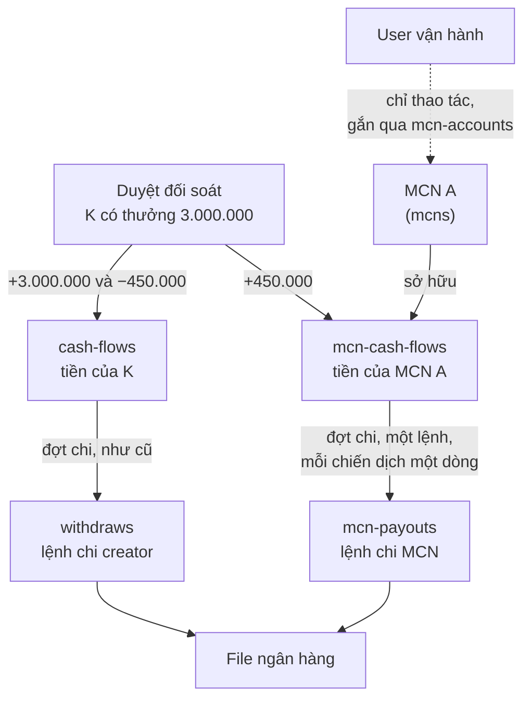
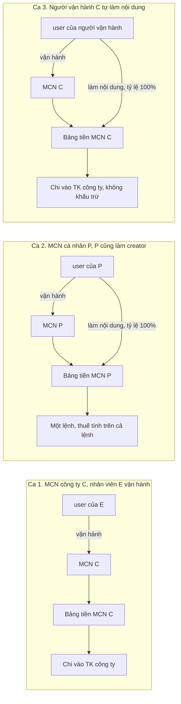
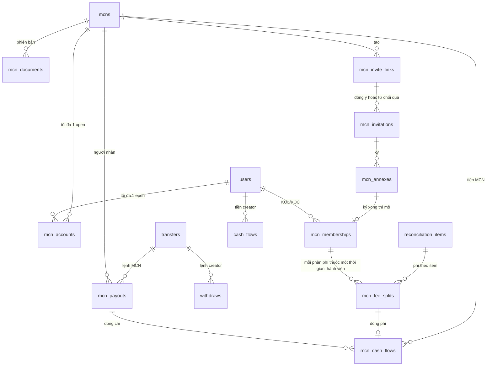
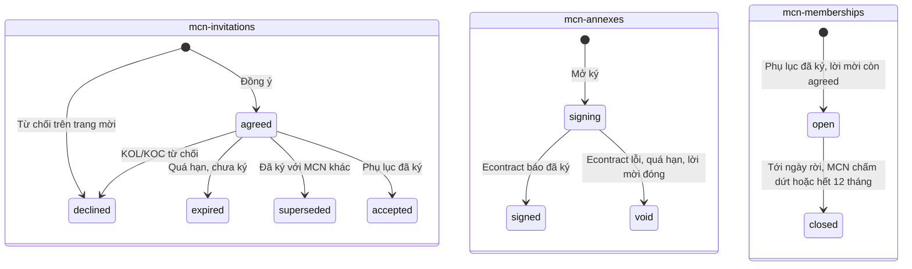
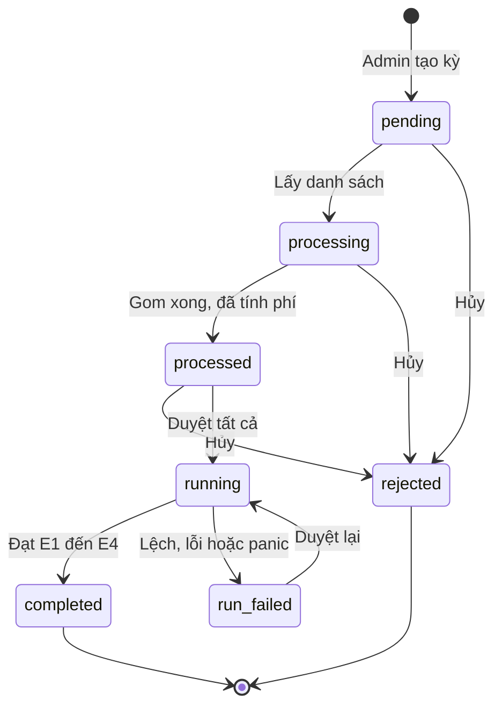
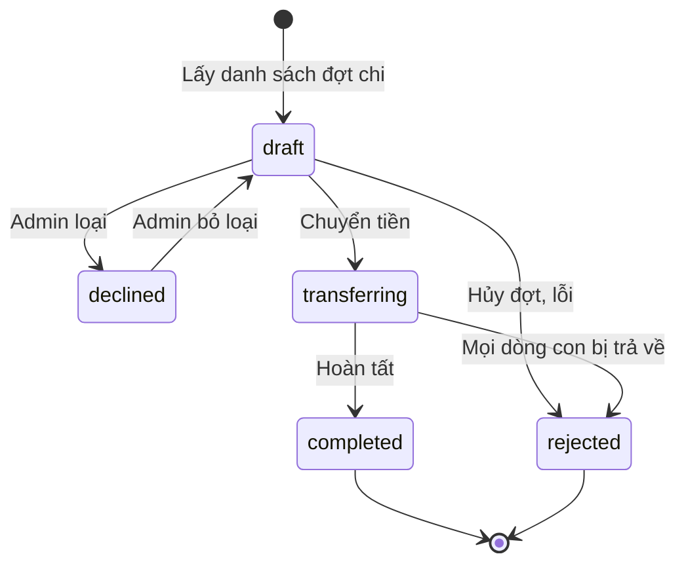

# Tech spec: MCN trên KOC Ambassador — Phase 1

| Mục | Giá trị |
|---|---|
| Dự án | KOC Ambassador, module MCN (Multi-Channel Network) |
| Ngày | 2026-11-13 |
| Người viết | Nguyễn Đăng Định |
| Người review | Thành Trung, Vinh Nguyễn |
| Version | 4.0 |
| Trạng thái | Draft, sửa theo review của anh Vĩnh trên PR #42 (12/11), chờ review lại |
| PRD | [prd-mcn-phase1-2026-11-04.md](./prd-mcn-phase1-2026-11-04.md). Bản 1.3 nằm ở PR #41 (nhánh `docs/mcn-phase1-prd-decisions-261109`), cần merge trước hoặc cùng PR này |
| Tài liệu khác | [08-Sequence.md](./08-Sequence.md) (BA, 22/10, mô hình cũ); [meeting-261103.md](./meeting-261103.md); biên bản họp 10/11 (chưa đưa lên repo); bản mẫu BA (artifact `BVwnmqnqNZhjnX6pbXDikV`) |
| Code | Repo `ambassador`, nhánh `feat/mcn-phase1`, head `8a17323f3` |

Đường dẫn code tính từ gốc repo `ambassador/`.

## 0. Nguyên tắc

Theo review của anh Vĩnh (PR #42, 12/11). Mọi mục bên dưới làm theo năm nguyên tắc này.

1. Mỗi object đủ độc lập: một object làm một việc, có vòng đời riêng. Không gắn dữ liệu MCN lên object lõi đang chạy (`users`, `event-rewards`, `event-bonus`, `reconciliation-items`…) nếu còn cách khác.
2. Hạn chế cờ tối đa. Trạng thái chỉ nằm trong một trường `status`, không có boolean chạy song song. Hành vi suy ra từ dữ liệu, không bật tắt bằng cờ. Bắt buộc có cờ để triển khai dần thì ghi ngày xóa cờ.
3. Giá trị cố định khai const trong code, không làm ENV. ENV chỉ cho thứ khác nhau giữa các môi trường (host, secret). Ví dụ đang có: `"B2C_AMBASSADOR"`, `MinTaxableRevenue = 5000000`.
4. Phase 1 lùi các logic phức tạp: đổi MCN, ký lại, đổi tỷ lệ. Để phase sau.
5. Số dư của creator luôn là số dư cá nhân, không gộp với MCN.

## 1. Tóm tắt

### 1.1 MCN phase 1 là gì

MCN là công ty hoặc cá nhân quản lý một nhóm KOL/KOC. Phase 1 cho MCN đưa KOL/KOC của mình lên KOC Ambassador và nhận phí quản lý ngay trên hệ thống, thay vì tự thu bên ngoài.

```
AccessTrade tạo hồ sơ MCN, kích hoạt, gắn tài khoản vận hành
  → MCN tạo link mời kèm tỷ lệ phí (0–100%), gửi cho KOL/KOC
  → KOL/KOC đồng ý (lời mời), ký phụ lục 12 tháng (phụ lục) → thành viên của MCN (thời gian thành viên)
  → Lấy danh sách đối soát: khoản thưởng phát sinh trong thời gian thành viên bị tính phí
  → Duyệt đối soát: trừ phí bên KOL/KOC, cộng vào số dư MCN
  → Đợt chi: MCN nhận cùng đợt với KOL/KOC; lệnh KOL/KOC như cũ, MCN một lệnh, mỗi chiến dịch một dòng
```

Ví dụ: K thuộc MCN A, tỷ lệ 15%, có thưởng 3.000.000đ. K nhận 2.550.000đ, A nhận 450.000đ.

PRD mô tả yêu cầu nghiệp vụ. Tech spec này mô tả cách làm trên code: dữ liệu, luồng tiền, API, màn hình đọc dữ liệu từ đâu, cách lên prod.

### 1.2 Chỗ khó

Hệ thống hiện tại coi một user là một người: user đó đăng nhập, có số dư, nhận tiền và chịu thuế. MCN thì khác. MCN ký hợp đồng với AccessTrade; người đăng nhập chỉ vận hành MCN. Nếu cộng phí MCN vào số dư của người vận hành:

- Đổi người vận hành thì tiền vẫn nằm ở người cũ.
- Người vận hành bị khóa vì lỗi creator thì MCN không được chi.
- Phí MCN và thu nhập creator lẫn vào một số dư, thuế tính sai.

Ngoài ra, Duyệt đối soát hiện tại không chạy trong transaction. Lỗi giữa chừng thì tiền ghi dở; thêm phần trích phí MCN vào thì càng dễ lệch (§4.2).

### 1.3 Thiết kế chính

Tiền đi như sau, lấy ví dụ K thuộc MCN A, tỷ lệ 15%:



Câu 1–5 là câu hỏi của tech lead. Câu 6–9 là các điểm còn lại của thiết kế.

1. MCN là đối tượng gì?
   Công ty (MST) hoặc cá nhân (CCCD) ký hợp đồng với AccessTrade. Lưu ở bản ghi `mcns`, không phải user. MCN sở hữu số dư, nhận tiền và chịu thuế. Xem §5.1.

2. Tài khoản MCN khác tài khoản creator thế nào?
   Tài khoản đăng nhập của MCN là một user bình thường, được gắn quyền vận hành qua `mcn-accounts`. User đó không sở hữu tiền của MCN: đổi người vận hành thì tiền vẫn ở MCN. Người vận hành vẫn làm creator được như mọi user. Xem §5.2.

3. Số dư MCN và số dư creator tách thế nào?
   Hai bảng riêng, như sơ đồ trên: `cash-flows` của K ghi `+3.000.000` và `−450.000`; `mcn-cash-flows` của A ghi `+450.000`. Số dư mỗi bên là tổng bảng của bên đó. Xem §6, §7.

4. Database thay đổi gì?
   Collection mới, đều của MCN: `mcn-invitations`, `mcn-annexes`, `mcn-memberships`, `mcn-user-locks`, `mcn-fee-splits`, `mcn-cash-flows`, `mcn-payouts`. Không thêm trường MCN vào `users`, `event-rewards`, `event-bonus`, `reconciliation-items`. Collection lõi chỉ thêm `cash-flows.idemKey` và trạng thái kỳ `run_failed`, thuộc đường ghi tiền mới (§7.3). Xem §6.

5. Thuế của MCN khi người đứng MCN cũng làm creator?
   Tài khoản creator của họ tham gia chính MCN với tỷ lệ 100% (tài khoản nhà). Thu nhập nội dung chuyển hết vào số dư MCN, nên chỉ có một lệnh chi MCN và một lần xét thuế trên cả lệnh.
   - MCN cá nhân P: phí 3.000.000 + nội dung 2.500.000 = 5.500.000, khấu trừ 10% là 550.000.
   - MCN công ty C: phí 8.000.000 + nội dung 6.000.000 = 14.000.000, không khấu trừ.

   Xem §5.3, §8.2.

6. Phí trích trên khoản thưởng nào?
   Khoản thuộc chiến dịch có `events.startAt` từ mốc `McnFeeStartAt` (00:00 01/12/2026 giờ VN, const trong code) và có ngày phát sinh nằm trong thời gian KOL/KOC là thành viên. Tính lúc Lấy danh sách đối soát, không gắn gì lên khoản thưởng. Ví dụ K ký ngày 05/12, thưởng view 300.000/ngày từ 01/12 đến 10/12: chỉ 6 ngày 05–10/12 bị trích, phí 270.000. Xem §7.

7. Duyệt đối soát lỗi giữa chừng thì sao?
   Mỗi item ghi trong một transaction: dòng tiền creator, dòng tiền MCN và trạng thái item cùng ghi hoặc cùng không ghi. Mỗi dòng tiền có khóa `idemKey` nên chạy lại không cộng trùng. Kỳ lỗi chuyển `run_failed`, gửi Telegram, Admin Duyệt lại. Đường này thay hẳn đường cũ cho mọi kỳ, mọi partner. Xem §7.3, §7.4.

8. Chi theo chiến dịch thế nào?
   MCN nhận trong cùng đợt chi với KOL/KOC, không có đợt riêng. Mỗi MCN có một lệnh trong đợt; mỗi chiến dịch còn số dư là một dòng con có trạng thái riêng. Thuế tính một lần trên cả lệnh. File ngân hàng ra một dòng cho mỗi chiến dịch. P có 3.000.000 ở chiến dịch C1 và 2.500.000 ở C2: một lệnh 5.500.000, thuế 550.000, file có hai dòng. Xem §8.1.

9. Làm sao không nhầm số của creator và MCN trên màn hình?
   Mỗi màn hình chỉ đọc một bảng. Trang Số dư của creator đọc `cash-flows`; trang Quản lý MCN đọc `mcn-cash-flows`. Không màn hình nào cộng hai số. Xem §9.3.

### 1.4 Câu hỏi còn mở

Không còn câu hỏi chặn code. Các câu ở bản trước đã đóng theo họp 10/11 (§12.3). Với những điểm PRD và biên bản họp chưa nói, tài liệu chọn sẵn cách làm, phần lớn giữ như hệ thống hiện nay (§12.4).

Chỉ còn chờ AT gửi mã mẫu phụ lục (dự kiến ký 17/11).

## 2. Thuật ngữ

| Thuật ngữ | Nghĩa |
|---|---|
| MCN | Công ty hoặc cá nhân ký hợp đồng MCN với AccessTrade. Bản ghi `mcns`, định danh bằng MST hoặc CCCD. Không phải user |
| Tài khoản vận hành | User được gắn vào MCN qua `mcn-accounts`. Chỉ có quyền thao tác, không sở hữu tiền. "Tài khoản MCN" trong PRD là khái niệm này |
| Người đứng MCN | Chủ MCN cá nhân, hoặc người được MCN công ty giao tài khoản vận hành |
| KOL/KOC, creator | User làm nội dung, có thu nhập ghi vào `cash-flows` |
| Lời mời | Một bản ghi `mcn-invitations`: KOL/KOC đã đồng ý hoặc từ chối link mời của MCN |
| Phụ lục | Một bản ghi `mcn-annexes`: một lần ký phụ lục trên econtract |
| Thời gian thành viên | Một bản ghi `mcn-memberships`: khoảng thời gian KOL/KOC là thành viên của MCN, kèm tỷ lệ |
| Thành viên | KOL/KOC có `mcn-memberships` ở `status = open`. Người mới đồng ý, chưa ký, chưa là thành viên |
| Tài khoản nhà | Thời gian thành viên `rate = 100` của user là người vận hành của chính MCN đó, hoặc trùng CCCD với MCN cá nhân đó. Không lưu cờ, tính khi cần (§5.3) |
| Chiến dịch | Bản ghi `events`. "Campaign" trong biên bản họp 10/11 là chiến dịch, không phải ADV |
| Mốc trích phí (`McnFeeStartAt`) | Const trong code: 00:00 ngày 01/12/2026 giờ VN. Chỉ chiến dịch có `events.startAt` từ mốc này mới bị trích phí. Muốn dời mốc thì sửa const rồi deploy. Không dùng ENV, không suy ra từ `mcns.activatedAt` |
| Khoản thưởng (reward) | Một bản ghi `event-rewards` (thưởng view, thưởng mốc) hoặc `event-bonus` (Thưởng thêm) |
| Item đối soát | Một bản ghi `reconciliation-items`. Item gộp nhiều khoản thưởng của cùng (user, content), có thể trải nhiều ngày |
| Phần phí | Một bản ghi `mcn-fee-splits`: phí của một thời gian thành viên trên một item |
| Ngày phát sinh | Thưởng view: ngày có view (`event-rewards.date`). Thưởng mốc: ngày đạt mốc. Thưởng thêm: ngày Admin tạo |
| Cửa sổ phí | Khoảng ngày `[from, to)` giờ Việt Nam của một thời gian thành viên (§7.2) |
| G | Tổng thưởng của một item, trước khi trừ phí (`totalCash`) |
| Đợt chi, lệnh chi | Đợt chi là `transfers`. Lệnh creator là `withdraws`, lệnh MCN là `mcn-payouts` |
| `taxpayerKey` | Khóa người chịu thuế trên lệnh: `mst:<số>`, `cccd:<số>` hoặc `user:<id>`. Kế toán dùng để tổng hợp |
| `idemKey` | Khóa duy nhất của một dòng tiền. Ghi lại cùng khóa không tạo dòng thứ hai |
| CAS | Cập nhật có điều kiện: chỉ ghi khi trạng thái hiện tại đúng trạng thái nguồn (`updateOne` lọc theo `status`). Hai bên cùng chuyển một bản ghi thì chỉ một bên thành công |
| Hợp đồng MCN, hợp đồng creator, phụ lục | Hợp đồng MCN: hợp đồng khung giữa AT và MCN. Hợp đồng creator: `B2C_AMBASSADOR` giữa AT và KOL/KOC. Phụ lục: phụ lục chỉ định thanh toán gắn với hợp đồng creator, ghi tỷ lệ phí |

Thao tác trên admin dùng trong tài liệu:

| Màn hình | Thao tác và trạng thái |
|---|---|
| Đối soát | Lấy danh sách: `pending → processing → processed`. Duyệt tất cả: `processed → running → completed`, lỗi thì `run_failed`. Duyệt lại: `run_failed → running` |
| Xử lý rút tiền (đợt chi) | Lấy danh sách: `new → processing → processed`. Chuyển tiền: `→ transferring → transferred`. Hoàn tất: `→ finished` |

## 3. Phạm vi

### 3.1 Làm trong phase 1

- Admin tạo, kích hoạt hồ sơ MCN; gắn tài khoản vận hành.
- MCN tạo link mời; KOL/KOC đồng ý, ký phụ lục, báo rời; MCN chấm dứt quan hệ.
- Tài khoản nhà 100%.
- Trích phí ở đối soát, bảng tiền MCN, chi MCN theo chiến dịch, thuế, file ngân hàng.
- Màn xem đối soát cho MCN và KOL/KOC; thông báo.

### 3.2 Không làm ở phase 1

- Đổi MCN, ký lại, đổi tỷ lệ giữa chừng (nguyên tắc 4); gia hạn phụ lục.
- Tạm dừng, chấm dứt cả MCN.
- KOL/KOC xác nhận hoặc báo sai đối soát; Admin thao tác thay MCN.
- MCN tự rút tiền; bảng kê, hóa đơn trong hệ thống.
- UI điều chỉnh tiền; duyệt hai người khi đổi TK ngân hàng MCN.
- Gộp ngưỡng thuế theo CCCD giữa lệnh MCN và lệnh creator.
- Chi theo chiến dịch cho lệnh creator ngoài MCN.

### 3.3 Ràng buộc kỹ thuật

- MongoDB replica set (nhánh `release` đã dùng transaction ở `withdraw.go`). Code mới dùng `RunInTransaction` bọc `session.WithTransaction` của driver. Callback có thể chạy lại nên chỉ chứa thao tác DB.
- Tiền trong code cũ là `float64`. Phần mới dùng `int64` (VND).
- Econtract không có webhook, trạng thái phụ lục lấy bằng polling.
- Repo không có metrics, cảnh báo gửi Telegram.
- Partial unique index chỉ dùng điều kiện bằng và `$exists: true`, vì chưa biết phiên bản Mongo trên prod. Vì vậy mỗi object chỉ có một trạng thái "đang mở" để index dựa thẳng vào `status` (§6.5).

## 4. Hiện trạng cần biết

### 4.1 Vì sao không cộng phí vào số dư user

| Tình huống | Nếu cộng phí vào `cash-flows` của người vận hành | Thiết kế này |
|---|---|---|
| MCN cá nhân P, trong đợt có thu nhập creator 2.500.000 và phí 3.000.000 | Một lệnh 5.500.000, không tách được đâu là phí, thuế không đúng loại thu nhập | Tài khoản nhà 100%: cả 5.500.000 vào số dư MCN P, thuế 550.000 tính một lần |
| Đổi người vận hành U1 → U2 rồi chạy lại kỳ | 3.000.000 nằm ở U1; chạy lại cộng thêm cho U2 (cộng trùng) | Số dư gắn với `mcns`; khóa chống trùng theo (item, thời gian thành viên) |
| Người vận hành bị `banned` vì lỗi creator | Đợt chi lọc `banned:false`, MCN không được chi | Điều kiện chi MCN dựa trên hợp đồng MCN và TK ngân hàng |
| Màn số dư creator của người vận hành | Số dư tăng thêm phí MCN, lịch sử lẫn phí | Không chứa phí MCN |

Số dư, lệnh chi và thuế hiện đều tính theo `user`, nên phải tách bảng. Sửa một hàm không đủ.

### 4.2 Đường Duyệt đối soát hiện tại có thể ghi dở

Duyệt hiện ghi dòng tiền, reward, item bằng các lệnh rời, không có transaction (`runCashBack` trong `backend/pkg/admin/service/reconciliation_running.go`). Có ba trường hợp ghi dở, đều không có cảnh báo:

| Lỗi ở bước | Kết quả |
|---|---|
| Ghi dòng tiền (lỗi chỉ in log) | Item, reward đã completed nhưng KOL/KOC không được cộng tiền; kỳ vẫn `completed` |
| Ghi content-analytic | Hàm `return` sớm: đã cộng tiền, item vẫn pending trong kỳ đã `completed`, thống kê không cập nhật |
| Ghi reward | Đã cộng tiền, reward vẫn pending; kỳ sau gom lại và cộng trùng |

Khoản có phí MCN phải ghi hai bảng cùng lúc, nên không giữ được đường này. Đường ghi tiền mới (§7.3) thay hẳn đường cũ cho mọi kỳ, mọi partner. Không có cờ chọn đường. Phần này tách thành spec và PR riêng, lên prod trước MCN (§11.4).

### 4.3 Đợt chi hiện tại

- Đợt chi (`transfers`) lọc theo partner và khoảng ngày, rút toàn bộ số dư của user, gộp mọi chiến dịch.
- Thuế: lệnh từ 5.000.000đ thì khấu trừ 10%, xét từng lệnh (`backend/internal/service/withdraw.go`).
- Chuyển tiền ghi dòng trừ tiền nhưng bỏ qua lỗi. Ghi lỗi thì lệnh vẫn được chi mà số dư không bị trừ.
- Khi đặt Max, user có số dư dưới Max bị loại khỏi đợt (OQ-10).

## 5. Tài khoản: MCN, người vận hành, creator

### 5.1 MCN

- Bản ghi `mcns`: `type` (company hoặc individual), `name`, `identityNumber` (MST 10 hoặc 13 số, CCCD 12 số; unique), `loginEmail`, `status` (`pending → active` khi đủ 5 hồ sơ). Hồ sơ MCN không gắn partner/ADV: Admin có quyền xem MCN thì thấy toàn bộ, không lọc theo ADV.
- MCN sở hữu số dư, là người nhận tiền và người chịu thuế. Công ty: không khấu trừ. Cá nhân: khấu trừ 10% TNCN nếu lệnh của MCN trong đợt từ 5.000.000đ (họp 10/11).
- Sau khi `active`, không sửa `type`, `identityNumber`; chỉ đổi bằng script có ticket. Đổi `name` thì TK ngân hàng phải xác minh lại.
- Hồ sơ pháp lý và TK ngân hàng ở `mcn-documents`, có phiên bản. Lệnh chi chép TK hiện hành lúc tạo lệnh.

### 5.2 Tài khoản vận hành

- Bảng `mcn-accounts`: `mcn`, `email`, `user` (có khi đã gắn), `boundAt`, `status` (`open → revoked`). Gắn user là một trường, không phải trạng thái riêng, để mỗi dòng chỉ có một trạng thái mở.
- User đăng nhập Google có email khớp thì được gắn vào dòng `open` của MCN (`BindAccountOnLogin`). Có hơn một user cùng email thì không gắn, gửi Telegram.
- Mỗi MCN tối đa một dòng `open`; mỗi user vận hành tối đa một MCN (INV-04, index ở §6.5).
- Tài khoản vận hành chỉ có quyền thao tác. Đổi người vận hành bằng script `cmd/mcn-rebind`: dòng cũ sang `revoked`, tạo dòng `open` với email mới. Tiền không di chuyển.
- Email MCN được trùng email tài khoản creator (PRD Q12, họp 10/11). Người vận hành vẫn đăng bài như creator bình thường.
- Không gọi `EnsureUserPartner` cho user vận hành, để user đó chỉ được đếm là creator khi tự tham gia partner.

### 5.3 Người đứng MCN làm creator: tài khoản nhà

Họp 10/11 chốt: người đứng MCN được làm creator trên cùng portal; tiền của hai vai gộp một lần chi, một lần tính thuế, để không chia nhỏ dưới 5.000.000đ.

Quy tắc (không lưu cờ, tính khi cần): user U là người vận hành của MCN X, hoặc CCCD của U trùng CCCD của MCN cá nhân X, thì U chỉ được tham gia X, với tỷ lệ 100%.

- Kiểm ở bước Đồng ý và bước mở ký. Link của X dưới 100% thì từ chối (`MCN_HOUSE_RATE_REQUIRED`). Link của MCN khác thì chặn như cũ.
- Bước mở ký luôn so CCCD của user với CCCD của MCN cá nhân, không cần đánh dấu lúc Đồng ý.
- Đối soát tạo phần phí 100%: `cash-flows` của user ghi `+G` và `−G`; `mcn-cash-flows` ghi `+G`. Không thêm loại dòng tiền mới.
- Màn MCN hiện nhãn "Tài khoản nhà" bằng cách tính lại quy tắc trên lúc trả API.
- Thu nhập trước ngày ký phụ lục 100%, hoặc ở chiến dịch trước mốc `McnFeeStartAt`, vẫn ở số dư creator và chi bằng lệnh creator.
- Hệ thống không tự đưa người đứng MCN vào MCN: họ vẫn mở link 100% và ký phụ lục như mọi KOL/KOC. Chưa ký thì thu nhập nội dung vẫn chi bằng lệnh creator; báo cáo vận hành liệt kê các trường hợp này để nhắc ký.

Ba trường hợp thường gặp:



Kênh khác do MCN sở hữu (không phải người vận hành) tham gia bằng link 100% như KOL/KOC, kết quả tiền như nhau.

### 5.4 Quy tắc vai và chặn đồng thời

| ID | Quy tắc |
|---|---|
| INV-01 | Một KOL/KOC có tối đa một thời gian thành viên `open` |
| INV-02 | Mỗi (user, MCN) tối đa một lời mời `agreed` |
| INV-03a | Tài khoản vận hành của MCN X chỉ được tham gia chính X, với tỷ lệ 100% |
| INV-03b | User có lời mời `agreed` hoặc thời gian thành viên `open` với MCN khác thì không gắn được làm tài khoản vận hành của X |
| INV-04 | Mỗi MCN một dòng `mcn-accounts` `open`; mỗi user vận hành một MCN |
| INV-05 | Mỗi user tối đa một phụ lục `signing` |

Vấn đề: các bước này đọc rồi mới ghi, trên nhiều collection. Ví dụ U đồng ý lời mời của MCN A; cùng lúc Admin kích hoạt MCN B bằng email của U. Không khóa thì U vừa vận hành B vừa là thành viên A.

Cách chặn: mọi bước đổi vai chạy trong `RunInTransaction`. Đầu tiên upsert `$inc` dòng `mcn-user-locks {_id: user, ver}` của user liên quan, rồi đọc lại điều kiện, rồi ghi. Hai bước cùng user ghi cùng một document nên một bên gặp `WriteConflict`. Driver chạy lại bên đó; điều kiện không còn đúng thì trả 409 `MCN_MEMBER_STATE_CHANGED`. Dòng khóa chỉ tăng số, không bao giờ xóa. Kèm partial unique index cho INV-01, 02, 04, 05 (§6.5).

| Phía | Bước | Điều kiện kiểm trong transaction |
|---|---|---|
| KOL/KOC | Đồng ý, mở ký, đồng bộ ký, kích hoạt thành viên | User không vận hành MCN nào. Nếu có, phải là link 100% của chính MCN đó |
| Người vận hành | Admin kích hoạt (gắn ngay), gắn khi đăng nhập | User không có lời mời `agreed` hoặc thời gian thành viên `open` với MCN khác. Có với chính MCN này thì phải là 100% |

Lời gọi econtract tạo phụ lục nằm ngoài transaction.

## 6. Dữ liệu

### 6.1 Sơ đồ

Hệ thống chia ba lớp:

- Đăng nhập (`users`, `mcn-accounts`): ai được thao tác.
- MCN và thành viên (`mcns`, `mcn-documents`, `mcn-invite-links`, `mcn-invitations`, `mcn-annexes`, `mcn-memberships`): MCN nào thu phí của ai, tỷ lệ bao nhiêu, trong khoảng ngày nào.
- Tiền (`mcn-fee-splits`, hai bảng tiền, hai loại lệnh chi): phí tính lúc Lấy danh sách từ thời gian thành viên và lưu ở `mcn-fee-splits`; lúc Duyệt chỉ đọc phần phí đã lưu; lệnh chi chép TK ngân hàng và thuế lúc tạo lệnh.



Tên trong sơ đồ dùng gạch dưới; collection thật dùng gạch nối.

### 6.2 Quan hệ MCN–KOL/KOC: ba object

Một lần tham gia đi qua ba giai đoạn, mỗi giai đoạn một object có vòng đời ngắn và một trạng thái mở.

**`mcn-invitations`**: KOL/KOC đã đồng ý hoặc từ chối link mời.

| Trường | Ghi chú |
|---|---|
| `mcn`, `user`, `link` | Link mời đã dùng |
| `rate` | Chép từ link lúc đồng ý, không đổi |
| `status` | `agreed` → `declined` / `expired` / `superseded` / `accepted`. Từ chối ngay trên trang mời thì tạo thẳng `declined` |
| `signDeadline`, `remindedAt`, `consentShareAt` | Hạn ký, nhắc ký, đồng ý chia sẻ thông tin |
| `declineNote`, `history[]` | Lý do từ chối; lịch sử bước chuyển |

**`mcn-annexes`**: một lần ký phụ lục.

| Trường | Ghi chú |
|---|---|
| `invitation`, `mcn`, `user` | Lời mời đang ký |
| `contractId` | Mã phụ lục trên econtract |
| `status` | `signing` → `signed` / `void`. Econtract lỗi khi tạo thì `void` ngay để bấm ký lại |
| `signedAt`, `signedAtSource` | Giờ ký; nguồn là econtract hoặc giờ đồng bộ (`sync_capped`) |

Phụ lục ký xong khi lời mời đã đóng (từ chối, quá hạn, hết hiệu lực) chỉ là một `mcn-annexes` `signed` trỏ tới lời mời đã đóng. Không mở thời gian thành viên, không trích phí (PRD D18).

**`mcn-memberships`**: thời gian là thành viên.

| Trường | Ghi chú |
|---|---|
| `mcn`, `user`, `invitation`, `annex` | Nguồn gốc |
| `rate` | Chép từ lời mời, không đổi |
| `status` | `open` → `closed` |
| `startAt` | Lúc kích hoạt (phụ lục ký xong được ghi nhận). Ghi một lần |
| `endAt` | `startAt` + 12 tháng |
| `leaveNotice` | `{at, effectiveAt, note}`. Báo rời là trường, không phải trạng thái. Rút lại trước ngày hiệu lực thì gỡ trường này |
| `closedAt`, `closeReason`, `closeNote` | `left` (tới ngày rời), `terminated` (MCN chấm dứt), `expired` (hết 12 tháng) |
| `history[]` | Lịch sử bước chuyển |

Ký xong: `mcn-annexes` → `signed`, `mcn-invitations` → `accepted`, các lời mời `agreed` khác của user → `superseded`, tạo `mcn-memberships` `open`. Cả bốn ghi trong một transaction.

### 6.3 Collection mcn-fee-splits (mới)

Một dòng cho mỗi (item đối soát, thời gian thành viên). Tạo lúc Lấy danh sách, không đổi sau khi kỳ `processed`.

| Trường | Kiểu | Ghi chú |
|---|---|---|
| `reconciliation`, `item` | ObjectID | Kỳ và item đối soát |
| `membership`, `mcn`, `user` | ObjectID | Thời gian thành viên, MCN, KOL/KOC |
| `event` | ObjectID | Chiến dịch của item |
| `rate` | int | Chép từ thời gian thành viên |
| `baseCash` | int64 | Tổng `cash` các khoản của item nằm trong cửa sổ phí |
| `fee` | int64 | Phí đã làm tròn (§7.2) |
| `rewardCount` | int | Số khoản tính phí |
| `createdAt` | Date | |

Màn MCN và tab Người nhận truy vấn thẳng collection này. Dòng `mcn-cash-flows` của phí trỏ tới split tương ứng.

### 6.4 Collection mcn-cash-flows (mới)

Chỉ ghi thêm, không sửa, không xóa. Số dư MCN = tổng `value`.

| Trường | Kiểu | Ghi chú |
|---|---|---|
| `mcn` | ObjectID | MCN sở hữu dòng tiền |
| `partner` | ObjectID | Chép từ `events.partner` của chiến dịch, để lọc theo đợt chi |
| `event` | ObjectID | Bắt buộc. Số dư tính theo (MCN, chiến dịch) |
| `action` | string | `mcn_fee`, `withdraw`, `tax`, `withdraw_fee`, `withdraw_reversal`, `adjustment` |
| `value` | int64 | Khác 0. Dương là cộng (`mcn_fee`, `withdraw_reversal`), âm là trừ (`withdraw`, `tax`, `withdraw_fee`). `adjustment` theo chiều điều chỉnh |
| `reversalOf` | string | Chỉ với `withdraw_reversal`: dòng gốc là `withdraw`, `tax` hay `withdraw_fee` |
| `idemKey` | string | Bắt buộc, unique |
| `source` | object | Chỉ với `mcn_fee`: `{reconciliation, split}` |
| `payout`, `transfer` | ObjectID | Chỉ với dòng chi |
| `adjustment` | object | Chỉ với `adjustment`: `{ticket, seq, reason, approvedBy}` |
| `createdBy`, `createdAt` | object, Date | `createdBy`: `{type: system \| staff \| script, id}` |

Mọi đọc ghi đi qua repository `McnLedger()`: `Post(sc, entries...)`, `Balance(sc, mcn)`, `EventBalance(sc, mcn, event)`. Repository này không có hàm update hay delete. Mọi thao tác làm giảm số dư MCN chạy trong transaction có `$inc mcns.ledgerVer`, để các thao tác trên cùng một MCN chạy lần lượt.

### 6.5 Collection mcn-payouts (mới)

Một lệnh cho mỗi (đợt chi, MCN). Mỗi chiến dịch là một dòng con.

| Trường | Kiểu | Ghi chú |
|---|---|---|
| `transfer`, `partner`, `mcn` | ObjectID | Unique `(transfer, mcn)` |
| `lines[]` | array | `{event, cash, cashTax, actualCash, status, rejectReason}`, mỗi chiến dịch một dòng |
| `cash`, `cashTax`, `bankFee`, `actualCash` | int64 | Của cả lệnh. `actualCash = cash − cashTax − bankFee ≥ 0` |
| `status` | string | `draft`, `declined`, `transferring`, `completed`, `rejected` |
| `rejectReason` | string | `transfer_rejected` (hủy đợt), `insufficient_balance`, `transfer_failed` |
| `declinedReason` | string | Lý do Admin loại lệnh |
| `bank` | object | Chép TK ngân hàng lúc tạo lệnh |
| `payee` | object | Chép thông tin MCN lúc tạo lệnh: loại, tên, MST hoặc CCCD, SĐT, ngày ký hợp đồng MCN |
| `tax` | object | `{incomeType, taxpayerType, taxpayerKey, base, rate, threshold, amount, computedAt}` |
| `history[]` | array | `{status, at, byType, by, note}` |

Trạng thái dòng con: `draft`, `transferring`, `completed`, `rejected`. `bank`, `payee`, `tax` không đổi sau khi lệnh rời `draft`.

### 6.6 Collection mcn-user-locks (mới)

`{_id: userId, ver}`. Chỉ upsert và `$inc ver`, không bao giờ xóa. Dùng để các bước đổi vai trên cùng user chạy lần lượt (§5.4).

### 6.7 Trường thêm vào collection có sẵn

| Collection | Thêm hoặc đổi |
|---|---|
| `mcns` | `ledgerVer` (chỉ `$inc`); `statistic` (§6.7.1) |
| `mcn-accounts` | `boundAt`, status `open`/`revoked`, `revokedAt`, `revokedBy`, `history[]` |
| `mcn-invite-links` | Giữ nguyên |
| `reconciliations` | Trạng thái `run_failed`; `completedAt` |
| `cash-flows` | `idemKey` (tag `omitempty`); action `mcn_fee` (`targetId` = MCN, `options.reconciliationItem`), `mcn_fee_adjustment` |

Không thêm trường MCN vào `users`, `event-rewards`, `event-bonus`, `reconciliation-items`, `withdraws`, `transfers`.

`cash-flows.idemKey` phải có `omitempty`. Thiếu thì mọi dòng không có khóa mang `idemKey: ""` và vi phạm unique index.

#### 6.7.1 mcns.statistic

Số cache để hiện ở màn Đối soát, Số dư của MCN và chi tiết MCN ở admin, giống `users.statistic`. Không dùng để tính tiền; tiền luôn tính từ nguồn ở cột cuối. Tiền là `int64` VND.

| Trường | Ý nghĩa | Nguồn |
|---|---|---|
| `totalMember`, `totalLink` | Đang có | `mcn-memberships` `open`, `mcn-invite-links` |
| `totalMemberCash` | Tổng thu nhập thành viên tạo ra trong thời gian thành viên | Khoản thưởng của user thành viên, ngày phát sinh trong cửa sổ phí, chiến dịch từ mốc; không tính khoản bị từ chối |
| `totalFeePending` | Phí tạm tính, chưa đối soát | Như trên, chỉ khoản `pending`: làm tròn(`Σ cash × rate`) theo từng thời gian thành viên |
| `totalFeeCompleted` | Phí đã đối soát, đã vào số dư | Σ dòng `mcn_fee` của `mcn-cash-flows` |
| `cashRemaining` | Số dư hiện tại | Σ `value` của `mcn-cash-flows` |
| `withdrawTotal`, `withdrawPending`, `withdrawSuccess`, `withdrawRejected` | Số lệnh chi | `mcn-payouts` theo trạng thái |
| `cashWithdrawTotal`, `cashWithdrawPending`, `cashWithdrawSuccess`, `cashWithdrawRejected` | Số tiền theo lệnh chi | `mcn-payouts` |
| `totalCashTax` | Thuế đã khấu trừ | Σ dòng `tax` của `mcn-cash-flows` |

Cập nhật bằng hàm `Mcn().UpdateStatistic(mcn)`: tính lại toàn bộ từ nguồn rồi `$set`, không `$inc`, nên chạy lại bao nhiêu lần cũng đúng. Gọi ở:

- Job hằng đêm tính lại cho mọi MCN đang hoạt động.
- Sau Duyệt từng kỳ có phí, sau Chuyển tiền và Hoàn tất lệnh MCN, sau đổi trạng thái thời gian thành viên.

### 6.8 Index

| Collection | Index | Để làm gì |
|---|---|---|
| `mcn-invitations` | `uniq(user, mcn)` partial `{status: agreed}`; `uniq(user, link)` partial `{status: declined}`; `(user, status)` | INV-02; bấm Từ chối trên trang mời nhiều lần không tạo nhiều dòng |
| `mcn-annexes` | `uniq(user)` partial `{status: signing}`; `(status, createdAt)` | INV-05; job đồng bộ ký |
| `mcn-memberships` | `uniq(user)` partial `{status: open}`; `(mcn, status)`; `(user, startAt)` | INV-01; tìm thời gian thành viên theo user và ngày |
| `mcn-accounts` | `uniq(mcn)` partial `{status: open}`; `uniq(user)` partial `{status: open, user: {$exists: true}}` | INV-04 |
| `mcn-fee-splits` | `uniq(item, membership)`; `(mcn, reconciliation)`; `(mcn, event)`; `(user, reconciliation)` | Chống trùng; màn đối soát MCN và KOL/KOC |
| `mcn-cash-flows` | `uniq(idemKey)`; `(mcn, event, createdAt)`; `(source.reconciliation, mcn)`; `(payout)` | Chống ghi trùng; số dư theo chiến dịch; đối chiếu |
| `mcn-payouts` | `uniq(transfer, mcn)`; `(mcn, -createdAt)`; `(transfer, status)` | Một lệnh mỗi MCN mỗi đợt |
| `cash-flows` | `uniq(idemKey)` partial `{idemKey: {$exists: true}}` | Không vướng dữ liệu cũ |

### 6.9 Quy tắc về tiền

| ID | Quy tắc |
|---|---|
| INV-06 | `rate`, `startAt` của thời gian thành viên ghi một lần; cận trên cửa sổ tính từ các mốc đã lưu, không từ trạng thái do job ghi |
| INV-07 | Cửa sổ phí của một user không chồng nhau |
| INV-08 | Mỗi phần phí: `0 ≤ fee ≤ floor(baseCash)` |
| INV-09 | Kỳ chỉ sang `processed` khi phí đã tính xong; `mcn-fee-splits` của kỳ không đổi sau `processed` |
| INV-10 | Item `completed` khi và chỉ khi có đủ dòng tiền khóa `rc:<itemId>:*` |
| INV-11 | Mỗi item: phí trừ bên creator bằng phí cộng bên MCN bằng tổng `fee` các split của item |
| INV-12 | Mỗi `idemKey` một dòng; không có `idemKey` rỗng; mỗi (đợt, MCN) một lệnh |
| INV-13 | `mcn-cash-flows` chỉ ghi thêm, chỉ qua `McnLedger().Post` |
| INV-14 | Dòng con của lệnh MCN chỉ trừ tiền khi số dư của chiến dịch ≥ `cash` của dòng, đọc trong cùng transaction |
| INV-15 | ADV còn kỳ đang `running` hoặc `run_failed` thì không Lấy danh sách đợt chi |
| INV-16 | Kỳ `run_failed` chỉ chuyển sang `running`, không Hủy được |
| INV-17 | `bank`, `payee`, `tax` của lệnh không đổi sau `draft`; `type`, `identityNumber` của MCN không đổi sau `active` |
| INV-18 | MCN chỉ đọc được dữ liệu của mình |
| INV-20 | Chỉ trích phí khoản của chiến dịch có `events.startAt` ≥ `McnFeeStartAt`, không xét chiến dịch thuộc ADV nào |

### 6.10 Trạng thái

Lời mời (`mcn-invitations`), phụ lục (`mcn-annexes`), thời gian thành viên (`mcn-memberships`). Mỗi bước chuyển là CAS theo trạng thái nguồn.



Kỳ đối soát (`reconciliations`). `run_failed` là trạng thái mới.



Lệnh chi MCN (`mcn-payouts`).



MCN: `pending → active`. Tài khoản vận hành: `open → revoked`. Link mời: `active → off`, một chiều.

## 7. Đối soát: tính phí và ghi tiền

### 7.1 Khi nào có phí

Không gắn gì lên khoản thưởng. Phí tính lúc Lấy danh sách đối soát (hàm `applyMcnFees`), từ thời gian thành viên.

Một khoản thưởng pending của item bị trích phí khi đủ hai điều kiện:

1. Chiến dịch của khoản có `events.startAt` từ mốc `McnFeeStartAt` (00:00 01/12/2026 giờ VN, const). Không xét chiến dịch thuộc ADV nào: MCN không gắn ADV.
2. Ngày phát sinh của khoản nằm trong cửa sổ phí của một thời gian thành viên của KOL/KOC đó (§7.2).

Ngày chạy kỳ đối soát không so với mốc. Mọi kỳ đối soát chạy sau mốc áp cùng một quy tắc, nên Kế toán chạy kỳ sớm hay muộn thì số phí vẫn như nhau. Thời gian thành viên chỉ ghi một lần (INV-06), nên tính lúc nào cũng ra cùng kết quả:

- Thành viên rời, hết 12 tháng hay MCN chấm dứt thì khoản phát sinh trong thời gian thành viên vẫn bị trích phí, kể cả khi đối soát sau ngày rời.
- `cash` của khoản thay đổi trước khi đối soát (view tăng, backfill) thì phí tính theo `cash` lúc Lấy danh sách.
- Admin sửa Thưởng thêm sang user khác thì lần Lấy danh sách sau tính theo user mới.
- Xét theo **ngày phát sinh** của khoản, không theo lúc tạo. Thưởng mốc tạo cuối đợt cho hoạt động trong thời gian thành viên vẫn bị trích, dù lúc tạo người đó đã rời.

Collection lõi `event-rewards`, `event-bonus` không đổi. Không có hàm gắn MCN ở chỗ tạo khoản thưởng, không có script gắn lại.

### 7.2 Cửa sổ phí và công thức

Cửa sổ phí của thời gian thành viên m, giờ Việt Nam, gồm `from`, không gồm `to`:

```
from(m) = 00:00 ngày startAt                                  // startAt ghi một lần
to(m)   = 00:00 ngày closedAt                                  nếu closed
        = min(00:00 ngày endAt, leaveNotice.effectiveAt)       nếu open và có leaveNotice
        = 00:00 ngày endAt                                     nếu open
// closedAt: KOL/KOC rời = ngày báo + 15; MCN chấm dứt = lúc chấm dứt; hết 12 tháng = endAt.
// Ngày kết thúc không tính phí.
```

Cửa sổ tính từ các mốc đã lưu, không theo trạng thái. Job kết thúc thành viên có chạy trễ thì kết quả vẫn đúng.

Lúc Lấy danh sách, với item i của KOL/KOC u:

```
M_u      = các thời gian thành viên của u (open và closed)
R_ij     = các khoản pending của item i, chiến dịch từ mốc, ngày phát sinh ∈ cửa sổ của j ∈ M_u
base_j   = Σ cash_r  với r ∈ R_ij
fee_j    = min( làm tròn half-up(base_j × rate_j / 100), floor(base_j) )   // làm tròn một lần cho mỗi phần phí
```

Mỗi (i, j) có `R_ij` khác rỗng ghi một dòng `mcn-fee-splits`. Sau `processed` không tính lại. Tỷ lệ 0% vẫn ghi phần phí để MCN thấy, nhưng không sinh dòng tiền.

Làm tròn một lần trên tổng của mỗi phần phí (một KOL/KOC, một thời gian thành viên, một item), theo PRD 1.2 FR-016 (chốt 11/11):

- Khớp phụ lục "MCN nhận x% thu nhập": ai bấm máy `tổng hoa hồng × tỷ lệ` cũng ra đúng số trên màn hình và trong số dư.
- Sai số tối đa 0,5đ mỗi phần phí. Làm tròn từng khoản cộng dồn sai số theo số khoản.

Ví dụ 3 khoản 10.003đ, 15%: trên tổng 30.009 × 15% = 4.501,35 → 4.501đ; từng khoản 1.500 × 3 = 4.500đ.

`applyMcnFees` lỗi sau 3 lần thử thì kỳ giữ `processing` và gửi Telegram; Admin Hủy kỳ rồi lập lại. Kỳ không sang `processed` khi phí chưa tính xong.

### 7.3 Ghi tiền lúc Duyệt

Đường ghi tiền này thay hẳn `runCashBack` cũ cho mọi kỳ, mọi partner. Không có cờ chọn đường. Kỳ không có phần phí nào thì bước 5 không có gì để ghi; kết quả tiền của creator giống hệt đường cũ.

Mỗi item một transaction (hàm `postItem`):

1. CAS item `pending → completed`. Không khớp (đã ghi rồi) thì dừng.
2. Kiểm item như hiện nay: content còn approved, số tiền, số view khớp. Lệch thì đánh item `rejected` như hiện nay.
3. CAS các khoản thưởng `pending → completed`, phải đủ số dòng.
4. `cash-flows` ghi `+totalCash`, khóa `rc:<itemId>:credit`.
5. Mỗi `mcn-fee-splits` của item có `fee > 0`: `cash-flows` ghi `−fee` (action `mcn_fee`), `mcn-cash-flows` ghi `+fee` (`source.split`). Hai dòng cùng khóa `rc:<itemId>:fee:<membershipId>`.
6. Commit. Sau commit mới cập nhật content-analytic, thống kê và gửi thông báo.

Trong transaction dùng hàm mới `CashFlow().AppendStrict`: chỉ insert, trả lỗi thật, từ chối `idemKey` rỗng. Không dùng `AddCashFlow` trong transaction, vì hàm này bỏ qua lỗi và chạy goroutine dùng chung `ctx`.

Đổi đường ghi tiền là thay đổi trên tiền của mọi creator, nên tách thành spec và PR riêng, lên prod trước MCN. Kiểm bằng hồi quy trên bản sao dữ liệu (§11.4 bước 1). Lỗi thì rollback bằng cách deploy lại bản cũ. PR MCN sau đó chỉ thêm bước 5.

### 7.4 Kiểm cuối kỳ

| Kiểm | Điều kiện |
|---|---|
| E1 | Không còn item pending |
| E2 | Với mỗi item có phí: tổng `−mcn_fee` bên creator = tổng `+mcn_fee` bên MCN = tổng `fee` các split của item |
| E3 | Mỗi item completed có đúng một dòng `rc:<itemId>:credit` bằng `totalCash` |
| E4 | Item không completed thì không có dòng tiền nào mang khóa `rc:<itemId>:*` |

Đạt cả bốn thì kỳ `completed`, ghi `completedAt`, rồi gửi hoa hồng người giới thiệu. Không đạt, lỗi hoặc panic thì kỳ `run_failed` và gửi Telegram. Duyệt lại chỉ xử lý item còn pending.

Mỗi item vào số dư ngay khi transaction của nó commit. Để không chi tiền của kỳ chưa xong, ADV còn kỳ `running` hoặc `run_failed` thì không Lấy danh sách đợt chi được (INV-15).

### 7.5 Ví dụ

- Ví dụ của BA: G = 3.000.000, cả kỳ trong cửa sổ, 15%. Phí 450.000; K nhận 2.550.000.
- K ký MCN A (15%) ngày 05/12/2026. Item thuộc chiến dịch bắt đầu 01/12, thưởng view 300.000/ngày từ 01/12 đến 10/12, G = 3.000.000. Chỉ 6 ngày từ 05/12 đến 10/12 nằm trong cửa sổ: phí 6 × 45.000 = 270.000. `cash-flows` của K: `+3.000.000`, `−270.000`. `mcn-cash-flows` của A: `+270.000`.
- Tài khoản nhà uP của MCN cá nhân P (100%), G = 2.500.000: `cash-flows` của uP ghi `+2.500.000`, `−2.500.000`; `mcn-cash-flows` của P ghi `+2.500.000`.
- Rời giữa item. Cùng item như ví dụ thứ hai: A chấm dứt với K ngày 07/12. A thu 2 ngày 05–06/12: 600.000 × 15% = 90.000. Từ 07/12 không trích phí.

## 8. Chi trả và thuế

### 8.1 Lệnh chi MCN

MCN nhận trong cùng đợt chi (`transfers`) với KOL/KOC, không có đợt riêng. Phần creator giữ nguyên; trong cùng đợt, phần MCN chạy thêm các bước sau.

1. Lấy danh sách: hàm `generateMcnPayouts` chạy trước vòng creator.
   - Chọn MCN đang `active` có số dư ở chiến dịch thuộc partner của đợt, có hợp đồng MCN hiện hành, TK ngân hàng đã khớp tên hoặc có lý do, tổng số dư ≥ Min.
   - Không xét SSO, eKYC, hợp đồng creator, `banned` của người vận hành.
   - MCN có chiến dịch nào số dư âm thì không tạo lệnh cho MCN đó và gửi Telegram. Nếu vẫn chi các chiến dịch dương thì tổng chi sẽ lớn hơn số dư thật.
   - Mỗi MCN một lệnh `draft`. Mỗi chiến dịch có số dư lớn hơn 0 là một dòng con, `cash` bằng số dư của chiến dịch.
   - Có Max: xếp chiến dịch theo ngày bắt đầu, chi đủ từng chiến dịch tới khi chạm Max; phần còn lại chờ đợt sau.
   - Chép `bank`, `payee` lên lệnh. Chạy lại không tạo trùng nhờ unique `(transfer, mcn)`.
2. Tính thuế trên cả lệnh, xem §8.2.
3. Admin loại lệnh khi còn `draft`: lệnh sang `declined`; bỏ loại thì về `draft`. Hoàn tất thì lệnh `declined` thành `rejected`.
4. Chuyển tiền: mỗi lệnh một transaction, `$inc mcns.ledgerVer`, đọc số dư của từng chiến dịch.
   - Mọi dòng con đủ số dư: lệnh và các dòng con sang `transferring`; mỗi dòng con ghi `withdraw −actualCash`, `tax −cashTax` của dòng, khóa `po:<id>:<event>:<action>`; phí ngân hàng ghi `withdraw_fee −bankFee` một lần.
   - Có dòng con thiếu số dư: không ghi gì, lệnh `rejected` (`insufficient_balance`), gửi Telegram.
   - Lỗi khác: lệnh giữ `draft`, gửi Telegram; tới Hoàn tất thì thành `rejected` (`transfer_failed`).
5. Hoàn tất: dòng con `transferring` thành `completed`. Dòng con ngân hàng trả về thành `rejected` và ghi `withdraw_reversal` dương cho từng dòng đã trừ của dòng con đó, khóa `po:<id>:<event>:reversal:<action>`. Lệnh `completed` nếu còn ít nhất một dòng con `completed`, không thì `rejected`.

Thống kê đợt (`GetStatistic`) cộng thêm `mcn-payouts`. Màn Xử lý rút tiền có thêm khối lệnh MCN.

### 8.2 Thuế

Thuế KOL/KOC giữ nguyên đoạn đang có trong `withdraw.go`, không sửa. Thuế MCN dùng lại ngưỡng `constants.MinTaxableRevenue` và mức 10% như đoạn đó; không thêm ENV.

| Người nhận | Loại thu nhập | Thuế |
|---|---|---|
| KOL/KOC | `creator_reward` | 10% trên số chi nếu lệnh từ 5.000.000đ, xét từng lệnh như hiện nay |
| MCN công ty | `mcn_income` | Không khấu trừ |
| MCN cá nhân | `mcn_income` | 10% trên `cash` của cả lệnh nếu lệnh từ 5.000.000đ (họp 10/11) |

- Thuế tính một lần trên cả lệnh. Lệnh gồm mọi chiến dịch của MCN trong đợt, nên không chia nhỏ được dưới 5.000.000đ, đúng điều họp 10/11 muốn chặn.
- Số dư MCN tính theo chiến dịch và file ngân hàng ra một dòng mỗi chiến dịch, nên thuế của lệnh ghi về từng dòng con theo tỷ lệ `cash`: mỗi dòng lấy phần nguyên, số đồng còn dư cộng cho dòng có phần lẻ lớn nhất.
- Phase 1 không gộp với lệnh creator cùng CCCD. File ngân hàng có `taxpayerKey` để Kế toán tự tổng hợp.

Các trường hợp (ngưỡng 5.000.000, thuế 10%, phí ngân hàng 0):

| # | Tình huống | Lệnh trong đợt | Thuế | Thực nhận |
|---|---|---|---|---|
| 1 | KOL/KOC không MCN, số dư 6.000.000 | Creator 6.000.000 | 600.000 | 5.400.000 (như hiện nay) |
| 2 | KOL/KOC có MCN 15%, G = 6.000.000 | Creator 5.100.000; MCN nhận 900.000 vào số dư | 510.000 | 4.590.000 |
| 3 | KOL/KOC có MCN 15%, G = 3.000.000 | Creator 2.550.000 | 0 | 2.550.000 |
| 4 | MCN công ty C, số dư 8.000.000 | MCN 8.000.000 | 0 | 8.000.000 |
| 5 | MCN cá nhân P, số dư 6.000.000 | MCN 6.000.000 | 600.000 | 5.400.000 |
| 6 | MCN cá nhân P: phí 3.000.000 ở C1; tài khoản nhà có nội dung 2.500.000 ở C2 | Một lệnh 5.500.000, hai dòng con 3.000.000 và 2.500.000 | 550.000, ghi 300.000 và 250.000 | 2.700.000 và 2.250.000 |
| 7 | MCN công ty C: phí 8.000.000; tài khoản nhà có nội dung 6.000.000 | Một lệnh 14.000.000, mỗi chiến dịch một dòng con | 0 | 14.000.000 |

MCN công ty xuất hóa đơn GTGT ngoài hệ thống (OQ-06).

### 8.3 File ngân hàng

`backend/pkg/admin/service/export_transfer.go` giữ nguyên 13 cột cũ, thêm dòng MCN và 5 cột cuối.

| Cột | Dòng creator | Dòng MCN |
|---|---|---|
| STT | Như hiện nay | `po:<payoutId>:<event>`, mỗi dòng con một dòng |
| Số tiền, thuế, số chuyển | Như hiện nay | `cash`, `cashTax`, `actualCash` của dòng con |
| TK, tên người hưởng, ngân hàng | Như hiện nay | Từ `bank` đã chép trên lệnh |
| MST, CCCD | Từ `users.contract` | Từ `mcns.identityNumber` |
| Nội dung, SĐT, ngày ký | Như hiện nay | Mã đợt và tên chiến dịch; SĐT MCN; ngày ký hợp đồng MCN |
| Chiến dịch (mới) | Trống | Tên chiến dịch |
| Loại người nhận (mới) | KOL/KOC | MCN |
| Loại đối tượng, loại thu nhập (mới) | Cá nhân, `creator_reward` | Công ty hoặc Cá nhân, `mcn_income` |
| `taxpayerKey` (mới) | Theo lệnh | Theo lệnh |

File bỏ lệnh `declined`, `rejected`, có dòng tổng. Nên xuất sau Chuyển tiền; xuất trước thì file có thể gồm lệnh sau đó bị `insufficient_balance`.

### 8.4 Điều chỉnh

| Tình huống | Cách xử lý |
|---|---|
| KOL/KOC thiếu thu nhập | Thưởng thêm như hiện nay. Khoản này cũng bị trích phí nếu ngày tạo nằm trong thời gian thành viên |
| Phí bị trích thừa | Script `cmd/mcn-adjust` (ticket, lý do, người duyệt, dry-run), một transaction: `cash-flows` `+x` (`mcn_fee_adjustment`), `mcn-cash-flows` `−x` (`adjustment`) ở đúng chiến dịch |
| MCN nhận thiếu, AT bù | Script ghi `mcn-cash-flows` `+x` (`adjustment`) |
| Số dư một chiến dịch của MCN âm | Không lấy chiến dịch khác bù. MCN đó không có lệnh trong đợt, gửi Telegram, vận hành xử lý bằng `cmd/mcn-adjust` |

Không dùng Thưởng thêm để hoàn phí, vì khoản hoàn lại bị trích phí lần nữa: hoàn 450.000 với tỷ lệ 15% thì KOL/KOC chỉ nhận 382.500. `cmd/mcn-adjust` là việc ngoài PRD (D7), cần PO đồng ý.

## 9. API, màn hình và code

### 9.1 Admin

Router `backend/pkg/admin/router/mcn.go`. MCN không gắn ADV nên không lọc hồ sơ MCN theo ADV của nhân sự; quyền xem dựa trên `mcn.view`.

| Method | Path | Quyền | Mô tả | Trạng thái |
|---|---|---|---|---|
| GET | `/mcns`, `/mcns/:id`, `/mcns/:id/documents/:kind`, `.../:docId/download` | `mcn.view` | Danh sách, chi tiết, hồ sơ, tải file | Có |
| POST, PUT | `/mcns`, `/mcns/:id`, `/mcns/:id/documents`, `/mcns/:id/bank/lookup` | `mcn.edit` | Tạo, sửa, thêm hồ sơ, tra tên chủ TK | Có |
| POST | `/mcns/:id/activate` | `mcn.activate` | Kích hoạt | Có |
| GET | `/mcns/:id/members` | `mcn.view` | Tab Thành viên, chỉ xem | Có; đọc lại từ ba object |
| GET | `/mcns/:id/ledger` | `mcn.view` | Số dư và dòng tiền MCN | Mới |
| GET | `/reconciliations/:id/mcn-recipients` | Quyền đối soát | Tab Người nhận (FR-017), đọc `mcn-fee-splits` | Có; đổi nguồn |
| GET, PATCH | `/transfers/:id/mcn-payouts`, `.../mcn-payouts/:pid/decline` | Quyền đợt chi | Lệnh MCN của đợt; loại, bỏ loại | Có; đổi theo lệnh một MCN |

### 9.2 Public

Tài khoản vận hành (`RequiredLogin` và `RequiredMcnAccount`; `mcnID` lấy từ phiên):

| Method | Path | Mô tả | Trạng thái |
|---|---|---|---|
| GET, POST | `/mcn/me`, `/mcn/links`, `/mcn/links/:id/off`, `/mcn/members`, `/mcn/members/:id/terminate` | Hồ sơ, link mời, thành viên, chấm dứt | Có |
| GET | `/mcn/balance`, `/mcn/ledger` | Số dư và dòng tiền MCN | Mới |
| GET | `/mcn/reconciliations`, `/mcn/reconciliations/:event` | Đối soát của MCN theo chiến dịch | Có; đổi nguồn |
| GET | `/mcn/payouts` | Lịch sử lệnh chi | Mới |

KOL/KOC:

| Method | Path | Mô tả | Trạng thái |
|---|---|---|---|
| GET | `/mcn-invites/:code`, `/mcn-memberships/me` | Xem lời mời (không cần đăng nhập); lời mời, phụ lục, thời gian thành viên của mình | Có |
| POST | `/mcn-invites/:code/agree\|decline`, `/mcn-invitations/:id/decline\|sign\|sync-sign`, `/mcn-memberships/me/leave\|cancel-leave` | Đồng ý, từ chối, ký phụ lục, báo rời, rút lại | Có; đổi theo ba object |
| GET | `/users/reconciliations` | Đối soát của creator: G, phí, số cộng vào số dư (FR-021) | Có; đổi nguồn |

### 9.3 Màn hình đọc bảng nào

| Màn hình | Vai | Nguồn số |
|---|---|---|
| Số dư, Lịch sử dòng tiền (`frontend/src/pages/bank`) | Creator | `cash-flows` của user |
| Avatar › Đối soát, MCN của tôi | Creator | `reconciliation-items`, `mcn-fee-splits` của user; ba object quan hệ của user |
| Quản lý MCN › Số dư | MCN | `mcn-cash-flows` |
| Quản lý MCN › Đối soát; Admin › chi tiết MCN › thống kê | MCN, Admin | Tạm tính: `mcns.statistic`; chi tiết theo thành viên truy vấn khoản thưởng theo user và khoảng ngày của thời gian thành viên. Đã đối soát: `mcn-fee-splits`. Gom theo thành viên (kể cả đã rời, D22), chiến dịch, kỳ |
| Quản lý MCN › Thành viên, Lời mời | MCN | `mcn-memberships`, `mcn-invitations`, `mcn-invite-links` |
| Thông báo MCN | MCN | Gửi tài khoản vận hành `open` tại lúc gửi |
| Đợt chi creator | Creator | Người vận hành được xét như mọi creator |

User vừa vận hành MCN vừa làm creator thấy hai khu riêng: "Số dư của bạn" và "Số dư MCN <tên>". Không màn hình nào cộng hai số.

Màn đối soát và thống kê MCN tách hai cột "Tạm tính" và "Đã đối soát". Số tạm tính còn đổi trước khi đối soát (view tăng, khoản bị từ chối); số đã đối soát không đổi sau khi kỳ `processed`. MCN chỉ đọc dữ liệu có `mcn` lấy từ tài khoản đăng nhập, không nhận `mcn` từ client (INV-18).

### 9.4 Mã lỗi

Frontend phân biệt lỗi theo mã trong body (dải 2400–2599, `backend/internal/locale/mcn.go`). Mã mới: `MCN_MEMBER_STATE_CHANGED`, `MCN_ANNEX_IN_FLIGHT`, `MCN_HOUSE_RATE_REQUIRED` (đã có). Xung đột trạng thái trả HTTP 409 (`Response409`, đã có).

### 9.5 Code nằm ở đâu

| Phần | Đã có | Sẽ thêm hoặc sửa |
|---|---|---|
| Model, DAO | `backend/internal/model/mg/mcn.go`, `mcn_member.go`; `backend/internal/module/database/mongodb/dao/mcn.go`, `collection_mcn.go` | Thay `mcn-members` bằng `mcn-invitations`, `mcn-annexes`, `mcn-memberships`; thêm `mcn-user-locks`, `mcn-fee-splits`; `mcn-payouts` theo lệnh một MCN |
| Gắn tài khoản vận hành | `backend/internal/service/mcn.go` (`BindAccountOnLogin`, `AccountOf`) | `mcn-accounts` `open`/`revoked`; khóa qua `mcn-user-locks` |
| Hằng số | `backend/internal/constants/mcn.go` (`McnFeeStartAt`) | Mã mẫu phụ lục, link thông báo xử lý dữ liệu cá nhân (§11.1) |
| API admin | `backend/pkg/admin/{router,handler,service}/mcn*.go` | Tab Thành viên đọc ba object; số dư MCN; tab Người nhận đọc `mcn-fee-splits`; lệnh MCN |
| API public | `backend/pkg/public/{router,handler,service}/mcn*.go`: lời mời, phụ lục, báo rời, link, thành viên, job | Đổi theo ba object; số dư, lệnh chi của MCN |
| Đối soát | `backend/pkg/admin/service/reconciliation_processing.go`, `reconciliation_running.go`, `reconciliation_ledger_v2.go`, `mcn_fee_snapshot.go` | Bỏ `runCashBack` cũ và cờ kỳ; `applyMcnFees` tính từ thời gian thành viên, ghi `mcn-fee-splits` |
| Dòng tiền, transaction | `backend/internal/service/cashflow.go`, `mcn_ledger.go`; `backend/internal/module/database/mongodb/transaction.go` | |
| Đợt chi, thuế | `backend/pkg/admin/service/transfer_processing.go`, `transfer_transferring.go`, `transfer_finish.go`, `export_transfer.go`; `backend/internal/service/tax.go` | Lệnh một MCN có dòng con; thuế trên cả lệnh |
| Web admin | `admin/src/pages/mcn`, `admin/src/pages/transfer`, `admin/src/pages/reconciliation` | Đổi theo dữ liệu mới |
| Web KOC | `frontend/src/pages/mcn-invite`, `mcn-manage`, `mcn-my`, `doi-soat`; `frontend/src/components/mcn` | Đổi theo dữ liệu mới |

## 10. Bảo mật và xử lý lỗi

### 10.1 Bảo mật

| Chủ đề | Thiết kế |
|---|---|
| Quyền MCN | `mcnID` lấy từ `mcn-accounts` `open` của phiên, không nhận từ client. Middleware kiểm `banned`; route tiền và dữ liệu cá nhân không đọc cache 5 phút |
| Quyền admin | `mcn.view`, `mcn.edit`, `mcn.activate`. Lệnh MCN dùng quyền đợt chi hiện có |
| IDOR | Mọi truy vấn phía MCN lọc theo `mcnID` của phiên. API đối soát chỉ trả phần phí của MCN đó |
| IDOR eKYC, ký hợp đồng creator | Ba route lưu eKYC, ký và tra hợp đồng creator đang nhận SSO id từ client (`backend/pkg/public/handler/user.go`). Sửa sang SSO của phiên, trước go-live |
| Người mới đồng ý | MCN thấy tên, không thấy email, SĐT; ảnh chỉ hiện khi đã là thành viên |
| Dữ liệu cá nhân | Hồ sơ ở thư mục `mcn-documents/` của bucket riêng tư `BUCKET_PRIVATE_FILE`, tải bằng presigned URL 10 phút. Log che số TK, CCCD (giữ 4 số cuối) |
| TK ngân hàng MCN | Chỉ admin sửa. Mỗi lần đổi tạo phiên bản mới, ghi audit, gửi Telegram. Lệnh chi dùng bản đã chép |
| Audit | Dòng tiền MCN có `createdBy`; mọi bước chuyển của ba object quan hệ, `mcn-accounts`, `mcn-payouts` ghi `history` |

### 10.2 Đồng thời và lỗi

| Tình huống | Hành vi |
|---|---|
| Hai lần Đồng ý cùng (user, MCN) | Unique `(user, mcn)` khi `status = agreed` chặn dòng thứ hai |
| Gắn tài khoản vận hành và mở ký cùng lúc trên một user | `WriteConflict` trên `mcn-user-locks`; bên sau đọc lại, trả 409 |
| Mở ký phụ lục MCN thứ hai khi đang ký MCN thứ nhất | Unique `(user)` khi `status = signing` chặn, trả `MCN_ANNEX_IN_FLIGHT` |
| Econtract lỗi khi tạo phụ lục | Phụ lục `void` ngay, người dùng bấm ký lại |
| Ký trước hạn nhưng đồng bộ sau hạn | Job hết hạn hỏi econtract trước. Đã ký thì kích hoạt, `signedAt = min(giờ đồng bộ, hạn ký)` |
| Phụ lục ký sau khi lời mời đã đóng | Phụ lục `signed`, không mở thời gian thành viên, không trích phí (PRD D18) |
| Job kết thúc thành viên chưa chạy | Cửa sổ phí tính từ mốc đã lưu, kết quả như khi job đã chạy |
| Hai lần Duyệt cùng một item | CAS item; lần sau dừng |
| Duyệt dừng giữa chừng | Kỳ ở `running`; chuyển `run_failed` rồi Duyệt lại an toàn |
| Hai đợt chi mở cùng lúc, hoặc điều chỉnh âm xen giữa | Chuyển tiền kiểm số dư trong transaction; thiếu thì lệnh `insufficient_balance` |
| Gắn tài khoản gặp hai user cùng email | Không gắn, gửi Telegram |

Khóa job bằng Redis `SETNX` phải dùng token ngẫu nhiên và chỉ xóa khóa của chính mình.

## 11. Triển khai

### 11.1 Hằng số, cờ và ENV

Không có cờ trên partner hay trên kỳ. Không có ENV riêng cho MCN.

| Hằng số (`backend/internal/constants/mcn.go`) | Giá trị | Ý nghĩa |
|---|---|---|
| `McnFeeStartAt` | 00:00 01/12/2026 giờ VN | Mốc trích phí (§7.1). Dời mốc thì sửa giá trị rồi deploy |
| `McnAnnexContractTypeCompany`, `McnAnnexContractTypeIndividual` | Chờ AT cấp | Mã mẫu phụ lục trên FPT e-contract theo loại MCN, giống `"B2C_AMBASSADOR"` của creator. Chỉ chuyển sang ENV nếu FPT cấp mã khác nhau giữa môi trường test và prod |
| `McnPrivacyNoticeURL` | Link cố định | Link "Thông báo xử lý dữ liệu cá nhân" ở màn Chờ ký |
| Thuế | `constants.MinTaxableRevenue` có sẵn, 10% | Dùng lại như đoạn thuế creator (§8.2) |

Bỏ khỏi `backend/internal/config/env.go`: `MCN_ANNEX_CONTRACT_TYPE`, `MCN_ANNEX_CONTRACT_TYPE_COMPANY`, `MCN_ANNEX_CONTRACT_TYPE_INDIVIDUAL`, `MCN_PRIVACY_NOTICE_URL`. Đã bỏ: `MCN_JOB_ENABLED`, `TAX_PIT_RATE`, `TAX_PIT_THRESHOLD`, `MCN_INDIVIDUAL_TAX_POLICY`, `PartnerOpts.McnEnabled`, `PartnerOpts.LedgerV2`, `reconciliations.ledgerV2`.

### 11.2 Thay đổi trên đường tiền creator

Kết quả tiền và thuế của creator không thuộc MCN giữ nguyên. Cách ghi thì đổi, cho mọi partner:

| Thay đổi | Áp cho |
|---|---|
| Duyệt: mỗi item một transaction, `idemKey`, kiểm E1–E4, trạng thái `run_failed`, hoa hồng gửi sau khi kỳ xong | Mọi kỳ |
| Không Lấy danh sách đợt chi khi ADV còn kỳ `running`, `run_failed` | Mọi ADV |
| Không cho Hủy kỳ `run_failed` | Mọi kỳ |
| Thêm `cash-flows.idemKey` | Mọi partner, dòng cũ không có |

Các thay đổi này thuộc spec và PR ghi tiền riêng, lên trước MCN (§7.3).

Rollback code an toàn: dòng `mcn_fee` mang giá trị âm, code cũ tính số dư bằng tổng `value` nên vẫn đúng.

### 11.3 Migration

- M1: tạo index mới (§6.8).
- Phần MCN chưa lên prod nên không có dữ liệu cũ phải chuyển. Dữ liệu `mcn-members` trên dev, QA tạo lại theo ba object mới.

### 11.4 Lịch lên prod

Mốc theo họp 10/11: mẫu hợp đồng chốt trong tuần, ký 17/11 (team My); demo tuần 16–20/11; go-live cuối tháng 11; phí áp cho chiến dịch bắt đầu từ mốc `McnFeeStartAt` (01/12/2026); nghiệm thu theo tuần với Hà Lê; màn mới làm mockup duyệt trước rồi mới code.

1. PR ghi tiền (§7.3, §11.2), lên trước MCN. Chạy hồi quy trên bản sao dữ liệu: một kỳ và một đợt chi của partner không có MCN (FEC, HDBank hoặc VPBank), so dòng tiền và thuế với bản cũ.
2. Trước demo: onboarding theo ba object (lời mời, phụ lục, thời gian thành viên), hằng số thay ENV. Demo hồ sơ, mời, ký, thành viên; chưa có phần tiền.
3. Cuối tháng 11: lên prod phần onboarding kèm M1. Trước đó phải vá IDOR eKYC và có `cmd/mcn-rebind`. Không có cờ cần bật: module mở khi có code, ẩn bằng cách chưa gán quyền `mcn.*`.
4. Phần phí (phase 5) và chi trả (phase 6) lên cùng một bản, trước kỳ đối soát đầu tiên có chiến dịch bắt đầu từ `McnFeeStartAt`. Phí tính lúc Lấy danh sách, nên chỉ cần phase 5 có mặt trước lần Lấy danh sách đó.
5. Theo dõi kỳ đối soát và đợt chi đầu tiên có phí MCN.
6. Màn xem đối soát (phase 7), thông báo (phase 8).

Rollback: không rollback giữa Chuyển tiền và Hoàn tất của đợt có lệnh MCN. Kỳ `run_failed` xử lý bằng Duyệt lại.

### 11.5 Theo dõi

- Telegram: kỳ `run_failed`; tính phí lỗi; Chuyển tiền MCN lỗi hoặc thiếu số dư; MCN có chiến dịch âm; job đối chiếu lệch; đổi TK ngân hàng MCN; gắn tài khoản gặp email trùng.
- Job `LedgerReconcile` hằng ngày: chạy lại E2–E4 cho các kỳ gần đây; mỗi dòng con đã chuyển có dòng `withdraw`; dòng con bị trả về có đủ dòng đảo; tổng file ngân hàng bằng tổng dòng `withdraw`; gửi lại hoa hồng còn pending.
- Truy vết một đồng phí: dòng file ngân hàng (`po:<id>:<event>`) → `mcn-payouts` → `mcn-cash-flows` → `mcn-fee-splits` → `mcn-memberships` và khoản thưởng của item.

### 11.6 Test

| Lớp | Ca chính |
|---|---|
| Unit | Cửa sổ phí (kích hoạt 23:59 và 00:00), công thức phí (làm tròn trên tổng, số lẻ, tỷ lệ 0 và 100), thuế (đúng 5.000.000 và 4.999.999), ghi thuế về dòng con, chuẩn hóa CCCD |
| Integration, Mongo thật (`-tags integration`, cổng 27099) | Đồng ý đồng thời; gắn tài khoản khi đang có lời mời `agreed` với MCN khác; tài khoản nhà; mở ký hai MCN; ký trước hạn đồng bộ sau hạn; phụ lục ký sau khi lời mời đóng; Duyệt hai lần; Duyệt dừng giữa chừng rồi Duyệt lại; hai đợt chi cùng MCN; dòng con bị trả về sau Chuyển tiền |
| Tiền và thuế | Mọi dòng bảng §8.2; rời hoặc hết hạn giữa item; chiến dịch bắt đầu trước và đúng mốc `McnFeeStartAt`; sửa Thưởng thêm sang user khác trước khi Lấy danh sách; MCN có chiến dịch âm; Max cắt số chi |
| Hồi quy creator | Kỳ và đợt chi không có MCN: dòng tiền và thuế giống bản cũ |
| IDOR | MCN A đọc dữ liệu MCN B; user `banned` gọi `/mcn/*`; người mới đồng ý không lộ email, SĐT; route eKYC với SSO người khác |
| Rà mã nguồn | Chỉ `McnLedger` đọc và ghi `mcn-cash-flows`; `idemKey` có `omitempty`; không gọi `AddCashFlow` trong transaction; route `/mcn/*` không đọc `cash-flows`; không còn ENV `MCN_*` |

### 11.7 Việc còn lại trên code

Trạng thái đọc trên `feat/mcn-phase1` tại commit `8a17323f3` (12/11/2026).

Đã xong theo review: bỏ `McnEnabled` (`7ed9c10b9`); thuế dùng lại cái có sẵn (`f1d2c7d29`); bỏ `MCN_JOB_ENABLED` (`3d79c0877`); mốc `McnFeeStartAt` (`8a17323f3`).

Còn giữ được: hồ sơ, kích hoạt MCN, link mời, hồ sơ ở `mcn-documents/` (`27841952c`), tra tên TK ngân hàng (`783ed7143`), `RunInTransaction` (`54ea55e39`), bỏ `EnsureUserPartner` (`6c30d7d62`), khóa job Redis (`8b840eb85`), khóa `type`, `identityNumber` (`e3c986866`), lịch sử đăng nhập (`c8deaf1ae`), `AppendStrict`, `McnLedger`, `mcn-cash-flows`, E1–E4, `run_failed`.

| # | Việc | Theo review | Khi |
|---|---|---|---|
| 1 | Hằng số mã mẫu phụ lục, link thông báo; bỏ 4 ENV `MCN_*` còn lại | Mục 1 | Trước phase 5 |
| 2 | Tách `mcn-members` thành `mcn-invitations`, `mcn-annexes`, `mcn-memberships`; bỏ `isPending`, `isMember`, `annexInFlight`, `annex.*`, `house`, `selfCheck`, `declinedByCode`, `activatedAt`, `feeFrom`; bỏ migration M2 | Mục 2, 3 | Trước phase 5 |
| 3 | `mcn-accounts` `open`/`revoked`, bỏ `isCurrent` và M3 | Mục 2 | Cùng việc 2 |
| 4 | `users.mcnGuardVer` → `mcn-user-locks` | Mục 5 | Cùng việc 2 |
| 5 | Bỏ `runCashBack` cũ và `reconciliations.ledgerV2`; INV-15 cho mọi kỳ. Tách PR riêng lên trước MCN | Mục 1 | Trước MCN |
| 6 | Bỏ `TagMcn*` ở 8 chỗ tạo khoản thưởng và các trường `mcn`, `mcnMember`, `mcnRate`; `applyMcnFees` tính từ thời gian thành viên | Mục 4 | Phase 5 |
| 7 | `mcnSplits`, `mcnFee`, `netCash`, `mcnEvaluatedAt` trên item → `mcn-fee-splits`; tab Người nhận, cột Phí MCN, màn đối soát MCN/KOC đọc collection mới | Mục 6 | Phase 5 |
| 8 | `mcn-payouts` một lệnh mỗi (đợt, MCN), dòng con theo chiến dịch; thuế trên cả lệnh; bỏ `groupBase`, `taxGroupBroken`; `declined` là trạng thái | Mục 7 | Phase 6 |
| 9 | `mcns.statistic` tính từ thời gian thành viên; job hằng đêm | Mục 4 | Phase 5 |
| 10 | API admin MCN bỏ trả `ErrOutOfScope` theo ADV (`af9323b19`), tab Thành viên bỏ lọc ADV (`4df06b10e`) | Mục 8 | Trước phase 5 |
| 11 | Vá IDOR eKYC, ký hợp đồng creator; script `cmd/mcn-rebind` | | Trước go-live |
| 12 | `CreateAnnex` gửi tên MCN, MST, tỷ lệ, ngày | | Chờ AT (17/11) |
| 13 | `cmd/mcn-adjust`; job `LedgerReconcile` | | Phase 5–6 |

## 12. Quyết định và rủi ro

### 12.1 Quyết định chính

| ID | Quyết định | Phương án đã bỏ và lý do |
|---|---|---|
| ADR-01 | Vai MCN qua `mcn-accounts`, không thêm loại tài khoản lên `users` | User riêng cho MCN (`account_type`, theo 08-Sequence): user MCN lẫn vào mọi vòng quét user |
| ADR-02 | MCN sở hữu số dư; bảng riêng `mcn-cash-flows` | Cộng vào `cash-flows` của người vận hành: sai chủ (§4.1). Thêm cột `mcn` vào `cash-flows` để `user` rỗng: dòng có `user` rỗng xuất hiện trong mọi phép gom theo user |
| ADR-03 | Email MCN được trùng tài khoản creator; người vận hành vẫn là creator | Bắt email mới: MCN cá nhân phải có hai user cùng CCCD |
| ADR-04 | Khóa vai bằng transaction trên `mcn-user-locks` (chỉ upsert, tăng số, không xóa) và partial unique theo `status` | `$inc users.mcnGuardVer`: đặt khóa MCN lên object lõi |
| ADR-05 | Bên creator ghi `+G` và `−fee` | Một dòng đã trừ phí: mất dấu phí, trái FR-018 |
| ADR-06 | Phí theo ngày phát sinh từng khoản, tính lúc Lấy danh sách từ thời gian thành viên; cửa sổ từ ngày kích hoạt; làm tròn một lần trên tổng mỗi phần phí | Gắn MCN lên khoản thưởng lúc tạo (`tagMcn`): sửa collection lõi, sót chỗ tạo khoản là mất phí, phải có script gắn lại. Lấy theo giờ ký thật: hồi tố kỳ đã chốt |
| ADR-07 | Mỗi item ghi trong một transaction, cho mọi kỳ; đường cũ bỏ hẳn | Giữ hai đường chọn bằng cờ (partner hoặc kỳ): hai đường song song, quên hoặc tắt cờ thì MCN mất phí |
| ADR-08 | Lệnh MCN riêng `mcn-payouts`; trừ tiền lúc Chuyển tiền, kiểm số dư trong transaction | Dùng chung `withdraws` với `payeeType = mcn`: mọi chỗ đọc `withdraws` phải xử lý thêm loại người nhận MCN |
| ADR-09 | Thuế theo loại người nhận; MCN cá nhân xét ngưỡng trên cả lệnh | Xét từng chiến dịch: chia nhỏ để không bị khấu trừ. Gộp theo CCCD với creator: phụ thuộc CCCD tự khai, để phase 2 |
| ADR-10 | Không có cờ MCN trên partner hay trên kỳ; giá trị cố định là const | Cờ, ENV: thêm trạng thái ẩn, nhiều tổ hợp phải test |
| ADR-11 | Phí trích sai sửa bằng `cmd/mcn-adjust`; số dư âm không tự bù | Hoàn bằng Thưởng thêm: bị trích phí lần nữa |
| ADR-12 | Tài khoản nhà 100% cho người đứng MCN làm creator, tính khi cần, không lưu cờ | Lưu cờ `house`: phải cập nhật khi đổi người vận hành |
| ADR-13 | Mốc áp dụng theo `events.startAt`, mốc là const | Cờ bật từng chiến dịch: quên bật là mất phí. Ngày MCN đầu tiên được kích hoạt: trạng thái chung bị ẩn, kích hoạt nhầm MCN thử là đổi mốc |
| ADR-14 | Lệnh MCN một lệnh mỗi (đợt, MCN), dòng con theo chiến dịch; lệnh creator giữ như cũ | Một lệnh mỗi chiến dịch: thuế phải tính theo nhóm lệnh, chia lại và xử lý khi một lệnh trong nhóm bị loại |
| ADR-15 | Quan hệ MCN–KOL/KOC tách ba object: lời mời, phụ lục, thời gian thành viên | Một dòng `mcn-members` qua cả ba giai đoạn: cần nhiều boolean song song với `status` để làm điều kiện index, quên cập nhật là dữ liệu lệch |

### 12.2 Chỗ khác PRD và bản mẫu BA

| # | Nội dung | PRD, BA | Tài liệu này | Người duyệt |
|---|---|---|---|---|
| 1 | Trạng thái kỳ | D8: giữ trạng thái hiện có | Thêm "Duyệt lỗi" (`run_failed`) | PO, BA |
| 2 | Đợt chi khi có kỳ đang Duyệt | Không quy định | Chặn | PO, Kế toán |
| 3 | Mở ký phụ lục | D18: Chờ ký nhiều MCN | Vẫn Chờ ký nhiều MCN, nhưng chỉ mở ký một phụ lục một lúc | PO, BA |
| 4 | Điều chỉnh phí | D7: chỉ Thưởng thêm | Thêm `cmd/mcn-adjust` | PO |
| 5 | Thu nhập nội dung của người vận hành | D14: như creator bình thường | Tài khoản nhà 100% (họp 10/11) | PO |
| 6 | Email MCN trùng tài khoản creator | PRD Q12 cho; BA-01 không | Theo PRD Q12 | BA |
| 7 | Chi trả MCN | FR-019: chi toàn bộ số dư một lần | Một lệnh mỗi đợt, mỗi chiến dịch một dòng trong file (họp 10/11) | PO, Kế toán |
| 8 | Phạm vi trích phí | Mọi chiến dịch | Chỉ chiến dịch bắt đầu từ `McnFeeStartAt` = 01/12/2026 (PRD 1.3 FR-016) | PO |

### 12.3 Đã chốt

- Hồ sơ MCN không gắn partner/ADV: bỏ trường `mcns.partner`, bỏ ô chọn ADV ở form tạo, không lọc MCN theo ADV của nhân sự (chốt 11/11). Phí trích trên mọi khoản của thành viên, không xét ADV. Không có cờ MCN trên partner (12/11).
- Chỉ chiến dịch có `events.startAt` từ mốc `McnFeeStartAt` mới bị trích phí. Mốc là const 00:00 01/12/2026 giờ VN, không ENV, không suy ra từ `mcns.activatedAt`; dời mốc thì sửa const và deploy (anh Vĩnh chốt 12/11, PR #42).
- Đường ghi tiền mới thay hẳn đường cũ cho mọi partner, tách spec và PR riêng lên trước MCN (review PR #42, 12/11).
- Phí tính từ **ngày kích hoạt** thành viên (ngày hệ thống ghi nhận phụ lục đã ký), 00:00 giờ Việt Nam, không theo ngày ký trên econtract. PRD 1.2 sửa FR-014, D20 (chốt 11/11).
- Làm tròn một lần trên tổng phí của mỗi phần phí, không làm tròn từng khoản. PRD 1.2 sửa FR-016 (chốt 11/11).
- Thuế KOL/KOC 10% trên số chi sau phí, ngưỡng 5.000.000đ mỗi đợt; MCN công ty không khấu trừ (D21, 05/11).
- Ngày ký có tính phí; từ ngày kết thúc không tính (D20).
- Ngày phát sinh: thưởng view là ngày có view, thưởng mốc là ngày đạt mốc, Thưởng thêm là ngày Admin tạo.
- Người đứng MCN được làm creator trên cùng portal. Tài khoản nhà của MCN đặt 100% cho MCN, gộp chi và tính thuế một lần (họp 10/11). Biên bản ghi Legal sẽ rà thêm sau, không chặn phase 1.
- MCN cá nhân khấu trừ thuế TNCN 10% như KOL/KOC, ngưỡng 5.000.000đ, xét trên cả lệnh của MCN trong đợt, để không chia nhỏ dưới 5.000.000đ (họp 10/11).
- "Campaign" là chiến dịch, không phải ADV (chốt 11/11).
- Kế toán chi theo từng chiến dịch, không gộp nhiều chiến dịch vào một lần chi (họp 10/11). Phase 1 áp cho lệnh MCN bằng dòng con theo chiến dịch. Lệnh creator giữ như cũ.
- Phase 1 không có luồng riêng cho đổi MCN, ký lại, đổi tỷ lệ; để phase 2 (họp 10/11, nguyên tắc 4). Nếu thành viên rời, hết 12 tháng hay MCN chấm dứt thì phí tính theo những ngày còn là thành viên (§7.2).
- Hợp đồng MCN–AT riêng, hợp đồng KOL/KOC–AT riêng, phụ lục ghi tỷ lệ, ký trên FPT e-contract. Có bản cho đối tác cá nhân và công ty; team My làm, mục tiêu ký 17/11 (họp 10/11). Code chọn mẫu phụ lục theo loại MCN.
- Được Chờ ký nhiều MCN; ký một MCN thì lời mời khác hết hiệu lực (D18). Phụ lục ký sau khi lời mời đã đóng không kích hoạt, không trích phí.
- Hết 12 tháng tự kết thúc; báo rời trước 15 ngày; MCN chấm dứt có hiệu lực ngay.
- MCN xem được kỳ cũ sau khi thành viên rời (D22).
- MCN thấy tên người Chờ ký; lý do từ chối, chấm dứt, báo rời hiện cho bên kia (Q10, Q13).
- Đổi TK ngân hàng MCN không cần hai người duyệt ở phase 1; dùng audit và Telegram.

### 12.4 Cách làm mặc định

Các điểm dưới đây PRD và biên bản họp chưa nói. Code làm theo cột "Cách làm", không cần chờ trả lời.

| ID | Trường hợp | Cách làm |
|---|---|---|
| OQ-04 | AT chi tiền theo đâu | Theo file xuất như hiện nay; dòng MCN lấy TK ngân hàng đã chép trên lệnh |
| OQ-05 | Econtract chưa trả giờ ký phụ lục, chưa có webhook, chưa tra được CCCD eKYC | Dùng giờ đồng bộ, polling, CCCD tự khai. AT có thêm thì dùng sau |
| OQ-06 | VAT và hóa đơn của MCN công ty | Phí trong phụ lục coi là đã gồm VAT. Hóa đơn xử lý ngoài hệ thống, không chặn chi |
| OQ-08 | Tài khoản nhà có phải eKYC, ký hợp đồng creator không | Có, vì phụ lục gắn với hợp đồng creator. Căn cứ chi 100% cho MCN: họp 10/11 tạm áp dụng, Legal rà sau |
| OQ-09 | MCN xem lại đối soát cũ trong bao lâu | Không xóa, như dữ liệu đối soát hiện nay |
| OQ-10 | Đợt chi có đặt Max | Creator giữ như hiện nay. MCN chỉ xét Min, vượt Max thì chi tới Max, phần còn lại để đợt sau |
| OQ-11 | Hoa hồng người giới thiệu | Tính trên G như hiện nay |

### 12.5 Rủi ro

| ID | Rủi ro | Giảm thiểu |
|---|---|---|
| R-01 | Legal đổi cơ sở thuế sang G (trước phí) | Bảng tiền giữ `+G`, đủ dữ liệu để phân bổ lại; Legal xác nhận D21 trước phase 6 |
| R-02 | Dữ liệu ghi dở từ đường Duyệt cũ còn lại trước khi đổi đường ghi tiền | Script dry-run liệt kê item pending có reward completed và đã có dòng tiền; xử lý tay theo ticket |
| R-03 | Mẫu phụ lục không kịp 17/11 | Lên phần hồ sơ, mời trước; mở ký khi có mẫu |
| R-04 | Không có webhook, kích hoạt thành viên trễ, MCN mất phí các ngày trước kích hoạt | Đồng bộ khi KOL/KOC quay lại trang; job 15 phút; webhook nếu AT có (OQ-05) |
| R-05 | Tài khoản admin bị chiếm, đổi TK ngân hàng MCN | Audit, Telegram; duyệt hai người ở phase sau |
| R-06 | Phase 5 chưa lên trước lần Lấy danh sách đầu tiên có chiến dịch từ mốc | Phase 5 và 6 lên cùng bản; checklist trước mỗi kỳ tháng 12 |
| R-07 | Tổng phí cả kỳ của MCN lệch `tổng hoa hồng mọi KOL/KOC × tỷ lệ` vài đồng | Làm tròn trên tổng mỗi phần phí nên từng KOL/KOC khớp phép tính tay; màn hình đọc phí đã lưu, không tự nhân |
| R-08 | Người đứng MCN chưa ký phụ lục 100%, thu nhập nội dung vẫn đi lệnh creator | Báo cáo vận hành nhắc ký; `taxpayerKey` trên file để Kế toán gộp |
| R-09 | Kênh khác của MCN vào bằng link dưới 100% | Hệ thống không nhận diện được; ghi trong hợp đồng MCN; Kế toán rà theo `taxpayerKey` |
| R-10 | Phase 5–6 chưa xong trước kỳ đầu của chiến dịch tháng 12 | Tách go-live onboarding khỏi phần tiền; demo theo tuần |

## 13. Lịch sử thay đổi

| Version | Ngày | Người viết | Thay đổi |
|---|---|---|---|
| 1.0 | 2026-11-04 | Vinh Nguyễn | Bản đầu: vai MCN qua `mcn-accounts`, thành viên qua `mcn-members` |
| 2.0, 2.1 | 2026-11-10, 2026-11-11 | Nguyễn Đăng Định | MCN sở hữu số dư, bảng tiền và lệnh chi riêng; cập nhật theo họp 10/11 |
| 3.0–3.10 | 2026-11-11, 2026-11-12 | Nguyễn Đăng Định | Gộp thành một bản; làm tròn trên tổng; bỏ `mcns.partner`, `McnEnabled`, ENV thuế, `MCN_JOB_ENABLED`; mốc `McnFeeStartAt` |
| 4.0 | 2026-11-13 | Nguyễn Đăng Định | Sửa theo review của anh Vĩnh (PR #42, 12/11): thêm §0 nguyên tắc; bỏ cờ kỳ `ledgerV2`, đường ghi tiền mới cho mọi kỳ, tách PR riêng (mục 1); mã phụ lục, link thông báo thành const (mục 1); tách `mcn-members` thành `mcn-invitations`, `mcn-annexes`, `mcn-memberships`, bỏ các cờ song song với `status`, `mcn-accounts` `open`/`revoked`, bỏ `transfers.isOpen` (mục 2, 3); không gắn MCN lên khoản thưởng, tính phí lúc Lấy danh sách từ thời gian thành viên (mục 4); `mcn-user-locks` thay `users.mcnGuardVer`, bỏ `totalCashMcnFee` (mục 5); `mcn-fee-splits` thay `mcnSplits` trên item (mục 6); lệnh MCN một lệnh mỗi (đợt, MCN), dòng con theo chiến dịch, thuế trên cả lệnh (mục 7); sửa 5 lỗi nhỏ (mục 8) |
