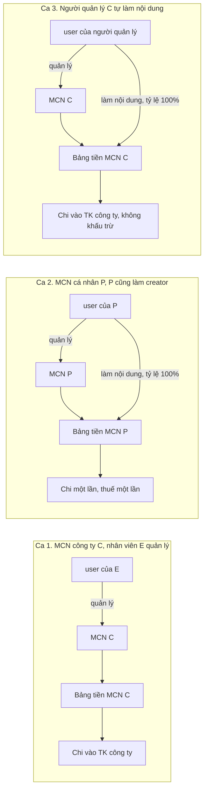
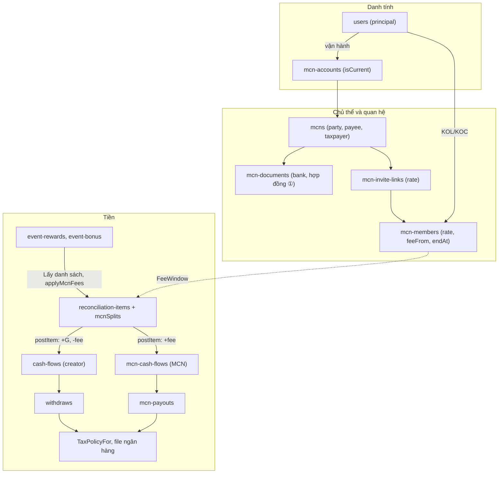
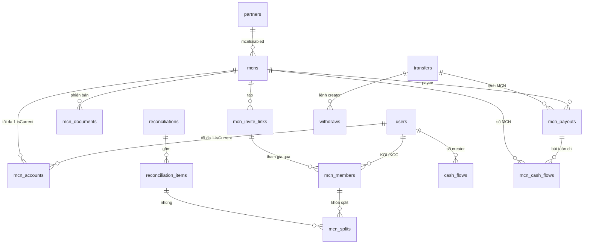
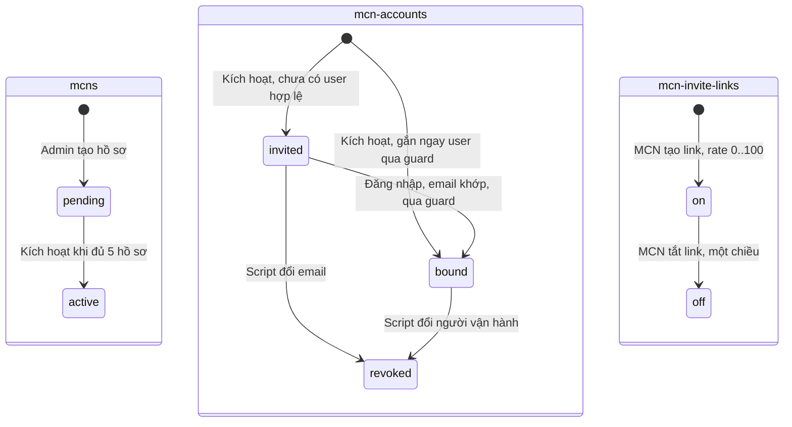
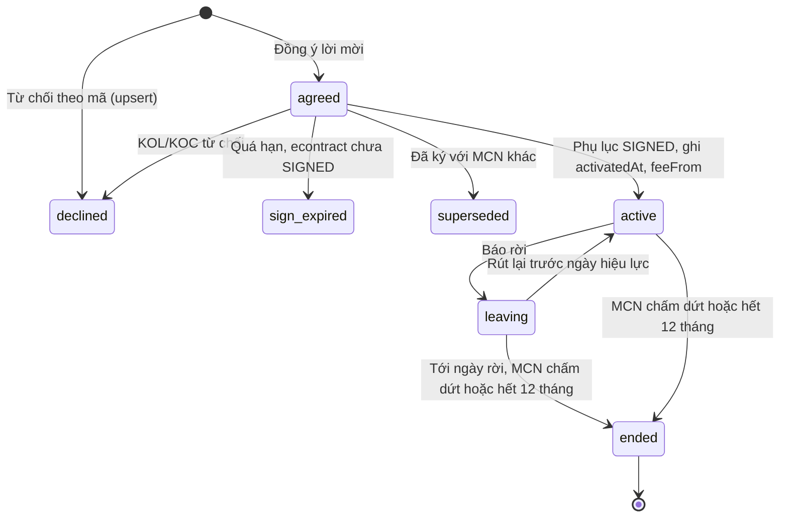
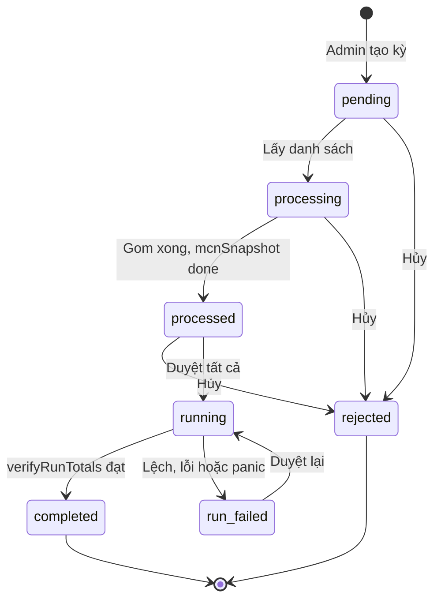
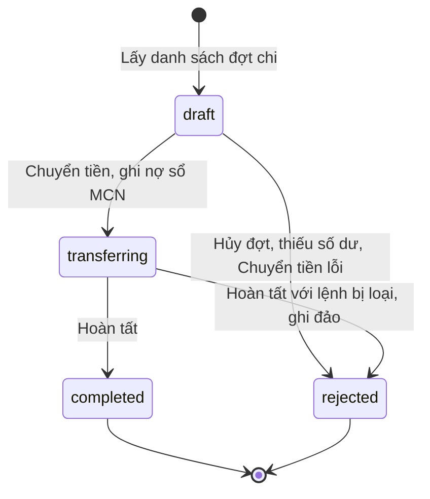
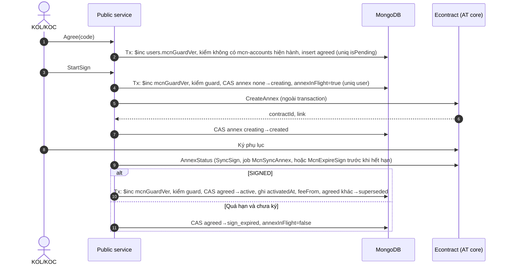
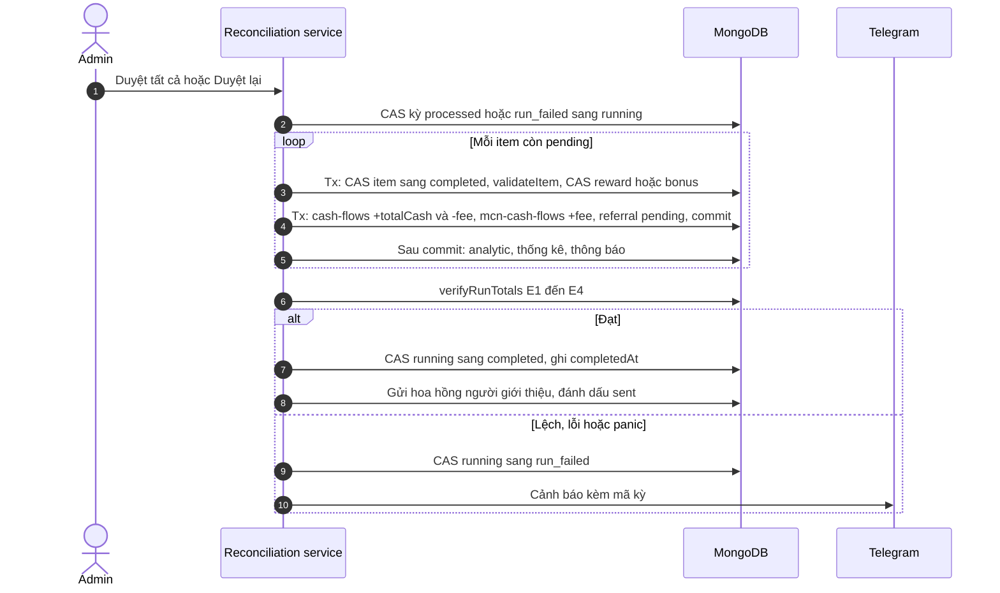
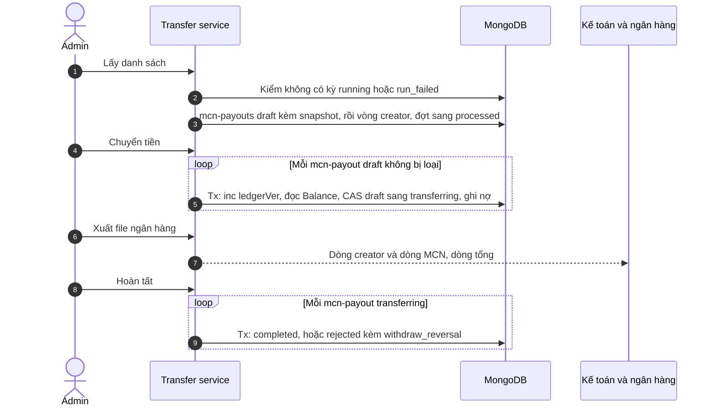

# Technical Specification: MCN trên KOC Ambassador — Phase 1

| Mục | Giá trị |
|---|---|
| Project | KOC Ambassador — module MCN (Multi-Channel Network) |
| Date | 2026-11-11 |
| Author | Nguyễn Đăng Định |
| Reviewer | Thành Trung, Vinh Nguyễn |
| Version | 2.1 |
| Status | Draft — chờ review kiến trúc. v2.1 cập nhật theo họp 10/11 (§16) |
| PRD | [prd-mcn-phase1-2026-11-04.md](./prd-mcn-phase1-2026-11-04.md) (v1.1 ở PR #41, nhánh [`docs/mcn-phase1-prd-decisions-261109`](https://github.com/viewboost/accesstrade-docs/blob/docs/mcn-phase1-prd-decisions-261109/mcn/prd-mcn-phase1-2026-11-04.md)). Bản trên `main` là v1.0, chưa có D17–D24, Q8–Q13; cần merge PR #41 trước hoặc cùng PR này |
| Repo | `ambassador/`: `backend/` (Go, module `viewboost`, MongoDB replica set), `frontend/` (Umi 3 + dva), `admin/` (Umi + antd) |
| Nhánh code | `feat/mcn-phase1` (head `b40af650b`) |

Đường dẫn code tính từ gốc repo `ambassador/`, số dòng đọc ngày 2026-11-10 trên `feat/mcn-phase1`. Mã D-n, Q-n, FR-n, SD-n, BA-n giải thích ở §0.1.

## Tóm tắt cho người review

### Vấn đề

Hiện tại một user vừa là người đăng nhập, vừa có số dư, vừa nhận tiền, vừa chịu thuế. Làm MCN theo cách đó (v1.0) thì phí MCN cộng vào số dư của user quản lý MCN. Người đứng MCN mà cũng làm creator thì phí MCN và tiền làm nội dung lẫn vào nhau, không biết khoản nào của ai, thuế tính theo ai.

### Cách làm

1. MCN là một bản ghi riêng (`mcns`), không phải user. User chỉ được gắn quyền quản lý MCN.
2. Tiền của MCN ghi ở bảng riêng `mcn-cash-flows`, chi bằng lệnh riêng `mcn-payouts`. Tiền creator vẫn ở `cash-flows` như cũ.
3. Người đứng MCN làm creator thì tham gia chính MCN của mình với tỷ lệ 100%. Mọi thu nhập của họ về MCN, chi một lần, tính thuế một lần.
4. Phí chỉ tính cho chiến dịch bắt đầu từ 01/12/2026, theo ngày phát sinh của từng khoản thưởng, trong thời gian KOL/KOC là thành viên.
5. Duyệt đối soát ghi tiền trong transaction: chạy lại không cộng trùng, lỗi giữa chừng thì báo để Duyệt lại.
6. Lệnh chi MCN tách theo chiến dịch. Thuế MCN cá nhân tính trên tổng tiền MCN nhận trong đợt. MCN công ty không khấu trừ.

Ví dụ: K thuộc MCN A, tỷ lệ 15%, có thưởng 3.000.000. K nhận 2.550.000, A nhận 450.000.

### So với các bản trước

So với v1.0 (04/11):
- Phí không cộng vào số dư user quản lý MCN; MCN có bảng tiền và lệnh chi riêng.
- Số dư KOL/KOC ghi hai dòng (thưởng, trừ phí) thay vì một dòng đã trừ.
- Duyệt và Chuyển tiền của creator chạy trong transaction, bật theo cờ partner `LedgerV2`. Số tiền và thuế của creator không đổi (§11.1).

So với v2.0 (10/11), theo họp 10/11:
- Người đứng MCN làm creator: dùng tỷ lệ 100% thay vì hai lệnh chi riêng (ADR-12).
- Thêm mốc chiến dịch (ADR-13) và lệnh chi MCN theo chiến dịch (ADR-14).
- Không làm luồng đổi MCN giữa chiến dịch, để phase 2 (NG-9).

### Còn chờ chốt

- OQ-01 (Kế toán): thuế MCN cá nhân có khấu trừ 10% như KOL/KOC không.
- OQ-13 (PO, Kế toán): chi theo chiến dịch chỉ cho MCN, hay cho cả creator.
- OQ-14 (PO): KOL/KOC rời MCN giữa chiến dịch thì tính phí thế nào.
- OQ-15 (PO, Legal): người đứng MCN có bắt buộc ký tỷ lệ 100% không.
- OQ-04 (AT): AT chi theo file xuất hay theo econtract.

## Trả lời các câu hỏi của tech lead

1. Tài khoản MCN khác tài khoản creator thế nào?
   MCN là bản ghi `mcns`. Tài khoản đăng nhập chỉ có quyền quản lý MCN, qua bảng `mcn-accounts`. Đổi người quản lý thì tiền của MCN không đổi chủ. Chi tiết: ADR-01, ADR-03.

2. Số dư MCN và số dư creator tách thế nào?
   Hai bảng riêng: creator ở `cash-flows`, MCN ở `mcn-cash-flows`. Ví dụ K có thưởng 3.000.000, MCN 15%: bảng của K ghi `+3.000.000` và `−450.000`; bảng của MCN ghi `+450.000`. Chi tiết: ADR-02, ADR-05.

3. Thuế của MCN khi người đứng MCN cũng làm creator?
   Tài khoản của họ tham gia MCN với tỷ lệ 100%, nên mọi thu nhập về MCN và chỉ tính thuế một lần.
   - MCN cá nhân P: phí 3.000.000 + nội dung 2.500.000 = 5.500.000, khấu trừ 10% là 550.000.
   - MCN công ty C: phí 8.000.000 + nội dung 6.000.000 = 14.000.000, không khấu trừ.

   Chi tiết: ADR-12, ADR-09, §7.3.

4. Database thay đổi gì?
   Thêm 2 bảng: `mcn-cash-flows` (dòng tiền MCN) và `mcn-payouts` (lệnh chi MCN). Thêm một số trường vào bảng có sẵn. Không thêm loại tài khoản vào `users`. Chi tiết: §6.

5. MCN là đối tượng gì?
   Công ty hoặc cá nhân ký hợp đồng với AccessTrade, định danh bằng MST hoặc CCCD. MCN sở hữu số dư, nhận tiền và chịu thuế. Công ty: không khấu trừ. Cá nhân: khấu trừ 10% (chờ Kế toán chốt). Chi tiết: §0, ADR-02.

6. Chi theo chiến dịch thế nào?
   Mỗi dòng tiền của MCN ghi kèm chiến dịch, mỗi chiến dịch một lệnh chi. Ví dụ MCN A có 3.000.000 từ chiến dịch E1 và 2.500.000 từ E2: hai lệnh, thuế tính trên tổng 5.500.000. Chi tiết: ADR-14.

7. Chỗ nào dễ nhầm creator với MCN?
   Mỗi màn hình chỉ đọc một bảng: trang Số dư của creator đọc `cash-flows`, trang Quản lý MCN đọc `mcn-cash-flows`. Chi tiết: §8.3.

Ba trường hợp thường gặp:



Ca 2 và ca 3: tiền làm nội dung chuyển hết sang MCN, số dư creator của người đó về 0, nên không có lệnh chi creator riêng.

Trình bày 15 phút:

1. Bài toán và bảng §2.7 (2 phút).
2. MCN tách khỏi user, hai bảng tiền, sơ đồ trên (5 phút).
3. Một kỳ đối soát và một đợt chi với ví dụ 3.000.000đ, §7.1–7.2 (4 phút).
4. Thuế và tài khoản nhà 100%, §7.3, ADR-12 (2 phút).
5. Chiến dịch: mốc áp dụng và lệnh chi theo chiến dịch, ADR-13, ADR-14 (2 phút).
6. Câu hỏi cần chốt, §15.2 (2 phút).

## 0. Thuật ngữ

| Thuật ngữ | Định nghĩa | Ví dụ / không nhầm với |
|---|---|---|
| MCN (chủ thể, party) | Công ty hoặc cá nhân ký Hợp đồng khung ① với AccessTrade. Bản ghi `mcns`, định danh bằng MST hoặc CCCD | Không phải user. Đổi người đăng nhập không đổi MCN |
| Tài khoản vận hành MCN | User có dòng `mcn-accounts` hiện hành (`isCurrent`). Chỉ mang quyền thao tác | Không sở hữu số dư MCN. "Tài khoản MCN" trong PRD và bản mẫu BA là khái niệm này |
| Creator, KOL/KOC | User tạo nội dung, có thu nhập ghi vào `cash-flows` | Tài khoản vận hành cũng có thể là creator (ADR-03) |
| Tài khoản nhà MCN (house account) | User làm nội dung cho chính MCN, tham gia MCN đó với tỷ lệ 100%; dòng quan hệ có `house = true`. Gồm tài khoản vận hành và tài khoản cùng CCCD với MCN cá nhân | Không phải loại tài khoản mới; vẫn là `users` + `mcn-members` (ADR-12) |
| Chiến dịch (campaign) | Bản ghi `events`. "Campaign" trong biên bản họp 10/11 là chiến dịch, không phải ADV (chốt 11/11) | Khác partner (ADV) |
| Mốc áp dụng | `MCN_FEE_EVENT_START_FROM`: chỉ chiến dịch có `events.startAt` từ mốc này mới bị trích phí MCN (ADR-13) | Không phải ngày ký phụ lục |
| Ngữ cảnh (context) | Phạm vi dữ liệu của một vai: creator hoặc MCN. Một principal có thể có cả hai | Không gộp số của hai ngữ cảnh trên một màn hình |
| Dòng quan hệ | Một bản ghi `mcn-members`, mọi trạng thái (`agreed`, `active`, `leaving`, `ended`, `declined`, `sign_expired`, `superseded`) | Không đồng nghĩa với thành viên |
| Thành viên | Dòng quan hệ có `isMember = true` (`active`, `leaving`) | `agreed` (Chờ ký) chưa là thành viên (D18) |
| Split | Phần phí của một dòng quan hệ trên một khoản đối soát | Một khoản có thể có hai split nếu KOL/KOC đổi MCN trong khoảng ngày của khoản |
| Cửa sổ phí (fee window) | Khoảng ngày `[feeFrom, effTo)` giờ Asia/Ho_Chi_Minh của một dòng quan hệ, tính bằng `FeeWindow(m)` (§7.1) | Ranh giới ngày, không phải thời điểm `startAt/endAt` |
| Ngày phát sinh (incurred date) | Thưởng view: ngày có view (`event-rewards.date`); thưởng mốc: ngày đạt mốc (`date`); Thưởng thêm: ngày Admin tạo (`event-bonus.createdAt`) | Không dùng `event-rewards.createdAt` (crawler ghi trễ) hay thời điểm Lấy danh sách |
| G (gross) | Tổng hoa hồng của một khoản, `reconciliation-items.totalCash` | Trước phí quản lý |
| Người nhận tiền (payee) | Bên được chuyển tiền trên lệnh chi: user (creator) hoặc MCN (`mcns`) | Không suy ra từ người đăng nhập |
| Người chịu thuế (taxpayer) | Bên được ghi nhận khoản khấu trừ thuế, khóa `taxpayerKey` = `cccd:<số>`, `mst:<số>` hoặc `user:<id>` | Hai payee có thể cùng một taxpayer (ca 2) |
| Sổ (bảng dòng tiền), bút toán (dòng tiền), số dư | Sổ là bảng dòng tiền: `cash-flows` của creator, `mcn-cash-flows` của MCN. Mỗi dòng là một khoản cộng (+) hoặc trừ (−). Số dư = tổng `value` theo user (creator) hoặc theo MCN. "Sổ MCN" trong tài liệu là `mcn-cash-flows` | `statistic.cashRemaining` chỉ là cache hiển thị |
| Đợt chi (payout batch), lệnh chi; Min, Max | `transfers`; lệnh creator `withdraws`, lệnh MCN `mcn-payouts`. Min = `minValueCashRemaining` (số dư tối thiểu để có lệnh), Max = `maxCashWithdraw` (trần số chi) | `backend/internal/model/mg/transfer.go:44-45` |
| Thuế khấu trừ tại nguồn (withholding) | TNCN AccessTrade khấu trừ lúc chi (D10) | Không tính ở đối soát |
| Snapshot | Giá trị chép tại một thời điểm, không cập nhật về sau | `rate` lúc đồng ý; `mcnSplits` lúc Lấy danh sách; `bank`, `payee`, `tax` lúc tạo lệnh |
| Idempotency key (`idemKey`) | Khóa duy nhất của một bút toán. Ghi lại cùng khóa không tạo bản ghi thứ hai | `rc:<itemId>:fee:<relId>` |
| Hợp đồng ①, ②, phụ lục | ① khung AT–MCN; ② `B2C_AMBASSADOR` AT–KOL/KOC; phụ lục chỉ định thanh toán gắn với ② | Căn cứ chi cho MCN là ①, không phải ② |

Thao tác trên UI và bước chuyển trạng thái:

| Màn hình | Thao tác: bước chuyển |
|---|---|
| Admin › Đối soát | Lấy danh sách: `pending → processing → processed`. Duyệt tất cả, Duyệt lại: `processed` hoặc `run_failed` `→ running → completed` hoặc `run_failed`. Hủy: `pending`, `processing`, `processed → rejected` |
| Admin › Xử lý rút tiền | Lấy danh sách: `new → processing → processed`. Chuyển tiền: `processed → transferring → transferred`. Hoàn tất: `transferred → finished` |

### 0.1 Tài liệu và mã tham chiếu

| Mã | Nguồn |
|---|---|
| D1–D24, Q1–Q13, FR-001–FR-022, A1–A5 | PRD v1.1 (PR #41) |
| SD-01–SD-08 | [08-Sequence.md](./08-Sequence.md) v3.0, 22/10/2026. Mô hình cũ: MCN là `account_type`, có bảng kê, xác nhận đối soát |
| BA-01…BA-05 | Bản mẫu BA (artifact `BVwnmqnqNZhjnX6pbXDikV`): 01 Tạo và kích hoạt, 02 Mời và thành viên, 03 Phí quản lý, 04 Đối soát và chi trả, 05 Ai thấy gì |
| BA Cần chốt, BA Đã chốt | Mục cuối bản mẫu BA |
| v1.0 | Tech spec này, bản 04/11 của Vinh Nguyễn, commit [`00aa629`](https://github.com/viewboost/accesstrade-docs/blob/00aa629bef56ed3d89c29b51615641fd3a31200c/mcn/techspec-mcn-phase1-2026-11-04.md). Mục v1.0 §n trong tài liệu này trỏ tới bản đó |
| Họp 03/11 | [meeting-261103.md](./meeting-261103.md) |
| Họp 10/11 | Biên bản họp sáng 10/11/2026 (chưa đưa lên repo): phạm vi phase 1, mốc áp dụng, cấu trúc hợp đồng trên FPT e-contract, MCN kiêm creator, tài khoản nhà 100%, chi theo chiến dịch. Mã `[seg-…]` trỏ tới đoạn trong biên bản |

## 1. Bối cảnh và phạm vi

### 1.1 Bài toán kiến trúc

PRD và bản mẫu BA mô tả hành vi (mời, ký, trích phí, chi), không mô tả chủ sở hữu tiền và chủ thể thuế. Thiết kế dữ liệu phải trả lời bốn câu hỏi trước phase 5–6:

1. Số dư phí quản lý thuộc MCN hay thuộc user đăng nhập?
2. Người vừa vận hành MCN vừa là creator thì số dư, lệnh chi, thuế tách thế nào?
3. Đổi người vận hành, khóa user, chạy lại kỳ đối soát có làm mất hoặc cộng trùng tiền không?
4. Thành viên đổi MCN giữa kỳ, hoặc có khoản phát sinh trước ngày ký, thì phí tính trên phần nào?

### 1.2 Mục tiêu

- G-1. Tách principal, party, payee, taxpayer. MCN có số dư, lệnh chi và chính sách thuế riêng, độc lập với user vận hành.
- G-2. Bảo toàn tiền theo từng khoản: phần KOL/KOC bị trừ đúng bằng phần MCN được cộng, kiểm được bằng truy vấn (NFR-002).
- G-3. Idempotent: chạy lại Duyệt, Lấy danh sách đợt chi, job đồng bộ không cộng trùng và không mất bút toán.
- G-4. Phí của một kỳ chỉ phụ thuộc dữ liệu phụ lục và dữ liệu thưởng tại lúc Lấy danh sách; không phụ thuộc thời điểm job chạy.
- G-5. Thuế xác định bởi loại payee và loại thu nhập; thông số thuế là cấu hình, snapshot lên lệnh chi.
- G-6. Partner không có MCN và creator không thuộc MCN có kết quả tiền và thuế như trước (NFR-001).
- G-7. MCN chỉ đọc được dữ liệu của mình (chống IDOR); giữ Q10, Q13.
- G-8. Truy vết được mọi đồng phí từ khoản thưởng tới dòng file ngân hàng.

### 1.3 Phi mục tiêu (phase 1)

- NG-1. Tạm dừng, Chấm dứt MCN; đổi tỷ lệ giữa chừng; gia hạn phụ lục (D4, D12).
- NG-2. KOL/KOC xác nhận hoặc báo sai đối soát; Admin thao tác thay MCN (D6, D7).
- NG-3. MCN tự rút tiền; bảng kê, hóa đơn GTGT, chứng từ khấu trừ trong hệ thống (D13).
- NG-4. UI điều chỉnh bút toán; clawback tự động.
- NG-5. Maker-checker khi đổi tài khoản ngân hàng MCN.
- NG-6. Gộp ngưỡng thuế theo CCCD giữa lệnh MCN và lệnh creator; lũy kế ngưỡng theo tháng hoặc năm. Phase 1 chỉ gộp các lệnh của cùng một MCN trong đợt (ADR-09).
- NG-7. Viết lại đường tiền creator ngoài các điểm liệt kê ở §11.1. Các điểm đó bật theo cờ partner.
- NG-8. MCN cho partner khác Ambassador (Q6).
- NG-9. Luồng riêng cho KOL/KOC rời, vào lại hoặc đổi MCN khi chiến dịch đang chạy; đổi MCN theo yêu cầu từng tháng (họp 10/11 [seg-007, seg-039-047], để P2). Phase 1 không chặn và không có UX riêng; nếu xảy ra, `FeeWindow` chia phí theo ngày (§7.1).
- NG-10. Chi theo chiến dịch cho lệnh creator (OQ-13). Phase 1 chỉ tách lệnh MCN.
- NG-11. Rà soát pháp lý, thuế cho MCN kiêm creator ngoài quy tắc 100% (họp 10/11 [seg-081-089], để P2).

### 1.4 Ràng buộc

- MongoDB replica set, driver `go.mongodb.org/mongo-driver v1.11.3` (`backend/go.mod:39`). Wrapper `TransactionDatabase().WithTransaction` (`backend/internal/module/database/mongodb/transaction.go:28-72`) gọi `StartTransaction`/`CommitTransaction` thủ công, không retry theo label `TransientTransactionError` hay `UnknownTransactionCommitResult`; khi commit lỗi, `AbortTransaction` trả `ErrAbortAfterCommit` và che lỗi gốc. Code MCN và sổ cái phải dùng hàm mới `RunInTransaction` bọc `session.WithTransaction` của driver (§14.1 #1). Callback của hàm này có thể chạy lại, nên chỉ được chứa thao tác DB.
- Phiên bản server prod chưa xác nhận, nên partial index chỉ dùng điều kiện bằng, `$exists:true` và `$and` mức trên cùng.
- Tiền trong code cũ là `float64` (`backend/internal/model/mg/event_reward.go:22`, `backend/internal/model/mg/reconciliation_item.go:20`, `backend/internal/model/mg/withdraw.go:26-30`). Phần mới dùng `int64` VND.
- Econtract không có webhook; trạng thái phụ lục lấy bằng polling. Repo đã có khuôn webhook AT core ký HMAC-SHA256 (`backend/pkg/public/router/routeauth/auth.go:95-130`, dùng ở `backend/pkg/public/router/creator_profile.go:20`), có thể dùng nếu AT core gửi sự kiện SIGNED (OQ-05).
- Repo không có hạ tầng metrics. Cảnh báo qua Telegram (`backend/internal/config/env.go:44-50`).

## 2. Hiện trạng hệ thống (đã kiểm chứng)

### 2.1 Danh tính

| Thành phần | Vị trí | Hành vi |
|---|---|---|
| `users` | `backend/internal/model/mg/user.go:19-58` | Không có trường loại chủ thể. `contract` (:44) giữ MST, CCCD tự khai; `accesstrade` (:51) là SSO id; `is_ekyc` (:54). Không có index nào, email không unique ở DB |
| Gắn tài khoản MCN | `backend/internal/service/mcn.go:152-204` | Theo `google.email` hoặc `info.email` đã xác thực. `VerifiedUserByEmail` (:96-109) chọn user cũ nhất khi trùng email. Không transaction |
| Q12 trong code | `backend/pkg/admin/service/mcn_validate.go:71-81`; `backend/pkg/admin/service/mcn_activate.go:59-69` | Cho dùng chung email creator; chỉ chặn user đang `isMember`; kích hoạt gắn luôn user có sẵn |
| `EnsureUserPartner` | `backend/internal/service/mcn.go:116-124`, gọi ở `backend/pkg/admin/service/mcn_activate.go:90` | Upsert `user-partners{isJoined:true}` cho user vận hành, nên user đó được đếm là creator (`backend/pkg/admin/service/partner.go:60`, `backend/pkg/admin/service/staff_statistic.go:84, 105`) |
| Middleware, lịch sử đăng nhập | `backend/pkg/public/router/routeauth/mcn.go:15-29`; `backend/pkg/public/service/user.go:1827` | `mcnID` lấy từ tài khoản, không nhận từ client; không kiểm `banned`; cache 5 phút (`backend/internal/service/mcn.go:58-73`). Lịch sử đăng nhập ghi cứng role `creator` |

### 2.2 Sổ dòng tiền và số dư

| Thành phần | Vị trí | Hành vi |
|---|---|---|
| `CashFlowRaw` | `backend/internal/model/mg/cash_flow.go:14-29` | Trường chính không có `omitempty`; `user` kiểu giá trị; `value float64`; không có idempotency key |
| `AddCashFlow` | `backend/internal/service/cashflow.go:58-84` | `oldBalance` đọc không khóa (:60-61); bỏ qua lỗi `InsertOne` (:79); gọi `UpdateStatistic` sau mỗi dòng (:81); luôn trả `nil` (:83) |
| Index `cash-flows` | `backend/internal/module/database/mongodb/index.go:222-229` | Không có unique index |
| Cache `statistic` | `backend/internal/service/user.go:141-280` | `UpdateStatistic` chạy 6 goroutine dùng chung `ctx`; `cashRemaining` = Σ sổ (:160); `CashTotal = Pending + Rejected + Completed` (:270, :482); `$set` đè cả object (:271-279) |
| `ActionMustTaxReward` | `backend/internal/constants/cash_flow.go:16-20` | Chỉ dùng cho thống kê và job thuế tháng đã tắt (`backend/pkg/public/router/schedule.go:28` bị comment). Không tham gia khấu trừ |
| UI số dư, lịch sử | `frontend/src/pages/bank/components/cashflow-section.tsx:34`; `frontend/src/pages/bank/components/withdraw-history/index.tsx:11, 28-31` | Số dư đọc `user.statistic.cashRemaining`. Tiêu đề lịch sử theo action (`backend/pkg/public/service/user.go:1070`, `backend/internal/locale/cash_flow.go:46-61`); cột `newBalance` đang bị comment |

### 2.3 Đối soát

| Thành phần | Vị trí | Hành vi |
|---|---|---|
| Gom thưởng | `backend/pkg/admin/service/reconciliation.go:421-437` | Điều kiện chỉ có `date < toAt` và `events`, không có `fromAt` |
| Item content | `backend/internal/module/database/mongodb/aggregate_pipeline/event_reward.go:34-62`; `backend/pkg/admin/service/reconciliation_processing.go:218` | Gộp theo (user, content, schema), không lọc `status`; `TotalCash` lấy `totalCashPending`. Nhóm có thể chứa reward đã completed ở kỳ trước |
| Lấy danh sách | `backend/pkg/admin/service/reconciliation_processing.go:21-66` | Ba goroutine không trả lỗi; `wg.Wait()` (:49); CAS `processing → processed` (:54-60) |
| Chuyển trạng thái | `backend/pkg/admin/service/reconciliation.go:365-373, 387, 475-493` | Đếm kỳ `running` trên mọi partner rồi mới CAS, không atomic. `run_failed` là nguồn hợp lệ của `running` và của `rejected`; không code nào ghi ra `run_failed`; admin không có nhãn cho trạng thái này |
| Duyệt | `backend/pkg/admin/service/reconciliation_running.go:83-115` | Pool 50 worker theo user; `wg.Wait()` (:103); `Sleep 15s` (:105); đặt `completed` vô điều kiện (:108-115) |
| Ghi tiền | `backend/pkg/admin/service/reconciliation_running.go:514-542, 582-638` | Thưởng thêm đã CAS `approved → completed` trước khi chi (:514-542). Cash-flow (:582-591) và reward (:593-601) ghi trong goroutine; content-analytic ghi đồng bộ và `return` sớm khi lỗi (:603-609), trước BulkWrite item (:611-620) |
| Hoa hồng người giới thiệu | `backend/pkg/admin/service/reconciliation_running.go:120, 144-239` | Gửi một lần sau khi đặt `completed`, tính trên mọi item pending lúc bắt đầu, kể cả item sau đó bị rejected; id = `user_referrer_type_firstItem_lastItem` |

Ba trạng thái ghi dở (partial write) của đường ghi tiền hiện tại, đều không có cảnh báo:

| # | Lỗi ở bước | Trạng thái để lại | Lần Duyệt sau |
|---|---|---|---|
| a | Insert cash-flow (bị bỏ qua) | Item và reward completed, thiếu dòng ghi có | Không xét lại; KOL/KOC mất tiền |
| b | Content-analytic, `return` sớm | Đã ghi có, reward completed, item pending | Reward không còn pending nên mismatch, item rejected dù tiền đã ghi |
| c | BulkWrite reward | Đã ghi có, item completed, reward pending | Kỳ sau gom lại reward (không có `fromAt`), cộng trùng (double credit) |

### 2.4 Đợt chi và thuế

| Thành phần | Vị trí | Hành vi |
|---|---|---|
| Trạng thái đợt | `backend/pkg/admin/service/transfer.go:376-389` | `new → processing → processed → transferring → transferred → finished`; `rejected` từ new, processed |
| Một đợt mở mỗi partner | `backend/pkg/admin/service/transfer.go:406-417` | `CountByCondition` rồi mới insert. Collection `transfers` không có index nào |
| Lấy danh sách | `backend/pkg/admin/service/transfer_processing.go:19-116` | User `banned:false` (:22-26); `return` sớm khi không có user (:41-44); cần SSO, `B2C_AMBASSADOR` SIGNED; Max loại user có số dư dưới Max (:96-104) |
| Tạo lệnh, khấu trừ | `backend/pkg/admin/service/transfer_processing.go:118-153`; `backend/internal/service/withdraw.go:136-139` | Số dư đọc từ sổ (:131), cắt theo Max (:136-138). `Cash ≥ 5.000.000` thì `CashTax = round(10% × Cash)`, theo từng lệnh |
| Chuyển tiền | `backend/pkg/admin/service/transfer_transferring.go:46-105` | Ghi `withdraw`, `tax`, `withdraw_fee` âm bằng `AddCashFlow`; nhánh lỗi (:83-96) không bao giờ chạy vì hàm luôn trả `nil`. Insert lỗi thì lệnh vẫn được chi mà sổ không bị trừ |
| Loại lệnh | `backend/pkg/admin/service/transfer.go:541-576` | Nhận lệnh ở `transferring` (:569); không kiểm lệnh thuộc đúng đợt |
| Hoàn tất | `backend/pkg/admin/service/transfer_finish.go:35-122` | Lệnh bị loại sau Chuyển tiền: đảo bút toán, giữ action, giá trị dương (:64-107). Đóng dấu `transferId` FIFO theo (user, partner) (:154-167) |
| File ngân hàng | `backend/pkg/admin/service/export_transfer.go:68-82, 93-120, 181-187` | 13 cột; không lọc trạng thái, chỉ loại lệnh trong `Declined`; MST, CCCD lấy từ `users.contract` |

### 2.5 Hợp đồng điện tử và phần MCN đã code

| Thành phần | Vị trí | Hành vi |
|---|---|---|
| eKYC, hợp đồng ② | `backend/pkg/public/handler/user.go:869-943`; service `backend/pkg/public/service/user.go:2554-2582`; route `backend/pkg/public/router/user.go:62-64` | Lưu eKYC (:869-887) đặt `is_ekyc` cho user tìm theo SSO id lấy từ body; Ký ② (:889-907) nhận `user_id` SSO từ body (`backend/internal/module/core/model.go:11-15`); Tra ② (:909-943) nhận `sso_ids` từ query. Là IDOR nếu econtract không ràng buộc token với SSO id (AT core xác nhận) |
| Kích hoạt thành viên | `backend/pkg/public/service/mcn_annex.go:234-264` | `signedAt` là giờ đồng bộ; filter `signDeadline > signedAt` (:242); chuyển mọi dòng `agreed` khác sang `superseded` (:256-257) |
| Kết thúc quan hệ | `backend/pkg/public/service/mcn_leave.go:114-148`; `backend/pkg/public/schedule/schedule.go:61`; `backend/pkg/public/service/mcn_member.go:159-175` | KOL/KOC rời và hết 12 tháng chỉ chuyển `ended` qua job 15 phút; MCN chấm dứt ghi `ended` ngay. Job tắt được bằng `MCN_JOB_ENABLED` (`backend/pkg/public/service/mcn_job.go:27-29`); khóa `SETNX` + `DEL` không kiểm token (:31-37) |

Các chênh lệch khác của code MCN trên nhánh (StartSign, Agree, hết hạn ký, sửa hồ sơ) liệt kê ở §14.1 kèm file:dòng.

### 2.6 Giả định ngầm của hệ thống hiện tại

(1) Một user là một payee: danh tính chi trả đi qua SSO và hợp đồng ② của một cá nhân. (2) Người làm ra tiền là người nhận tiền: `runCashBack` ghi có toàn bộ `TotalCash` cho `item.User`. (3) Một (user, partner) là một quỹ: số dư cộng mọi action, lệnh chi rút toàn bộ. (4) Người nộp thuế là cá nhân cư trú, 10% trên số chi từng lệnh; không có loại người nộp thuế, loại thu nhập, MST tổ chức. (5) Điều kiện chi (`banned`, SSO, ②, Min) áp ở mức user; MST, CCCD trên file chi lấy từ `users.contract`. (6) Ghi sổ không cần idempotency vì mỗi kỳ chỉ chạy một lần.

### 2.7 Vì sao không thể cộng phí MCN vào số dư user

v1.0 cộng `mcn_fee` vào `cash-flows` của user vận hành (v1.0 §8.2) và chi bằng `IsPayableMcnUser` + `TaxExempt=true` (v1.0 §9). Kết hợp với PRD Q12 (dùng chung tài khoản creator):

| # | Tình huống | Theo v1.0 | Theo v2.1 | Sai lệch của v1.0 |
|---|---|---|---|---|
| 1 | MCN cá nhân P dùng chung tài khoản creator. Trong đợt: thu nhập creator 2.500.000, phí 3.000.000 | Một lệnh 5.500.000, `TaxExempt` nên thuế 0 | uP là tài khoản nhà 100% của P: cả 5.500.000 vào sổ P, lệnh MCN theo chiến dịch, khấu trừ 550.000 trên `groupBase` (ADR-12, ADR-09) | Miễn khấu trừ cả phí MCN cá nhân lẫn thu nhập creator, trái BA-04 và FR-019 (MCN cá nhân khấu trừ như KOL/KOC). Chứng từ không tách được loại thu nhập |
| 2 | MCN công ty C, tài khoản vận hành uC có thu nhập nội dung 6.000.000, phí 3.000.000 | Một lệnh 9.000.000, thuế 0, chi vào TK công ty | uC là tài khoản nhà 100% của C: lệnh MCN 9.000.000, thuế 0, TK công ty. Căn cứ là phụ lục 100%, không phải cờ trên tài khoản (ADR-12) | Thuế của thu nhập nội dung là hệ quả của cờ trên tài khoản, không phải quyết định nghiệp vụ. PRD Q8 đề xuất miễn; nếu Legal chốt khác, v1.0 không biểu diễn được |
| 3 | Đổi người vận hành U1 → U2 sau kỳ K, rồi chạy lại K | 3.000.000 nằm ở U1. Khóa delta `{user, mcn_fee, reconciliation}` của U2 bằng 0 nên cộng thêm 3.000.000 cho U2 | Số dư thuộc `mcns`; khóa theo (item, dòng quan hệ) | Cộng trùng (double credit) 3.000.000 |
| 4 | uC bị `banned` vì vi phạm với tư cách creator | Đợt chi lọc `banned:false` (`backend/pkg/admin/service/transfer_processing.go:22-26`): phí của C không được chi | Điều kiện chi MCN dựa trên ① và TK ngân hàng | Giữ tiền của pháp nhân vì lỗi của cá nhân |
| 5 | Thống kê creator của uC | `cashRemaining` tăng 3.000.000, `CashTotal` không đổi (`backend/internal/service/user.go:160, 270`) | Thống kê creator không chứa phí | Màn số dư creator lệch; lịch sử lẫn phí MCN |

Kết luận: số dư phí quản lý phải thuộc một chủ thể khác user. Lỗi không nằm ở một hàm mà ở khóa của sổ, lệnh chi và thuế.

## 3. Bất biến (invariant)

| ID | Bất biến | Cơ chế bảo đảm | Kiểm chứng |
|---|---|---|---|
| INV-01 | Một KOL/KOC có tối đa một dòng quan hệ `isMember` | Partial unique `user` `{isMember:true}` (`backend/internal/module/database/mongodb/index.go:469`) | Test đồng thời (đã có) |
| INV-02 | Mỗi (user, MCN) tối đa một dòng `agreed` | Partial unique `(user, mcn)` `{isPending:true}` | Test Agree đồng thời |
| INV-03 | User có `mcn-accounts` hiện hành chỉ có dòng quan hệ `agreed`, `active`, `leaving` với chính MCN đó, `rate = 100`, `house = true`; và ngược lại, user đang có dòng như vậy với MCN khác thì không được gắn làm tài khoản vận hành | `RunInTransaction` + `$inc users.mcnGuardVer` ở mọi bước chuyển vai (ADR-04) | Test bind giữa lúc Chờ ký MCN khác rồi ký; test tài khoản vận hành nhận link 15% của chính MCN |
| INV-04 | Mỗi MCN tối đa một tài khoản hiện hành; mỗi user vận hành tối đa một MCN | Partial unique `mcn` và `user` `{isCurrent:true}` | Test index |
| INV-05 | Mỗi user tối đa một phụ lục đang mở ký | Partial unique `user` `{annexInFlight:true}` trên `mcn-members` | Test StartSign hai MCN đồng thời |
| INV-06 | `rate ∈ [0,100]`, không đổi; `feeFrom` ghi một lần; cận trên cửa sổ là hàm `FeeWindow(m)` của các mốc đã lưu, không đọc trạng thái do job ghi | Không có API sửa; filter `{feeFrom:{$exists:false}}` | Test Lấy danh sách khi job chưa chạy |
| INV-07 | Cửa sổ phí của một user không chồng nhau | Suy ra từ INV-01 và §7.1 | Unit test |
| INV-08 | Mỗi reward: `0 ≤ fee_r ≤ floor(cash_r)`. Mỗi item: `Σ base_j ≤ totalCash`, `totalCash = netCash + mcnFee` | Công thức §7.1; kiểm trong `applyMcnFees` | Unit test |
| INV-09 | Kỳ chỉ sang `processed` khi `mcnSnapshot.status = done`; `mcnSplits` không đổi sau `processed` | CAS điều kiện; chỉ `applyMcnFees` ghi | Test lỗi snapshot |
| INV-10 | Item `completed` khi và chỉ khi có đủ bút toán `rc:<itemId>:*`; item khác `completed` không có bút toán nào mang khóa đó | `postItem` trong transaction, CAS item đầu tiên; E1–E4 | `verifyRunTotals`, job đối chiếu |
| INV-11 | Bảo toàn theo item: `−Σ cash-flows(mcn_fee) = Σ mcn-cash-flows(mcn_fee) = mcnFee` | Cùng transaction | E2 |
| INV-12 | Mỗi `idemKey` một bút toán trên mỗi sổ; `idemKey` không bao giờ là chuỗi rỗng; mỗi (transfer, mcn, event) một lệnh | `uniq(idemKey)`; `omitempty`; `uniq(transfer, mcn, event)` | Test chạy lại; test mức nguồn |
| INV-13 | `mcn-cash-flows` chỉ ghi thêm (append-only), chỉ qua `McnLedger().Post` | Repository riêng không trả `IDatabase` | Rà mức nguồn trong CI |
| INV-14 | Lệnh MCN chỉ ghi nợ sổ khi `Balance(mcn, event) ≥ cash`, đọc trong cùng transaction có `$inc mcns.ledgerVer` | ADR-08, ADR-14 | Test hai đợt đồng thời |
| INV-15 | Đợt chi của partner bật `LedgerV2` không sang `processing` khi partner có kỳ `running` hoặc `run_failed` | Kiểm ở bước Lấy danh sách đợt chi | Test |
| INV-16 | Kỳ `run_failed` chỉ chuyển sang `running`, không sang `rejected` | `isValidStatus` | Test |
| INV-17 | Snapshot `bank`, `payee`, `tax` của lệnh không đổi sau `draft`; `identityNumber`, `type` của MCN không đổi sau `active` | Không có đường cập nhật | Rà route |
| INV-18 | MCN chỉ đọc dữ liệu của chính mình | `mcnID` từ context; lọc `mcnSplits.mcn`, `mcn` | Test IDOR |
| INV-19 | Dòng quan hệ `house = true` có `rate = 100` | Kiểm ở Agree trong transaction; không có API sửa `rate` | Test Agree link dưới 100% khi là tài khoản nhà |
| INV-20 | Phí chỉ trích trên khoản của chiến dịch có `events.startAt ≥ MCN_FEE_EVENT_START_FROM` | Lọc trong `applyMcnFees`; mốc snapshot lên `reconciliations.mcnSnapshot.eventStartFrom` | Test chiến dịch bắt đầu 30/11 và 01/12 |

## 4. Kiến trúc tổng thể

Hệ thống chia ba lớp. Lớp danh tính (`users`, `mcn-accounts`) chỉ quyết định ai được thao tác. Lớp chủ thể và quan hệ (`mcns`, `mcn-documents`, `mcn-invite-links`, `mcn-members`) quyết định ai thu phí của ai, tỷ lệ bao nhiêu, trong khoảng ngày nào. Lớp tiền (đối soát, hai sổ, hai loại lệnh chi, chính sách thuế, file ngân hàng) chỉ đọc lớp quan hệ qua snapshot.





Tên trong ER dùng gạch dưới; collection thật dùng gạch nối. `mcn_splits` là mảng nhúng trong `reconciliation-items`. `mcn-accounts` giữ cả dòng `revoked`, nên quan hệ là 1-n với tối đa một dòng hiện hành.

## 5. Quyết định kiến trúc (ADR)

### ADR-01. Liên kết danh tính

Bối cảnh
- v1.0 Nguyên tắc 1 đã đúng: không thêm `type`/`role` lên `users`; vai MCN đến từ `mcn-accounts`. Code đã làm theo (`backend/pkg/public/router/routeauth/mcn.go:15-29`).
- Thiếu: không có trạng thái thu hồi; `uniq(user)` không phân biệt dòng hiện hành (`backend/internal/module/database/mongodb/index.go:452-456`); không có `uniq(mcn)`.

| Tiêu chí | A. Bảng quan hệ `mcn-accounts` (v1.0) | B. User riêng cho MCN, `account_type` (SD-01) | C. Role, claim trên `users` |
|---|---|---|---|
| Đổi người vận hành | Thu hồi dòng, mời email mới | Đổi email đăng nhập trên user MCN; lịch sử đăng nhập lẫn hai người | Sửa trường trên user |
| Ảnh hưởng code cũ | Thấp | User MCN xuất hiện trong các vòng quét mọi user (`backend/pkg/admin/service/admin_notification.go:525-535`, `backend/pkg/admin/service/partner.go:60`, `backend/pkg/admin/service/staff_statistic.go:84, 105`) | Mọi chỗ đọc `users` |
| Khớp PRD | Có (D16, Nguyên tắc 2 của PRD) | Không | Không |

Quyết định: A, giữ như v1.0. Bổ sung `isCurrent`, trạng thái `revoked`, `history[]`, `uniq(mcn)` và `uniq(user)` theo `isCurrent`. Phase 1 mỗi MCN một tài khoản hiện hành.

Hệ quả
- (+) Chiếm tài khoản (ATO) người vận hành không đổi được nơi nhận tiền, vì tài khoản ngân hàng do Admin khai.
- (−) Đổi người vận hành cần script có ticket (`cmd/mcn-rebind`), phase 1 chưa có UI.

### ADR-02. Chủ thể sở hữu phí quản lý và sổ cái MCN

Bối cảnh
- Khác biệt thật giữa v1.0 và v2.0 nằm ở quyết định này. v1.0 đã có `mcns`, `mcn-accounts`, `WithdrawRaw.RecipientType/Mcn`, lấy MST từ `mcns` (v1.0 §2, §9). Nhưng số dư phí và lệnh chi treo trên `users._id` của người vận hành: `creditMcnFees` ghi `cash-flows` của `acc.User` (v1.0 §8.2), đợt chi tìm MCN qua `IsPayableMcnUser(user)` (v1.0 §9). Hệ quả ở §2.7.

| Tiêu chí | A. `cash-flows` của user vận hành (v1.0) | B. Tạo một user giả cho mỗi MCN để đứng tên số dư | C. Sổ riêng `mcn-cash-flows` theo `mcns` | D. `cash-flows` thêm owner `mcn`, `user` rỗng |
|---|---|---|---|---|
| Chủ sở hữu đúng pháp lý | Không | Gián tiếp qua user giả | Có | Có |
| Đổi người vận hành | Số dư nằm ở user cũ; cộng trùng khi chạy lại | Không ảnh hưởng | Không ảnh hưởng | Không ảnh hưởng |
| Điều kiện chi, thuế | Lẫn với điều kiện cá nhân (`banned`, SSO, ②) | Phải bỏ qua kiểm SSO, ② cho user giả | Riêng | Phải rẽ nhánh ở mọi chỗ đọc `withdraws` |
| Ảnh hưởng code cũ | `UpdateStatistic`, lịch sử public | User giả xuất hiện trong các vòng quét mọi user | Không | Dòng `user` rỗng rơi vào mọi `$group` theo user |
| Khối lượng | Thấp | Trung bình | Trung bình | Trung bình |

Quyết định: C.
- MCN (`mcns`) sở hữu số dư, là người nhận tiền và người chịu thuế của phí quản lý và thu nhập tài khoản nhà. Thu nhập nội dung ghi có vào `cash-flows` của user làm nội dung; phần của tài khoản nhà chuyển sang sổ MCN bằng split 100% (ADR-12).
- `mcn-cash-flows` chỉ ghi thêm; `value int64` có dấu; `idemKey` unique; số dư `Balance(mcn) = Σ value`, không lưu `oldBalance/newBalance`, không có cache dùng để quyết định chi.
- Ghi và đọc chỉ qua repository `McnLedger()` có hai hàm `Post(sc, entries...)` (trả lỗi thật) và `Balance(sc, mcn)`; repository không trả `IDatabase` ra ngoài (khuôn DAO hiện có cho `UpdateOne`, `DeleteOne`, `Collection()`).
- Mọi đường ghi nợ (lệnh chi, điều chỉnh âm) chạy trong transaction có `$inc mcns.ledgerVer` để tuần tự hóa theo MCN. Ghi có (phí ở Duyệt) không cần, vì không làm giảm số dư.

Hệ quả
- (+) Không kế thừa lỗi bỏ qua insert và race `oldBalance` của `AddCashFlow`. Điều chỉnh về sau không chạm sổ creator.
- (−) Báo cáo tổng hợp phải union hai sổ. Màn Xử lý rút tiền cần khối MCN.

### ADR-03. Tài khoản vận hành có được là creator không

Bối cảnh
- D14 và BA Đã chốt: thu nhập từ nội dung do chính tài khoản MCN làm tính như creator bình thường. Sau khi gắn, tài khoản vận hành vẫn đăng bài trên chính tài khoản đó, nên trạng thái kiêm vai là trạng thái hệ thống bắt buộc hỗ trợ, bất kể quy tắc email lúc tạo.
- PRD Q12 (đã chốt): dùng chung email creator, chặn khi tài khoản đang là thành viên. Code làm theo (`backend/pkg/admin/service/mcn_validate.go:71-81`).
- BA-01 ghi "Không trùng với tài khoản đã có"; BA Cần chốt #3 để "Không". Hai nguồn lệch nhau.
- Họp 10/11 chốt: người đứng MCN được đồng thời là creator trên cùng portal [seg-056-060]. Đóng lệch trên theo PRD Q12.
- Sau ADR-02 và ADR-12, lựa chọn này không ảnh hưởng tiền và thuế. Đây là quyết định trải nghiệm và vận hành, không phải điều kiện để tiền đúng. Phương án "chặn email của user đã có dữ liệu creator" bị loại: chỉ kiểm tại lúc gắn nên không giữ được ranh giới, mà vẫn chặn MCN cá nhân đã là creator.

| Tiêu chí | A. Dùng chung (PRD Q12, code hiện tại) | B. Email chưa thuộc user nào lúc tạo và kích hoạt (BA-01) |
|---|---|---|
| Trạng thái kiêm vai sau khi gắn | Có | Có (D14) |
| MCN cá nhân đã là creator | Dùng tài khoản đang có | Phải tạo Google khác; P có hai user cùng CCCD |
| Bất biến kiểm được | INV-03 | INV-03 và email trống tại lúc tạo, sửa, kích hoạt, gắn |
| Chi phí kỹ thuật | Đã có | Thêm kiểm ở 4 điểm; xử lý user tạo sau kích hoạt, trước khi gắn |
| Ảnh hưởng tiền, thuế | Không | Không |

Quyết định: A, theo PRD Q12 và họp 10/11 (đóng OQ-02). Bất biến về vai: INV-03, INV-19. Thu nhập nội dung của tài khoản vận hành đi theo ADR-12 (thành viên nhà 100%). Mỗi màn hình, thông báo, thống kê thuộc đúng một ngữ cảnh (bảng §8.3). Bỏ `EnsureUserPartner` cho user vận hành, để user đó chỉ được đếm là creator khi tự onboarding.

Hệ quả
- (+) Không chặn MCN cá nhân đã là creator, ca phổ biến theo BA Cần chốt #3. Một người một user nên `taxpayerKey` nhất quán.
- (−) UI phải tách ngữ cảnh rõ. Bản mẫu BA-01 phải bỏ câu "Không trùng với tài khoản đã có".

### ADR-04. Bất biến vai và xử lý đồng thời

Bối cảnh
- "Tài khoản MCN không là thành viên" chỉ chặn ở Agree (`backend/pkg/public/service/mcn_invite.go:142-145, 172-174`). `StartSign`, `SyncSign`, `ActivateMember`, job `McnSyncAnnex` không kiểm lại; Bind chỉ chặn `isMember`.
- Kịch bản vi phạm: U đồng ý lời mời của MCN A. Admin kích hoạt MCN B bằng email của U; U đăng nhập và được gắn vào B. Sau đó U ký phụ lục của A, vừa thu phí vừa chịu phí.
- Agree là check-then-insert.

| Tiêu chí | A. Check-then-act (hiện tại) | B. Collection guard `mcn-user-roles` | C. Transaction + `$inc users.mcnGuardVer` + partial unique `isPending` |
|---|---|---|---|
| Chặn write skew giữa hai collection | Không | Có | Có (write conflict trên cùng document `users`) |
| Rủi ro lệch dữ liệu | – | Cao: mọi đường kết thúc phải xóa dòng guard | Không sao chép trạng thái |
| Phủ trạng thái `agreed` | Không | Không | Có |

Quyết định: C.
- Mọi bước chuyển vai chạy trong `RunInTransaction`: `$inc users.mcnGuardVer` trên user liên quan; đọc lại điều kiện trong transaction; ghi. Hai bước chạy đồng thời cùng ghi một document `users`: bên thua nhận `WriteConflict`, driver chạy lại callback, lần sau đọc thấy trạng thái đã commit và trả `409 MCN_MEMBER_STATE_CHANGED`. Hết số lần retry cũng trả 409.
- `mcn-members.isPending` (true khi và chỉ khi `status=agreed`), partial unique `(user, mcn)` `{isPending:true}`.

| Phía | Bước | Điều kiện kiểm trong transaction |
|---|---|---|
| Thành viên | Agree, StartSign, SyncSign, ActivateMember, `McnSyncAnnex` | User không có `mcn-accounts` hiện hành; hoặc có, với `mcn-accounts.mcn = link.mcn` và `link.rate = 100` (dòng ghi `house = true`) |
| Người vận hành | Admin Activate (khi gắn ngay), `BindAccountOnLogin` | User không có dòng quan hệ `isPending` hoặc `isMember` với MCN khác; dòng với chính MCN này phải `rate = 100` |

- Bind tìm thấy hơn một user có cùng email đã xác thực thì không gắn, gửi Telegram (`users` không có unique index theo email).
- Agree đánh `house = true` khi user là tài khoản vận hành của MCN, hoặc MCN là cá nhân và `users.contract.identificationNumber` của user (chuẩn hóa) bằng `mcns.identityNumber`. Dòng `house` mà link dưới 100% thì từ chối `MCN_HOUSE_RATE_REQUIRED` (INV-19). Không xác định được CCCD thì cho đồng ý và ghi `selfCheck: unresolved`; StartSign kiểm lại trước khi tạo phụ lục. v2.0 dùng mã `MCN_SELF_MEMBERSHIP` để chặn hẳn tự tham gia; v2.1 bỏ, vì họp 10/11 yêu cầu ngược lại (ADR-12).
- Agree yêu cầu KOL/KOC đã tham gia partner của MCN (`user-partners{isJoined:true}`).
- Lời gọi econtract (`CreateAnnex`) nằm ngoài transaction (§6.8).

Hệ quả
- (+) Bất biến bảo đảm ở mức DB, không cần collection phụ.
- (−) Ghi ngoài transaction lên cùng document `users` (ví dụ `UpdateStatistic`) chờ transaction kết thúc. Bước chuyển vai hiếm, độ tranh chấp thấp.

### ADR-05. Ghi sổ phía KOL/KOC: gross và dòng trừ phí

Bối cảnh
- v1.0 §8.2 ghi một dòng net với lý do giữ cơ sở thuế qua `ActionMustTaxReward`. Lý do không đúng: khấu trừ chỉ diễn ra ở `backend/internal/service/withdraw.go:136-139` trên số chi; `ActionMustTaxReward` chỉ nuôi thống kê và job thuế tháng đã tắt.
- FR-018 yêu cầu sổ ghi đủ khoản thưởng và khoản trừ phí.

| Tiêu chí | A. Một dòng net | B. `+G` và một dòng `−fee_j` cho mỗi split |
|---|---|---|
| Khớp FR-018 | Không | Có |
| Truy vết G và phí trên sổ | Mất phần phí | Đủ |
| Bảo toàn tiền kiểm được trên sổ | Không | Có, theo cặp `idemKey` |

Quyết định: B.
- Action mới `mcn_fee`, giá trị âm, `options.{mcn, mcnMember, rate, reconciliationItem, event}`. Category giữ `event` để bộ lọc lịch sử (`backend/internal/util/mgquery/common.go:361-365`) hiện khoản trừ cạnh khoản thưởng. Khai `TitleCashFlowVn/En` cho `mcn_fee`, `mcn_fee_adjustment` (`backend/internal/locale/cash_flow.go`), tiêu đề kèm tên MCN và tỷ lệ.
- Mỗi split một dòng, cùng `idemKey` với dòng `+fee_j` bên `mcn-cash-flows`. Khoản đối soát mới ghi có bằng khóa `rc:<itemId>:credit`, kể cả khoản không có MCN.
- `cash-flows.idemKey` khai `string` với tag `bson:"idemKey,omitempty"`, partial unique `{idemKey:{$exists:true}}`. Thiếu `omitempty` thì mọi bút toán chưa đặt khóa (withdraw, tax, hoàn thuế…) mang `idemKey:""`, từ dòng thứ hai trùng khóa và bị `AddCashFlow` bỏ qua lỗi. Chuỗi rỗng là lỗi lập trình; writer mới từ chối.
- `mcn_fee` không thuộc `ActionMustTaxReward`.

Hệ quả
- (+) Idempotent ở cấu trúc dữ liệu.
- (−) Nếu Legal đổi cơ sở thuế sang G (R-01), phải thiết kế phân bổ G vào từng lệnh chi; không phải đổi cấu hình (§7.3).

### ADR-06. Snapshot phí: thời điểm xét, cửa sổ ngày, làm tròn

Bối cảnh
- Đã chốt: không trích phí khoản phát sinh trước ngày ký hoặc từ ngày kết thúc, xét theo ngày phát sinh (D20, D24); Thưởng thêm phát sinh ngày Admin tạo (PRD §0, Q11). Item content gộp nhiều ngày, không lọc trạng thái (§2.3).
- Rời và hết 12 tháng chỉ do job ghi `ended` (§2.5): cận trên lấy từ trạng thái do job ghi thì Lấy danh sách chạy trước job sẽ trích phí sau ngày rời hoặc sau 12 tháng. Kích hoạt có thể xảy ra sau snapshot: `feeFrom` theo giờ ký thật thì mở cửa sổ hồi tố vào phần đã chốt.
- Ba nguồn làm tròn khác nhau: FR-016 từng khoản; SD-04 `floor` từng dòng; BA-03 trên tổng kỳ.

| Trục | Phương án loại | Phương án chọn |
|---|---|---|
| Thời điểm xét | Trạng thái lúc Lấy danh sách (v1.0), trái D20 | Ngày phát sinh của từng reward |
| Cận dưới | `startOfDayHCM(annex.signedAt)`: hồi tố khi kích hoạt sau snapshot | `feeFrom = startOfDayHCM(activatedAt)`, ghi một lần khi `agreed → active` |
| Cận trên | `feeTo` do job ghi khi `→ ended` | `FeeWindow(m)` tính từ `endAt`, `leaveEffectiveAt`, `endedAt` |
| Ngày phát sinh Thưởng thêm | Trường `incurredAt` Admin lùi được: trái PRD §0, cho phép dời phí giữa KOL/KOC và MCN | `event-bonus.createdAt` |
| Làm tròn | Trên tổng kỳ (BA-03) hoặc trên split | Từng reward, half-up, chặn bởi `floor(cash_r)` (FR-016) |
| Lỗi khi snapshot | Item thiếu split coi như không có MCN (fail-open) | Kỳ giữ `processing`, không sang `processed` (fail-closed) |

Quyết định
- Công thức và cửa sổ: §7.1.
- `applyMcnFees(ctx, rc)` chạy sau `wg.Wait()` (`backend/pkg/admin/service/reconciliation_processing.go:49`), trước CAS `processing → processed` (:54-60). Xét mọi dòng quan hệ đã có `feeFrom` của MCN có `mcns.partner = rc.partner`, gồm cả `ended`. Khóa split theo dòng quan hệ, không theo MCN: KOL/KOC rời rồi ký lại cùng MCN trong khoảng ngày của một item có hai dòng quan hệ.
- Mỗi item đã xét ghi `mcnEvaluatedAt`, kể cả khi không có split. Xong toàn kỳ thì ghi `reconciliations.mcnSnapshot{status: done, items, splits, totalFee}`. CAS sang `processed` có điều kiện `mcnSnapshot.status = done`. Lỗi sau 3 lần thử: `mcnSnapshot.status = failed`, kỳ giữ `processing`, Telegram; Admin Hủy kỳ rồi lập lại.
- Tỷ lệ 0% vẫn lưu split (MCN cần thấy) nhưng không sinh bút toán.

Hệ quả
- (+) Kết quả không phụ thuộc thời điểm chạy job; không có hồi tố qua snapshot đã chốt. MCN chỉ trích phần thuộc thời gian của mình (D24), xem được kỳ cũ sau khi thành viên rời (D22).
- (−) `feeFrom` là ngày hệ thống ghi nhận ký, trùng ngày ký trừ khi đồng bộ qua nửa đêm; khi đó MCN mất tối đa một ngày phí (lệch FR-014, §14.3).
- (−) Tổng phí MCN trong kỳ có thể lệch `ΣG × tỷ lệ` (cách BA-03 hiển thị) vài đồng.
- (−) Thưởng thêm dùng để bù khoản cũ bị trích phí theo dòng quan hệ tại ngày tạo, không theo ngày của khoản gốc (theo PRD Q11).

### ADR-07. Ghi sổ lúc Duyệt cho mọi khoản

Bối cảnh
- Đường cũ ghi cash-flow, reward, item bằng các lệnh độc lập, để lại ba trạng thái ghi dở ở §2.3. v1.0 §8.2 đề xuất `creditMcnFees` kiểu delta (đọc tổng đã ghi rồi ghi phần chênh): read-then-write, hai runner đồng thời cộng trùng.
- Phương án B (giữ đường cũ cho khoản không có MCN, thêm `verifyRunTotals`) không đủ. Với (a), E3 không bao giờ đạt vì lần chạy lại chỉ xét item pending, nên kỳ không thoát được `run_failed`. Với (b) và (c), E3 không phát hiện được.

| Tiêu chí | A. Giữ đường cũ | B. Đường cũ + `idemKey` + `verifyRunTotals` | C. `postItem` trong transaction cho mọi khoản | D. Delta `creditMcnFees` (v1.0) |
|---|---|---|---|---|
| Mất tiền không cảnh báo | Có | E3 phát hiện (a) nhưng không tự sửa | Không | Có (a) |
| Cộng trùng khi chạy lại | Có (c) | Có (c) | Không | Có khi chạy đồng thời |
| `run_failed` hội tụ khi chạy lại | – | Không | Có | – |
| Đổi hành vi partner không có MCN | Không | Có | Có | Không |

Quyết định: C, bật theo cờ `PartnerOpts.LedgerV2`.
- Mọi khoản đi qua `postItem` (§7.1). Partner tắt cờ chạy đúng code cũ. Partner có MCN bắt buộc bật cờ; `Mcn().EnabledFor` và `applyMcnFees` từ chối partner chưa bật.
- Bỏ `Sleep 15s` (`backend/pkg/admin/service/reconciliation_running.go:105`) và bước đặt `completed` vô điều kiện (:108-115), thay bằng `verifyRunTotals`.
- Trong transaction chỉ dùng writer chặt `CashFlow().AppendStrict(sc, entries)`: chỉ insert, trả lỗi thật, từ chối `idemKey` rỗng, không gọi `UpdateStatistic`, không gọi `GetRemaining` ngoài session. `AddCashFlow` không được nhận `SessionContext`: hàm này bỏ qua lỗi insert, và `UpdateStatistic` chạy 6 goroutine dùng chung một `ctx`, trong khi session của driver không an toàn khi dùng đồng thời.
- `AppendStrict` điền `oldBalance/newBalance` bằng Σ đọc trong session. Hai trường chỉ để hiển thị, như hiện nay; UI đang ẩn (`frontend/src/pages/bank/components/withdraw-history/index.tsx:28-31`).
- Hoa hồng người giới thiệu theo mẫu outbox (§7.1 bước 6).

Hệ quả
- (+) Bảo toàn tiền theo từng khoản cho mọi partner bật cờ; `run_failed` hội tụ khi Duyệt lại.
- (−) Đổi hành vi đường creator, đảo Nguyên tắc 2 của v1.0 (§11.1, §14.2). Cần chạy hồi quy trên partner không có MCN trước khi bật cờ.
- (−) Thêm một trạng thái kỳ (`run_failed`) ở admin, lệch D8 và BA-04 (§14.3).

### ADR-08. Chi trả cho MCN

Bối cảnh: hiện trạng đợt chi ở §2.4. Mọi bước khóa theo `withdraw.User`; điều kiện chi là điều kiện cá nhân. Ràng buộc một đợt mở mỗi partner chỉ là check-then-insert, không có ở DB. `mcn-cash-flows` chỉ ghi thêm, nên hai transaction chèn hai dòng khác nhau không gây write conflict (write skew).

| Tiêu chí | A. Qua user vận hành + `TaxExempt` (v1.0) | B. `withdraws.payeeType=mcn` | C. `mcn-payouts`, giữ tiền ở Lấy danh sách | D. `mcn-payouts`, ghi nợ ở Chuyển tiền, kiểm số dư trong transaction |
|---|---|---|---|---|
| Đúng payee | Sai khi dùng chung tài khoản | Đúng | Đúng | Đúng |
| Failure mode khi thiếu một nhánh | – | Fail-open: `AddCashFlow(user rỗng)`, sổ MCN không bị trừ, đợt sau chi trùng | Fail-closed | Fail-closed nhờ INV-14 |
| Chi vượt số dư khi có hai đợt mở hoặc điều chỉnh âm xen giữa | Có | Có | Có | Không |
| Hủy đợt từ processed | Đúng | Đúng | Phải nhả bút toán giữ | Đúng: chưa có bút toán |
| Ảnh hưởng đường creator | Sửa lõi | Rẽ nhánh ở mọi file đọc `withdraws` | Chỉ thêm lời gọi | Chỉ thêm lời gọi |

Quyết định: D. Luồng ở §7.2. Khuyến nghị thêm partial unique `transfers(partner)` `{isOpen:true}` (trường mới, `false` khi `finished` hoặc `rejected`) để khóa "một đợt mở" ở DB.

Phương án dự phòng nếu team ưu tiên tái sử dụng `withdraws` là B, kèm bốn điều kiện:

- `WithdrawRaw.User` thành con trỏ hoặc có `omitempty`; `withdraws.mcn` có `omitempty`.
- Constructor kiểm `payeeType=mcn ⇒ user=nil ∧ mcn≠nil`.
- `AddCashFlow` trả lỗi khi user rỗng.
- Test rà mọi file đọc `withdraws`.

Hệ quả
- (+) Code chi creator không đọc thấy lệnh MCN. Đổi tài khoản ngân hàng sau khi tạo lệnh không ảnh hưởng lệnh đó.
- (−) Màn Xử lý rút tiền cần khối MCN (danh sách, loại lệnh, thống kê).

### ADR-09. Thuế TNCN khi chi

Bối cảnh
- Khấu trừ chỉ ở `backend/internal/service/withdraw.go:136-139`, theo từng lệnh, không có loại người nộp thuế hay loại thu nhập.
- Đã chốt (D21, 05/11): 10% trên số chi sau phí, ngưỡng 5.000.000đ mỗi đợt; MCN công ty không khấu trừ. MCN cá nhân tạm khấu trừ như KOL/KOC (Q9, chờ Kế toán).
- v2.0: tách sổ làm kết quả thuế khác mô hình một tài khoản của PRD Q12. MCN cá nhân P có phí 3.000.000 và thu nhập creator 2.500.000: một lệnh 5.500.000 khấu trừ 550.000; hai lệnh theo payee khấu trừ 0 + 0. Họp 10/11 gọi đúng rủi ro này là chia nhỏ dưới 5.000.000đ để lách TNCN [seg-065-073, seg-079-089] và chốt gộp một lần qua tài khoản nhà 100% (ADR-12).
- Lệnh MCN tách theo chiến dịch (ADR-14) lại sinh nhiều lệnh nhỏ cho cùng một payee trong một đợt.

| Tiêu chí | A. Theo user + `TaxExempt` (v1.0) | B. Theo payee, ngưỡng từng lệnh | C. Theo người nộp thuế, gộp ngưỡng trong đợt | D. Lũy kế theo tháng |
|---|---|---|---|---|
| Khớp D21, BA-04 | Không | Có | Có | Không |
| Trung lập thuế so với mô hình một tài khoản (Q12) | – | Không, ở ca P | Có | – |
| Ảnh hưởng creator không thuộc MCN | Không | Không | Có thể (creator trùng CCCD với MCN cá nhân) | Cao |
| Phụ thuộc chất lượng CCCD | Không | Không | Có (`users.contract` tự khai; eKYC của AT chưa có API) | Có |
| Khối lượng | Thấp | Thấp | Trung bình: gom nhóm, tính lại khi loại lệnh, phân bổ làm tròn | Cao |

Quyết định: B cho lệnh creator; với lệnh MCN, ngưỡng xét theo payee trong đợt (C thu hẹp về một MCN).
- `TaxPolicyFor(payee)` thay đoạn inline; kết quả với creator giống hệt code cũ (test hồi quy).
- Mỗi lệnh snapshot `taxpayerKey`, `incomeType`, `policy`, `base`, `rate`, `threshold`, `amount`, `ruleVersion`. File ngân hàng có cột `taxpayerKey` để Kế toán tự tổng hợp.
- Thu nhập nội dung của tài khoản nhà: payee là MCN, ghi vào sổ MCN như phí, khấu trừ theo loại MCN (ADR-12). Bỏ phương án payee là user của v2.0.
- Lệnh MCN cá nhân: ngưỡng và thuế tính trên tổng `cash` các lệnh của cùng MCN trong đợt, phân bổ về từng lệnh theo largest remainder (§7.3). Gom nhóm chỉ trong một `mcns`, không theo CCCD, nên không chạm creator.
- Gộp ngưỡng theo CCCD giữa lệnh MCN và lệnh creator (C đầy đủ) không làm ở phase 1: tài khoản nhà không còn lệnh creator, nên ca P của v2.0 không còn.

Hệ quả
- (+) Creator không thuộc MCN không đổi kết quả thuế (G-6). Không phụ thuộc CCCD tự khai.
- (+) Một MCN một lần quyết định thuế trong đợt, dù tách lệnh theo chiến dịch.
- (−) Loại một lệnh MCN thì nhóm đổi. Trước Chuyển tiền: tính lại thuế cả nhóm. Sau Chuyển tiền (ngân hàng trả về): đảo lệnh đó gồm cả phần thuế đã phân bổ; thuế các lệnh còn lại giữ nguyên, lệnh ghi `taxGroupBroken` để Kế toán xử lý tay (§7.2 bước 6).
- (−) Thu nhập của tài khoản nhà phát sinh trước ngày ký phụ lục 100% vẫn đi lệnh creator, thuế riêng.

### ADR-10. Phạm vi cờ `PartnerOpts.McnEnabled`

| Tiêu chí | A. Chỉ lúc tạo hồ sơ (hiện tại) | B. Mọi điểm, kể cả trích phí và chi | C. Chỉ các bước onboarding |
|---|---|---|---|
| Chặn MCN mới khi tắt | Không đủ | Có | Có |
| Giữ tiền đang nợ MCN | Không | Có | Không |
| Thay đổi điều khoản phụ lục đã ký | Không | Có (thôi trích phí) | Không |

Quyết định: C. `Mcn().EnabledFor(partner)` kiểm ở tạo, sửa hồ sơ, kích hoạt, tạo link, xem lời mời, Agree, StartSign, Bind. Không kiểm ở `applyMcnFees` (phụ lục đã ký đang có hiệu lực), `generateMcnPayouts` và các màn xem. Lệch câu "chỉ áp dụng cho partner bật MCN" của FR-016 (§14.3).

Hệ quả: tắt cờ chỉ dừng onboarding; muốn dừng thu phí phải chấm dứt phụ lục. Bật cờ trên prod trước khi phase 5 và 6 lên là an toàn khi `MCN_FEE_EVENT_START_FROM` còn trống, vì `applyMcnFees` không tạo split nào (ADR-13, §11.4).

### ADR-11. Điều chỉnh, bù thiếu, số dư âm

Bối cảnh: phase 1 không có báo sai đối soát; thiếu thì bù bằng Thưởng thêm kỳ sau (D7); Admin không thao tác thay MCN (D6).

| Tiêu chí | A. Thưởng thêm kèm `mcnFeeMode: exempt` | B. Thưởng thêm cho thu nhập gốc; script cho phí trích sai | C. UI điều chỉnh |
|---|---|---|---|
| Bảo toàn tiền | Không: hoàn phí cho KOL/KOC mà MCN vẫn giữ phí | Có, hai vế cùng transaction | Có |
| Khối lượng phase 1 | Thấp | Thấp | Cao |

Quyết định: B.
- Thưởng thêm chỉ dùng để bù thu nhập gốc; bị trích phí theo dòng quan hệ tại ngày tạo. Dùng Thưởng thêm để hoàn phí trích thừa sẽ bị trích phí lần nữa (hoàn 450.000 với tỷ lệ 15% thì KOL/KOC chỉ nhận 382.500).
- Phí trích sai xử lý bằng script `cmd/mcn-adjust` (runbook, không có UI): bắt buộc `ticket`, `reason`, `createdBy`, người duyệt, chế độ dry-run. Đây là năng lực ngoài D7, cần PO đồng ý (§14.3).
- Số dư MCN âm sau điều chỉnh mang sang kỳ sau; đợt chi không tạo lệnh vì điều kiện `Balance > 0`.

### ADR-12. Tài khoản nhà MCN và thu nhập nội dung của người đứng MCN

Bối cảnh
- Họp 10/11: người đứng MCN được làm creator trên cùng portal; "gộp thanh toán và tính thuế một lần, không tách riêng hai vai trò"; account nhà MCN đặt share 100% cho MCN để dồn chi về một mối, tránh hai lần chuyển dưới 5.000.000đ lách TNCN [seg-056-060, seg-065-073, seg-079-089].
- v2.0 làm ngược lại: thu nhập nội dung luôn thuộc user làm nội dung và đi lệnh creator (ADR-02, §7.3 ca 6–7); tài khoản vận hành không được là thành viên (INV-03, `MCN_SELF_MEMBERSHIP`). Người đứng MCN có hai lệnh, hai lần xét ngưỡng, đúng tình huống họp muốn bỏ.
- Code nhánh chặn ở ba chỗ: trang mời trả `is_mcn_account` (`backend/pkg/public/service/mcn_invite.go:144, 174, 281`); tạo và kích hoạt MCN từ chối email của thành viên (`backend/pkg/admin/service/mcn_validate.go:71-81`); gắn tài khoản bỏ qua user đang là thành viên (`backend/internal/service/mcn.go:172-176`).

| Tiêu chí | A. Hai payee (v2.0) | B. Thành viên nhà 100% qua link và phụ lục | C. Ghi có thẳng sổ MCN theo vai đăng nhập (`mcn_self_content`, PRD Q8) |
|---|---|---|---|
| Khớp họp 10/11 | Không: hai lệnh, hai lần xét ngưỡng | Có | Có |
| Căn cứ chi thu nhập nội dung cho MCN | – | Phụ lục chỉ định thanh toán 100% gắn với ②, cùng mẫu với KOL/KOC | Không có văn bản riêng, dựa vào vai đăng nhập |
| Thay đổi sổ, đối soát | Không | Không: `applyMcnFees` tạo split tỷ lệ 100% như mọi split | `postItem` rẽ ghi có theo vai của `item.User` tại ngày phát sinh |
| Đổi người vận hành giữa kỳ | Không ảnh hưởng | Không ảnh hưởng: quan hệ gắn với user làm nội dung, không với vai vận hành | Phải chia khoản theo ngày đổi vai |
| Kênh khác do MCN sở hữu | Không xử lý | Cùng cơ chế (link 100%) | Không xử lý |
| Thay đổi code | – | Nới ba điểm chặn, thêm `house`, INV-19 | Rẽ nhánh ở lõi ghi sổ |

Quyết định: B.
- Tài khoản nhà là dòng `mcn-members` bình thường, `rate = 100`, `house = true`. Đi đúng luồng Agree → ký phụ lục → `active`. `applyMcnFees` tạo split 100%: sổ creator `+G`, `−G`; sổ MCN `+G`. Không thêm action ghi sổ.
- `house` đặt ở Agree (ADR-04): user là tài khoản vận hành của chính MCN, hoặc trùng CCCD với MCN cá nhân. Kênh khác do MCN sở hữu vào qua link 100% như KOL/KOC, `house = false`, kết quả tiền như nhau.
- Tài khoản vận hành chỉ được là thành viên của chính MCN mình (INV-03). Phụ lục 100% vẫn yêu cầu eKYC và ② của người đứng sau tài khoản (OQ-08).
- Thu nhập phát sinh trước ngày ký phụ lục 100%, hoặc thuộc chiến dịch trước mốc áp dụng (ADR-13), đi lệnh creator như hiện nay.
- Có bắt buộc tài khoản vận hành ký phụ lục 100% trước chiến dịch đầu tiên không: OQ-15. Đề xuất: hệ thống không chặn; báo cáo vận hành liệt kê MCN có tài khoản vận hành phát sinh thu nhập creator mà chưa là thành viên nhà.

Hệ quả
- (+) Một payee, một số dư, một lần quyết định thuế cho MCN kiêm creator; hết ca tách hai lệnh dưới ngưỡng giữa hai vai.
- (+) Không thêm nhánh ghi sổ; đúng cho cả MCN công ty và cá nhân.
- (−) Với MCN công ty, thu nhập nội dung của người vận hành thành doanh thu của pháp nhân, không khấu trừ TNCN. Legal xác nhận phụ lục 100% đủ căn cứ (OQ-08); rà soát sâu để P2 theo họp 10/11 (NG-11).
- (−) Tài khoản nhà hiện trong danh sách thành viên của MCN; UI gắn nhãn "Tài khoản nhà".

### ADR-13. Mốc áp dụng theo chiến dịch

Bối cảnh
- Họp 10/11 [seg-024-031]: MCN chỉ áp cho chiến dịch mới, từ tháng sau go-live; go-live cuối tháng 11 thì từ tháng 12. "Campaign" là chiến dịch (`events`), chốt 11/11.
- Mọi khoản đối soát xác định được chiến dịch: `event-rewards.event` (`backend/internal/model/mg/event_reward.go:23`), `event-bonus.event` (`backend/internal/model/mg/event_bonus.go:14`). Ngày bắt đầu chiến dịch là `events.startAt` (`backend/internal/model/mg/event.go:33`).

| Tiêu chí | A. `events.startAt ≥ mốc`, mốc là cấu hình | B. Cờ `events.mcnApplicable`, Admin bật từng chiến dịch | C. Ngày phát sinh ≥ mốc |
|---|---|---|---|
| Khớp "chỉ chiến dịch mới" | Có | Có | Không: chiến dịch đang chạy qua mốc vẫn bị trích |
| Vận hành | Không thao tác | Bật từng chiến dịch; quên bật là mất phí | Không thao tác |
| Đổi điều kiện chiến dịch đang chạy | Không thể | Bật, tắt giữa chừng được | – |
| Code | Lọc một chỗ | Thêm trường, UI admin | Lọc một chỗ |

Quyết định: A.
- ENV `MCN_FEE_EVENT_START_FROM` (ngày, giờ Asia/Ho_Chi_Minh). Trống nghĩa là chưa áp dụng: `applyMcnFees` không tạo split nào.
- `applyMcnFees` bỏ qua item thuộc chiến dịch có `startAt` trước mốc; mốc snapshot lên `mcnSnapshot.eventStartFrom` (INV-20). Đổi ENV sau đó không đổi kỳ đã `processed`.
- Mốc áp dụng chung cho cả tài khoản nhà (ADR-12).

Hệ quả
- (+) Chiến dịch đang chạy lúc go-live giữ nguyên điều khoản với KOL/KOC.
- (−) KOL/KOC đã ký nhưng chỉ có thu nhập từ chiến dịch cũ thì MCN chưa có phí. Màn mời và màn MCN ghi rõ "Phí áp dụng cho chiến dịch bắt đầu từ 01/12/2026".

### ADR-14. Lệnh chi MCN theo chiến dịch

Bối cảnh
- Họp 10/11 [seg-091-101]: Kế toán chi theo từng chiến dịch, không gộp nhiều chiến dịch vào một lần chi.
- Hiện trạng: đợt chi `transfers` lọc theo partner và khoảng ngày (`backend/internal/model/mg/transfer.go:41-46`), rút cả số dư. Số dư creator cộng dồn mọi chiến dịch. Bút toán ghi có mang `options.event` (`backend/internal/model/mg/cash_flow.go:33`); bút toán chi `withdraw` không mang.

| Tiêu chí | A. Chỉ lệnh MCN theo chiến dịch | B. Mọi lệnh, creator và MCN, theo chiến dịch | C. Một lệnh mỗi MCN mỗi đợt (v2.0) |
|---|---|---|---|
| Khớp họp 10/11 | Cho MCN | Đủ | Không |
| Ảnh hưởng creator không thuộc MCN | Không (G-6) | Có: `withdraws`, FIFO theo chiến dịch, file ngân hàng, thuế | Không |
| Sổ | `mcn-cash-flows.event` bắt buộc; `Balance(mcn, event)` | Thêm `event` cho bút toán chi creator; số dư theo (user, chiến dịch) | Như v2.0 |
| Ngưỡng thuế | Tổng lệnh của MCN trong đợt (ADR-09) | Gộp theo payee trong đợt cho mọi creator | Một lệnh |
| Khối lượng | Thấp, sổ MCN là sổ mới | Cao, ngoài phase 1 | Không |

Quyết định: A (OQ-13).
- Mọi bút toán `mcn-cash-flows` có `event`: phí lấy chiến dịch của item; chi lấy chiến dịch của lệnh; điều chỉnh bắt buộc chỉ định. `Balance(mcn, event) = Σ value` theo (MCN, chiến dịch); `Balance(mcn)` là tổng mọi chiến dịch.
- `generateMcnPayouts` tạo một lệnh draft cho mỗi (transfer, mcn, event) có `Balance(mcn, event) > 0`. Unique `(transfer, mcn, event)` thay cho `(transfer, mcn)` (INV-12).
- Min xét trên `Balance(mcn)`. Max cắt trên tổng số chi của MCN, lấy lần lượt chiến dịch có `startAt` sớm hơn.
- INV-14 kiểm `Balance(mcn, event) ≥ cash` trong transaction, vẫn khóa bằng `$inc mcns.ledgerVer`.
- Chiến dịch có số dư âm sau điều chỉnh không bù bằng chiến dịch khác; chỉ tạo lệnh cho chiến dịch có số dư dương.

Hệ quả
- (+) Kế toán đối chiếu từng chiến dịch với ADV; creator không đổi.
- (−) Nhiều lệnh nhỏ cho cùng một TK MCN: phí chuyển khoản tính theo lệnh, file ngân hàng thêm cột chiến dịch. Kế toán xác nhận chấp nhận (OQ-13).
- (−) Ngưỡng thuế phải xét theo nhóm lệnh (ADR-09), thêm bước tính thuế nhóm trước Chuyển tiền.

## 6. Mô hình dữ liệu

### 6.1 Collection MCN hiện có

| Collection | Model | Trường chính, ràng buộc | Thay đổi v2.0 |
|---|---|---|---|
| `mcns` | `backend/internal/model/mg/mcn.go:23-43` | `partner`; `type` company \| individual; `name` (so tên chủ TK); `identityNumber` unique (MST 10/13 số, CCCD 12 số); `loginEmail` unique; `status` pending \| active; `phone` | Thêm `ledgerVer int64` (chỉ `$inc`). Khóa `type`, `identityNumber` sau `active`, chỉ đổi qua script có ticket. Đổi `name` sau `active` thì đặt `bank.match = unverified` của TK hiện hành; lệnh chi yêu cầu `mismatchReason` |
| `mcn-accounts` | `backend/internal/model/mg/mcn.go:53-64` | `mcn`, `email` (lowercase), `user` (có khi đã gắn), `status` invited \| active | Thêm `isCurrent` (⇔ `status ∈ {invited, active}`, cập nhật trong cùng lệnh với `status`), status `revoked`, `revokedAt/By`, `history[]` |
| `mcn-documents` | `backend/internal/model/mg/mcn.go:68-95` | `kind` identity \| contract \| dpa \| bank \| policy; `isCurrent` đổi trong transaction (`backend/pkg/admin/service/mcn_document.go:63-66`); `bank.match` ok \| mismatch \| unverified, khác `ok` bắt buộc lý do | Không. Lệnh chi chép bản `bank` hiện hành |
| `mcn-invite-links` | `backend/internal/model/mg/mcn_member.go:19-30` | `code` unique; `rate` 0..100 (`backend/internal/constants/mcn.go:67-68`); `status` active \| off, một chiều | Không |

### 6.2 `mcn-members` (`backend/internal/model/mg/mcn_member.go:43-80`)

| Trường | Kiểu | Ràng buộc | Ghi chú |
|---|---|---|---|
| `mcn`, `user`, `link` | ObjectID | Bắt buộc | |
| `rate` | int | 0..100, snapshot từ link lúc đồng ý | Không đổi |
| `status` | string | §6.7 | |
| `isMember`, `isPending` | bool | `isMember` ⇔ `status ∈ {active, leaving}`; `isPending` ⇔ `status = agreed` | `isPending` mới |
| `annexInFlight` | bool | true từ CAS `annex.state: none → creating` tới khi dòng rời `agreed` | Mới, INV-05 |
| `annex.state`, `annex.signedAt`, `annex.signedAtSource` | string, Date, string | `state`: none \| creating \| created; `signedAtSource`: econtract \| sync \| sync_capped | Mới. `signedAt` lấy giờ ký từ econtract nếu có (OQ-05) |
| `startAt`, `endAt` | Date | `startAt = annex.signedAt`; `endAt = startAt + 12 tháng` | Có, sửa nguồn |
| `activatedAt`, `feeFrom` | Date | Ghi một lần khi `agreed → active`; `feeFrom = startOfDayHCM(activatedAt)` | Mới |
| `leaveEffectiveAt`, `endedAt`, `endReason` | Date, Date, string | Có sẵn (`backend/pkg/public/service/mcn_leave.go:68, 121-140`; `backend/pkg/public/service/mcn_member.go:165-166`) | Nguồn của `FeeWindow` |
| `signedAfterClose`, `selfCheck` | bool, string | `signedAfterClose`: phụ lục SIGNED khi dòng đã `declined`, `sign_expired`, `superseded`. `selfCheck`: ok \| unresolved (ADR-04) | Mới |
| `house` | bool | Đặt ở Agree, không đổi; `house ⇒ rate = 100` (INV-19) | Mới, ADR-12. Tài khoản vận hành hoặc trùng CCCD với MCN cá nhân |

### 6.3 `mcn-cash-flows` (mới, append-only)

| Trường | Kiểu | Ràng buộc | Ghi chú |
|---|---|---|---|
| `mcn` | ObjectID | Bắt buộc | MCN sở hữu dòng tiền |
| `partner` | ObjectID | Chép từ `mcns.partner` | Chỉ để lọc |
| `event` | ObjectID | Bắt buộc với mọi action | Chiến dịch; số dư tính theo (mcn, event) (ADR-14) |
| `action` | string | `mcn_fee` \| `withdraw` \| `tax` \| `withdraw_fee` \| `withdraw_reversal` \| `adjustment` | |
| `reversalOf` | string | Chỉ với `withdraw_reversal`: `withdraw` \| `tax` \| `withdraw_fee` | Thuế khấu trừ ròng = Σ`tax` + Σ`withdraw_reversal{reversalOf: tax}` |
| `value` | int64 | Khác 0; dấu khớp action | Dương là ghi có, âm là ghi nợ |
| `idemKey` | string | Bắt buộc, không rỗng, unique | §7.1, §7.2, §7.5 |
| `source` | object | Chỉ với `mcn_fee` | `{reconciliation, reconciliationItem, member, koc, rate, baseCash, windowFrom, windowTo}` |
| `payout`, `transfer`; `adjustment` | ObjectID; object | Chỉ với action chi; chỉ với `adjustment` | `adjustment`: `{ticket, seq, reason, approvedBy}` |
| `createdBy`, `createdAt` | object, Date | `createdBy` bắt buộc: `{type: system \| staff \| script, id}` | Ngày cộng hiển thị lấy `reconciliations.completedAt`, không lấy `createdAt` |

### 6.4 `mcn-payouts` (mới)

| Trường | Kiểu | Ràng buộc | Ghi chú |
|---|---|---|---|
| `transfer`, `partner`, `mcn`, `event` | ObjectID | `uniq(transfer, mcn, event)` | Một lệnh mỗi chiến dịch (ADR-14) |
| `cash`, `cashTax`, `bankFee`, `actualCash` | int64 | `cash > 0`; `actualCash = cash − cashTax − bankFee ≥ 0` | |
| `status` | string | draft \| transferring \| completed \| rejected (§6.7) | |
| `declined`, `declinedReason`, `rejectReason` | bool, string, string | `rejectReason`: `transfer_rejected` \| `insufficient_balance` \| `transfer_failed` \| `declined_after_transfer` | |
| `bank` | object | Snapshot | `{document, bankId, bankName, accountNumber, holderName, match, mismatchReason}` |
| `payee` | object | Snapshot | `{type: company \| individual, name, identityNumber, phone, contractSignedAt}` |
| `tax` | object | Snapshot | `{policy, incomeType, taxpayerType, taxpayerKey, base, groupBase, rate, threshold, amount, ruleVersion, computedAt, taxGroupBroken}`. `groupBase`: tổng `cash` các lệnh cùng MCN trong đợt (ADR-09) |
| `history[]`, `createdAt`, `updatedAt` | array, Date | | `history`: `{status, at, byType, by, note}` |

### 6.5 Collection hiện có được sửa

| Collection | Thêm hoặc đổi | Ràng buộc |
|---|---|---|
| `users` | `mcnGuardVer int64`, chỉ `$inc` | – |
| `reconciliations` | `completedAt`; `mcnSnapshot{status: pending \| done \| failed, items, splits, totalFee, eventStartFrom, at}` | `completedAt` ghi cùng CAS `running → completed` |
| `reconciliation-items` | `mcnSplits[]{member, mcn, rate int32, baseCash int64, fee int64, windowFrom, windowTo, rewardCount}`; `mcnFee int64`; `netCash float64`; `mcnEvaluatedAt`; `postedAt`; `referral{state: pending \| sent, base, sentAt}` | Split không đổi sau `processed`; `totalCash = netCash + mcnFee` |
| `cash-flows` | `idemKey string` với `bson:"idemKey,omitempty"`; action `mcn_fee`, `mcn_fee_adjustment`; `options.{mcn, mcnMember, rate}` | Mỗi khóa ghi một lần; không có chuỗi rỗng |
| `withdraws` | `tax` (snapshot), `incomeType` (mặc định `creator_reward`); giữ `cashTax` | Snapshot không đổi sau draft |
| `users.statistic`, `user-partners.statistic` | `totalCashMcnFee = −Σ value(mcn_fee) − Σ value(mcn_fee_adjustment)` | Tính trong `UpdateStatistic` và `UpdateUserPartnerStatistic`, nếu không sẽ bị `$set` đè. Chỉ để hiển thị |
| `transfers` | `isOpen bool` (khuyến nghị, ADR-08) | |

Số dư creator luôn là `cashRemaining = Σ value(cash-flows)` theo user. Test đối chiếu dùng đẳng thức theo action: `cashRemaining = Σ event_* + Σ mcn_fee + Σ mcn_fee_adjustment + Σ withdraw + Σ tax + Σ withdraw_fee + Σ tax_refund`. Mỗi tổng có dấu và đã gồm bút toán đảo, vì bút toán đảo giữ action (`backend/pkg/admin/service/transfer_finish.go:64-107`). `CashTotal` không tham gia vì gồm cả thưởng pending và rejected (`backend/internal/service/user.go:270`).

### 6.6 Index

| Collection | Index | Mục đích |
|---|---|---|
| `mcn-cash-flows` | `uniq(idemKey)`; `(mcn, event, createdAt)`; `(source.reconciliation, mcn)`; `(payout)` | INV-12; số dư theo chiến dịch, lịch sử; đối chiếu kỳ; đối chiếu lệnh |
| `mcn-payouts` | `uniq(transfer, mcn, event)`; `(mcn, -createdAt)`; `(transfer, status)` | Một lệnh mỗi (MCN, chiến dịch) mỗi đợt |
| `cash-flows` | `uniq(idemKey)` partial `{idemKey:{$exists:true}}` | Không vướng dữ liệu cũ |
| `reconciliation-items` | `(mcnSplits.mcn, reconciliation)` multikey | Màn đối soát MCN |
| `mcn-members` | Mới: `uniq(user, mcn)` partial `{isPending:true}`; `uniq(user)` partial `{annexInFlight:true}`; `uniq(user, link)` partial `{declinedByCode:true}` (chỉ dòng từ chối theo mã, để bước `agreed → declined` không va index). Giữ: `uniq(user)` partial `{isMember:true}` và 5 index thường (2 tra cứu, 3 theo hạn) ở `backend/internal/module/database/mongodb/index.go:469-474` | INV-01, INV-02, INV-05; từ chối theo mã là upsert |
| `mcn-accounts` | `uniq(mcn)` partial `{isCurrent:true}`; `uniq(user)` partial `{isCurrent:true, user:{$exists:true}}` thay index ở `backend/internal/module/database/mongodb/index.go:453`; giữ `uniq(email)` partial `{status:"invited"}` | INV-04 |
| `transfers` | `uniq(partner)` partial `{isOpen:true}` (khuyến nghị) | Một đợt mở mỗi partner |

### 6.7 Máy trạng thái

MCN (phase 1 không có tạm dừng, chấm dứt), tài khoản vận hành (`isCurrent` đúng ở `invited`, `active`) và link mời:



Trong sơ đồ, `bound` là `status = active` của `mcn-accounts`, `on` là `status = active` của link (đổi tên để không trùng trạng thái của `mcns`).

Dòng quan hệ (`mcn-members`). Mọi bước chuyển là CAS theo trạng thái nguồn; bước ra khỏi `agreed` đặt `isPending=false`, `annexInFlight=false` trong cùng lệnh.



Kỳ đối soát (`reconciliations`). `run_failed` là trạng thái mới về mặt ghi; Hủy từ `run_failed` bị chặn (INV-16).



Lệnh chi MCN (`mcn-payouts`).



### 6.8 Luồng onboarding và điểm guard



SIGNED phát hiện sau hạn ký: kích hoạt với `signedAt = min(giờ đồng bộ, signDeadline)`, `signedAtSource = sync_capped`.

Phía người vận hành, Admin Activate (khi gắn ngay) và `BindAccountOnLogin` chạy trong transaction có `$inc users.mcnGuardVer` và kiểm user không có dòng `isPending` hoặc `isMember`.

## 7. Luồng tiền

### 7.1 Đối soát

`applyMcnFees` chạy ở bước Lấy danh sách, ghi `mcnSplits`, `mcnFee`, `netCash`, `mcnEvaluatedAt` lên item `pending`, rồi `mcnSnapshot.status = done`. Sau `processed` không ghi lại. Item thuộc chiến dịch có `events.startAt` trước `MCN_FEE_EVENT_START_FROM` (hoặc mốc trống) chỉ ghi `mcnEvaluatedAt`, không có split (ADR-13, INV-20).

Cửa sổ phí của dòng quan hệ m, giờ Asia/Ho_Chi_Minh, nửa mở `[feeFrom, effTo)`:

```
feeFrom(m) = startOfDayHCM(m.activatedAt)                     // ghi một lần
effTo(m)   = startOfDayHCM(m.endedAt)                         nếu status = ended
           = min(startOfDayHCM(m.endAt), m.leaveEffectiveAt)  nếu status = leaving
           = startOfDayHCM(m.endAt)                           nếu status = active
// endedAt: KOL/KOC rời = leaveEffectiveAt (00:00, ngày báo + 15); MCN chấm dứt = thời điểm chấm dứt;
//          hết 12 tháng = endAt. Ngày kết thúc không tính phí (D19, D20).
```

Ba mốc đều đã biết trước khi job `McnEndMembers` chạy, nên kết quả không phụ thuộc job (G-4). Mọi mốc ghi mới đều không sớm hơn ngày ghi, nên không đổi phần đã snapshot. Ngoại lệ: kỳ có `toAt` bằng ngày MCN chấm dứt, bị Hủy rồi lập lại sau thời điểm chấm dứt, không còn phí của ngày đó.

Công thức cho item i và split j (một dòng quan hệ):

```
R_i      = { r ∈ event-rewards : điều kiện của item i ∧ r.status = pending }   // reconciliation_running.go:411-415
           (item Thưởng thêm: chính khoản event-bonus của item)
D(r)     = startOfDayHCM(r.date)          // thưởng view, thưởng mốc
         = startOfDayHCM(bonus.createdAt) // Thưởng thêm
R_ij     = { r ∈ R_i : feeFrom_j ≤ D(r) < effTo_j }
fee_r    = min( roundHalfUp(cash_r × rate_j / 100), floor(cash_r) )  // từng khoản, FR-016; netCash ≥ 0 cả khi 100%
base_j   = Σ cash_r,  r ∈ R_ij
fee_j    = Σ fee_r,   r ∈ R_ij
mcnFee_i = Σ_j fee_j
netCash_i = totalCash_i − mcnFee_i
Kiểm: Σ_{r ∈ R_i} cash_r = totalCash_i ;  Σ_j base_j ≤ totalCash_i
```

Ghi sổ lúc Duyệt, `postItem(item)` trong `RunInTransaction`:

1. CAS `reconciliation-items{_id, status: pending} → completed`, đặt `postedAt`. Không khớp thì abort, trả `ErrAlreadyPosted`.
2. `validateItem` dùng chung cho mọi loại item: content còn `approved`; lượt xem được thưởng khớp (`backend/pkg/admin/service/reconciliation_running.go:339, 382`); Thưởng thêm còn `approved`, đúng số tiền, `bonusMatchesItem` (:500-512); Σ`cash_r` bằng `totalCash`; base từng split tính lại bằng snapshot. Lệch thì abort; ngoài transaction CAS item `pending → rejected` kèm ghi chú như nhánh mismatch hiện có.
3. CAS reward `{_id ∈ R_i, status: pending} → completed`, yêu cầu số dòng đổi bằng `|R_i|`; Thưởng thêm CAS `approved → completed`.
4. `cash-flows`: `+totalCash`, action như hiện nay, khóa `rc:<itemId>:credit`.
5. Mỗi split có `fee_j > 0`: `cash-flows{mcn_fee, −fee_j}` và `mcn-cash-flows{mcn_fee, +fee_j}`, cùng khóa `rc:<itemId>:fee:<relId>`.
6. User có người giới thiệu hợp lệ (tạo dưới 6 tháng, có `referrerInfo.referrer`): ghi `referral{state: pending, base: totalCash}` lên item.
7. Commit. Sau commit, ngoài transaction và idempotent: content-analytic, `UpdateStatistic`, thông báo (số cộng vào số dư là `netCash`).

`RunInTransaction` tự chạy lại khi `WriteConflict` (ví dụ crawler ghi cùng reward). Hết số lần thử thì item giữ `pending`, E1 không đạt.

Kết kỳ, `verifyRunTotals(rc)`:

| Kiểm | Điều kiện |
|---|---|
| E1 | Không còn item `pending` |
| E2 | Mỗi item completed có split: `−Σ cash-flows(mcn_fee) = Σ mcn-cash-flows(mcn_fee) = item.mcnFee` |
| E3 | Mỗi item completed có đúng một dòng `rc:<itemId>:credit`, giá trị bằng `totalCash` |
| E4 | Item khác completed không có bút toán `rc:<itemId>:*` trên hai sổ |

Đạt thì CAS `running → completed`, ghi `completedAt`. Không đạt, lỗi hoặc panic thì CAS `running → run_failed` và gửi Telegram. Duyệt lại từ `run_failed` chỉ xử lý item còn `pending`. E2–E4 không đạt nghĩa là dữ liệu bất thường; xử lý bằng script sửa có dry-run và ticket (ghi bù hoặc đảo theo `idemKey`).

Hiệu lực của bút toán: mỗi khoản thuộc số dư từ lúc commit, ở mức item. Ngày cộng hiển thị cho KOL/KOC và MCN là `reconciliations.completedAt`. Để không chi khoản của kỳ đang điều tra, đợt chi không bắt đầu khi partner có kỳ `running` hoặc `run_failed` (INV-15).

Hoa hồng người giới thiệu chỉ gửi sau khi kỳ `completed`: mỗi user một postback trên các item completed có `referral.state = pending`, id giữ định dạng hiện có (`user_referrer_type_firstItem_lastItem`, item sắp theo `_id`), gửi xong CAS `pending → sent`. Lỗi postback thì giữ `pending`, job hằng ngày gửi lại. Cách này cũng bỏ lỗi hiện tại tính hoa hồng trên item bị rejected.

Ví dụ:
- K ký với MCN A (15%) lúc 14:00 ngày 05/11, kích hoạt cùng ngày. Item content có thưởng view 300.000/ngày từ 01/11 đến 10/11, `G = 3.000.000`. Cửa sổ `[05/11, 05/11 năm sau)`: 6 khoản trong cửa sổ, mỗi khoản `fee_r = 45.000`, `fee = 270.000`, `net = 2.730.000`. Sổ K: `+3.000.000`, `−270.000`. Sổ A: `+270.000`.
- Ví dụ BA: `G = 3.000.000`, cả kỳ trong cửa sổ, 15%: `fee = 450.000`, KOL/KOC nhận 2.550.000 vào số dư.
- Tài khoản nhà uP của MCN cá nhân P (100%), item G = 2.500.000 cả kỳ trong cửa sổ: `fee = 2.500.000`, `net = 0`. Sổ uP: `+2.500.000`, `−2.500.000`. Sổ P: `+2.500.000` (ADR-12).
- Phase 1 không có luồng đổi MCN giữa chiến dịch (NG-9); nếu xảy ra, công thức vẫn chia theo ngày. Cùng item ở ví dụ đầu, A chấm dứt K lúc 10:00 ngày 07/11; K ký B (10%) lúc 09:00 ngày 08/11. Split A: `[05/11, 07/11)` 2 ngày, 600.000 × 15% = 90.000. Split B: `[08/11, …)` 3 ngày, 900.000 × 10% = 90.000. Ngày 07/11 không thuộc cửa sổ nào. `net = 2.820.000`.

### 7.2 Đợt chi

| Bước | Creator | MCN |
|---|---|---|
| Lấy danh sách | Vòng hiện có; thuế qua `TaxPolicyFor` | `generateMcnPayouts`: một lệnh draft mỗi (MCN, chiến dịch) có số dư dương; thuế tính theo nhóm lệnh của MCN |
| Loại, bỏ loại | `ChangeDeclined` hiện có | CAS trên chính lệnh MCN |
| Hủy đợt | `draft → rejected` | `draft → rejected`, chưa có bút toán |
| Chuyển tiền | Mỗi lệnh một transaction: CAS `draft → transferring` và bút toán `wd:<withdrawId>:<action>` qua `AppendStrict` (cờ `LedgerV2`; tắt cờ như hiện nay) | Mỗi lệnh một transaction: kiểm số dư, ghi nợ |
| Hoàn tất | Đảo bút toán theo khóa `wd:<withdrawId>:reversal:<action>` (cờ `LedgerV2`) | Mỗi lệnh một transaction: hoàn tất hoặc đảo |

Chi tiết phía MCN:

1. Chặn chung: partner bật `LedgerV2` có kỳ `running` hoặc `run_failed` thì đợt không sang `processing` (INV-15).
2. Vị trí gọi: `generateMcnPayouts` chạy trước vòng user, không phụ thuộc `return` sớm ở `backend/pkg/admin/service/transfer_processing.go:41-44`.
3. Điều kiện chọn: `mcns.partner = transfer.partner`, `status = active`; có Hợp đồng ① hiện hành; TK ngân hàng hiện hành `match = ok` hoặc có `mismatchReason`; `Balance(mcn) > 0 ∧ Balance(mcn) ≥ Min`. Không xét SSO, eKYC, ②, `banned` của user vận hành (FR-019). Mỗi chiến dịch có `Balance(mcn, event) > 0` thành một lệnh (ADR-14).
4. Số chi: mỗi lệnh `cash = Balance(mcn, event)`. Có Max thì tổng số chi của MCN bị cắt ở Max, lấy lần lượt chiến dịch có `events.startAt` sớm hơn. MCN có số dư trên Max bị cắt số chi, không bị loại như hành vi hiện tại với creator (OQ-10).
5. Insert draft kèm snapshot `bank`, `payee`. Trùng `(transfer, mcn, event)` thì bỏ qua (chạy lại an toàn).
6. Thuế nhóm: sau khi tạo xong lệnh của một MCN, `groupBase = Σ cash` các lệnh draft không bị loại; `TaxPolicyFor(mcn)` tính thuế trên `groupBase`, phân bổ về từng lệnh theo largest remainder, snapshot `tax` (ADR-09). MCN công ty: `amount = 0`.
7. Loại lệnh: CAS `{_id, transfer, status: draft}` khi đợt ở `processed`, rồi tính lại thuế nhóm (bước 6). CAS `{_id, transfer, status: transferring}` khi đợt ở `transferred` (ngân hàng trả về, TK sai): thuế các lệnh còn lại giữ nguyên, ghi `tax.taxGroupBroken = true` lên các lệnh cùng nhóm để Kế toán xử lý. Cùng document với bước Chuyển tiền nên không có race.
8. Chuyển tiền, mỗi lệnh `draft` không bị loại, một `RunInTransaction`: `$inc mcns.ledgerVer`; đọc `Balance(mcn, event)` trong session; `Balance(mcn, event) < cash` thì abort, ngoài transaction CAS `draft → rejected` với `insufficient_balance` và gửi Telegram. Đủ thì CAS `draft → transferring` và ghi `withdraw −actualCash` (`po:<id>:withdraw`), `tax −cashTax` (`po:<id>:tax`, khi > 0), `withdraw_fee −bankFee` (`po:<id>:withdraw_fee`, khi > 0). Lỗi khác: lệnh giữ `draft`, Telegram.
9. Thống kê đợt (`GetStatistic`, `backend/pkg/admin/service/transfer.go:678-704`) cộng thêm aggregate `mcn-payouts`.
10. Hoàn tất, mỗi lệnh một `RunInTransaction`. Lệnh `transferring` không bị loại → `completed`. Lệnh `transferring` bị loại → `rejected` (`declined_after_transfer`), ghi `withdraw_reversal` dương cho mỗi bút toán đã ghi nợ (`reversalOf` theo action, khóa `po:<id>:reversal:<action>`). Lệnh còn `draft` → `rejected` (`transfer_failed`). Bấm Hoàn tất lại chỉ xử lý lệnh còn `transferring`. Không đóng dấu `transferId` FIFO cho sổ MCN.

### 7.3 Thuế

`TaxPolicyFor(payee)` (file mới `backend/internal/service/tax.go`) thay đoạn inline `backend/internal/service/withdraw.go:136-139`.

| Payee | `incomeType` | `policy` | Cơ sở | Ngưỡng |
|---|---|---|---|---|
| KOL/KOC. Tài khoản nhà chỉ còn lệnh creator cho thu nhập trước ngày ký phụ lục 100% hoặc thuộc chiến dịch trước mốc | `creator_reward` | `pit_10` | Số chi của lệnh (sổ đã trừ phí, D21) | `TAX_PIT_THRESHOLD` = 5.000.000đ |
| MCN công ty | `mcn_income` (phí quản lý và thu nhập nội dung của tài khoản nhà) | `none` | – | – |
| MCN cá nhân | `mcn_income` | `MCN_INDIVIDUAL_TAX_POLICY`, mặc định `pit_10` (Q9, OQ-01) | `groupBase`: tổng số chi các lệnh của MCN trong đợt | Như trên, xét trên `groupBase` |

`taxpayerKey`: MCN công ty `mst:<identityNumber>`; MCN cá nhân `cccd:<identityNumber>`; creator `cccd:<users.contract.identificationNumber>` chuẩn hóa chỉ giữ chữ số, không có thì `user:<id>` kèm `taxIdUnresolved`.

Bảng tình huống (ngưỡng 5.000.000, suất 10%, phí ngân hàng 0):

| # | Tình huống | Lệnh trong đợt | Thuế | Thực nhận |
|---|---|---|---|---|
| 1 | KOL/KOC không MCN, số dư 6.000.000 | Creator 6.000.000 | 600.000 | 5.400.000 (như hiện nay) |
| 2 | KOL/KOC có MCN 15%, G = 6.000.000 | Creator 5.100.000; MCN A nhận 900.000 vào sổ | 510.000 | 4.590.000 |
| 3 | KOL/KOC có MCN 15%, G = 3.000.000 (ví dụ BA) | Creator 2.550.000 | 0 | 2.550.000 |
| 4 | MCN công ty C, số dư 8.000.000 | MCN 8.000.000, `mst:C` | 0 | 8.000.000 (HĐ GTGT ngoài hệ thống, OQ-06) |
| 5 | MCN cá nhân P (CCCD X), số dư 6.000.000 | MCN 6.000.000, `cccd:X` | 600.000 | 5.400.000 |
| 6 | MCN cá nhân P (CCCD X): phí 3.000.000 từ chiến dịch E1; tài khoản nhà uP (100%) có nội dung 2.500.000 ở E2 | Hai lệnh MCN P: E1 3.000.000, E2 2.500.000; `groupBase` 5.500.000, `cccd:X` | 550.000, phân bổ 300.000 + 250.000 | 2.700.000 và 2.250.000 |
| 7 | MCN công ty C: phí 8.000.000; tài khoản nhà uC (100%) có nội dung 6.000.000 | Lệnh MCN C theo chiến dịch, tổng 14.000.000, `mst:C` | 0 | 14.000.000 (HĐ GTGT ngoài hệ thống, OQ-06) |

Ca 6 nếu xét ngưỡng từng lệnh: hai lệnh đều dưới 5.000.000, khấu trừ 0. Đây là ca tách lệnh lọt ngưỡng mà họp 10/11 muốn chặn; vì vậy lệnh MCN xét ngưỡng trên `groupBase` (ADR-09).

v2.0 có bảng so sánh hai mô hình cho thu nhập nội dung của tài khoản vận hành MCN công ty: thu nhập cá nhân hay của pháp nhân (OQ-03). Họp 10/11 chọn dồn về MCN qua tài khoản nhà 100% (ADR-12), nên OQ-03 đóng và bảng đó bỏ.

### 7.4 File ngân hàng

`backend/pkg/admin/service/export_transfer.go` thêm dòng MCN và bốn cột cuối, không đổi vị trí 13 cột cũ (:68-82).

| Cột | Dòng creator | Dòng MCN |
|---|---|---|
| STT | `withdraw.User.Hex()` như hiện nay | `mcn:<mcnId>` |
| Số tiền trước thuế, thuế, số chuyển | `cash`, `cashTax`, `actualWithdrawCash` | `cash`, `cashTax`, `actualCash` |
| TK hưởng, tên người hưởng, ngân hàng | Như hiện nay (đang rỗng, OQ-04) | Từ snapshot `bank` |
| MST, CCCD | `users.contract.taxNumber`, `identificationNumber` | MST: `identityNumber` (cá nhân: CCCD là MST cá nhân). CCCD: cá nhân `identityNumber`, công ty rỗng |
| Nội dung, Số điện thoại, Ngày ký TOS | Như hiện nay | Chi MCN kèm mã đợt và tên chiến dịch; `mcns.phone`; ngày ký Hợp đồng ① |
| Chiến dịch (mới, ADR-14) | Rỗng | `events.name` của lệnh |
| Loại người nhận (mới, FR-019) | KOL/KOC | MCN |
| Loại đối tượng, Loại thu nhập, `taxpayerKey` (mới) | Cá nhân; `creator_reward`; snapshot | Công ty hoặc Cá nhân; `mcn_income`; snapshot. Thêm cột `groupBase` để Kế toán thấy cơ sở thuế của nhóm |

Hai loại dòng dùng một quy tắc lọc: loại lệnh bị loại và lệnh `rejected`. File thêm dòng tổng. Khuyến nghị Kế toán xuất file sau Chuyển tiền; xuất ở `processed` thì file gồm cả lệnh có thể bị `insufficient_balance`. Job đối chiếu kiểm Σ cột "Số tiền chuyển" của lệnh `transferring`, `completed` bằng Σ bút toán `withdraw` của đợt trên hai sổ.

### 7.5 Điều chỉnh và bù

| Tình huống | Cách xử lý |
|---|---|
| KOL/KOC thiếu thu nhập gốc | Thưởng thêm (D7). Phí trích theo dòng quan hệ tại ngày tạo Thưởng thêm |
| Phí bị trích sai | `cmd/mcn-adjust`, một `RunInTransaction` có `$inc mcns.ledgerVer`: `cash-flows{mcn_fee_adjustment, +x}` khóa `adj:<ticket>:<seq>:koc` và `mcn-cash-flows{adjustment, −x}` khóa `adj:<ticket>:<seq>:mcn` |
| Chỉ MCN nhận thiếu | Script ghi `mcn-cash-flows{adjustment, +x}`, khóa `adj:<ticket>:<seq>:mcn` |
| Số dư MCN âm sau điều chỉnh | Mang sang kỳ sau; không tạo lệnh chi khi `Balance ≤ 0` |

`seq` là số thứ tự dòng trong ticket, nên một ticket có nhiều KOL/KOC hoặc nhiều kỳ không trùng khóa.

### 7.6 Sơ đồ Duyệt kỳ



### 7.7 Sơ đồ Đợt chi



## 8. API (phần MCN)

### 8.1 Admin

Router `backend/pkg/admin/router/mcn.go:11-28`, quyền ở `backend/pkg/admin/router/routeauth/registry_routes.go:173-177`. Phạm vi ADV qua `IsAllowPartner`; ngoài phạm vi trả như không tồn tại.

| Method | Path | Quyền | Mô tả | Trạng thái |
|---|---|---|---|---|
| GET | `/mcns`, `/mcns/:id`, `/mcns/:id/documents/:kind`, `.../:docId/download` | `mcn.view` | Danh sách, chi tiết kèm 5 điều kiện; lịch sử hồ sơ; presigned URL 10 phút | Có |
| POST, PUT | `/mcns`, `/mcns/:id`, `/mcns/:id/documents`, `/mcns/:id/bank/lookup`; GET `/mcns/banks` | `mcn.edit` | Tạo, sửa (khóa `type`, `identityNumber` sau `active`); hồ sơ mới; tra tên chủ TK (stub `unverified`, `backend/pkg/admin/service/mcn_bank.go:57-59`) | Có, sửa |
| POST | `/mcns/:id/activate` | `mcn.activate` | Kích hoạt; xung đột trả 409 | Có, sửa guard |
| GET | `/mcns/:id/members`, `/mcns/:id/ledger` | `mcn.view` | Thành viên (chỉ đọc); số dư và bút toán `mcn-cash-flows` | Mới |
| GET | `/reconciliations/:id/recipients`, `.../recipients/mcn/:mcnId` | Quyền đối soát hiện có | Tab Người nhận (FR-017). Trước Duyệt đọc `mcnSplits`; sau Duyệt chỉ tính item completed, item bị loại hiện "Đã loại" với phí 0 | Mới |
| GET, POST | `/transfers/:id/mcn-payouts`, `/transfers/:id/mcn-payouts/declined` | Quyền đợt chi hiện có | Lệnh MCN của đợt; loại, bỏ loại | Mới |

### 8.2 Public

Tài khoản vận hành (`backend/pkg/public/router/mcn.go:13-27`, `RequiredLogin` + `RequiredMcnAccount`; `mcnID` lấy từ context):

| Method | Path | Mô tả | Trạng thái |
|---|---|---|---|
| GET, POST | `/mcn/me`; `/mcn/links`, `/mcn/links/:id/off`; `/mcn/members?group=…`, `/mcn/members/:id/terminate` | Hồ sơ; link mời 0..100; thành viên và người đã đồng ý (Q10); chấm dứt kèm lý do (Q13) | Có |
| GET | `/mcn/balance` | `McnLedger().Balance(mcnID)`, đọc trực tiếp sổ | Mới, phase 7 |
| GET | `/mcn/ledger` | Bút toán `mcn-cash-flows` của MCN: phí theo thành viên và kỳ, chi, đảo (FR-018) | Mới, phase 7 |
| GET | `/mcn/reconciliations`, `/mcn/reconciliations/:id` | Kỳ completed có bút toán phí của MCN; từng thành viên: tỷ lệ, G trong cửa sổ, phí. Số lấy từ Σ `mcn-cash-flows` theo `source.reconciliation` | Stub, phase 7 |
| GET | `/mcn/payouts` | Lịch sử lệnh chi MCN | Mới, phase 7 |

KOL/KOC (`backend/pkg/public/router/mcn_invite.go:12-29`):

| Method | Path | Mô tả | Trạng thái |
|---|---|---|---|
| GET | `/mcn-invites/:code`, `/mcn-memberships/me` | Lời mời (không bắt đăng nhập); dòng quan hệ của mình | Có |
| POST | `/mcn-invites/:code/agree\|decline`, `/mcn-memberships/:id/decline\|sign\|sync-sign`, `/mcn-memberships/me/leave\|cancel-leave` | Đồng ý; từ chối theo mã (upsert theo (user, link)); ký phụ lục; báo rời, rút lại | Có, sửa guard |
| GET | `/users/reconciliations`, `/users/reconciliations/:id` | Mọi creator: G, phí, số cộng vào số dư theo kỳ completed (FR-021) | Mới, phase 7 |

Route web đã có: `frontend/config/routes.ts:119-150`; admin `admin/config/routes.ts:205-217`.

Mã lỗi: frontend phân biệt theo mã trong body (dải 2400), không theo HTTP status (`backend/pkg/public/handler/mcn_invite.go:30-31`). Mã mới: `MCN_MEMBER_STATE_CHANGED`, `MCN_ANNEX_IN_FLIGHT`, `MCN_HOUSE_RATE_REQUIRED` (tài khoản nhà nhận link dưới 100%). Bỏ `MCN_EMAIL_IN_USE` và `MCN_SELF_MEMBERSHIP` của v2.0 (họp 10/11). HTTP 409 cho xung đột trạng thái cần thêm `Response409` vào `backend/internal/echo/echo.go` (hiện chỉ có 200, 400, 401, 403, 404 ở :262-345).

### 8.3 Ánh xạ màn hình với ngữ cảnh và nguồn số

| Điểm | Ngữ cảnh | Nguồn, quy tắc |
|---|---|---|
| Số dư, Lịch sử dòng tiền (`frontend/src/pages/bank`) | Creator | `cash-flows` của user; `statistic.cashRemaining` |
| Avatar › Đối soát; Avatar › MCN của tôi | Creator | `reconciliation-items` completed của user; `mcn-members` của user |
| Quản lý MCN › Số dư (mới) | MCN | `/mcn/balance`, `/mcn/ledger` |
| Quản lý MCN › Đối soát | MCN | `mcn-cash-flows` theo `source.reconciliation` |
| Quản lý MCN › Thành viên, Lời mời | MCN | `mcn-members`, `mcn-invite-links` |
| Thông báo | Theo loại | `mcn_*` gửi user vận hành hiện hành tại lúc gửi (không theo user lúc ghi sổ); đối soát creator gửi `item.User` |
| `GET /users/me` | Cả hai | Trả `mcn` (id, tên, vai) độc lập với các trường creator; quyền thật kiểm ở middleware |
| Lịch sử đăng nhập | Cả hai | Giữ role `creator`; thêm trường `mcn` khi user có tài khoản hiện hành (thay việc ghi cứng ở `backend/pkg/public/service/user.go:1827`) |
| Admin › danh sách creator, thống kê partner | Creator | `user-partners.isJoined` |
| Đợt chi creator | Creator | User vận hành được xét như mọi creator (SSO, eKYC, ②, `banned`) |

User kiêm vai thấy hai khu tách biệt, nhãn "Số dư của bạn" (creator) và "Số dư MCN <tên MCN>". Hai số không cộng gộp ở bất kỳ màn hình nào.

## 9. Phân quyền, bảo mật, quyền riêng tư

| Chủ đề | Thiết kế |
|---|---|
| AuthZ MCN | `RequiredMcnAccount` đặt `mcnID` từ `mcn-accounts` hiện hành; handler không nhận mcn id từ client. Thêm kiểm `banned`; route tiền và PII đọc trực tiếp, không qua cache 5 phút |
| AuthZ admin | RBAC `mcn.view`, `mcn.edit`, `mcn.activate`; dành sẵn `mcn.adjust` cho phase có UI. Lệnh MCN dùng quyền đợt chi hiện có |
| IDOR | Mọi truy vấn phía MCN lọc theo `mcnID` từ context; đối soát chỉ chiếu split và bút toán của MCN đó, không trả thu nhập ngoài cửa sổ. Dòng quan hệ phía KOL/KOC lọc theo `user` của phiên |
| IDOR eKYC, hợp đồng ② | Ba route ở §2.5 dùng SSO của phiên, bỏ `user_id`, `sso_ids` từ client. Vá trước go-live vì `is_ekyc` là điều kiện ký phụ lục |
| Q10, Q13 | Người Chờ ký: chỉ tên và thông tin lời mời; ảnh chỉ trả khi đã là thành viên (`backend/pkg/public/service/mcn_member.go:126-151`); không trả email, SĐT. Lý do Từ chối, Chấm dứt, Báo rời hiện cho bên kia và Admin |
| PII | Hồ sơ pháp lý ở bucket riêng tư, tải qua presigned URL ngắn hạn. Số TK, CCCD, MST chỉ trả cho admin có quyền; log che số TK và CCCD (giữ 4 số cuối) |
| Nơi nhận tiền, người vận hành | Chỉ admin sửa TK ngân hàng MCN; đổi TK tạo phiên bản mới, audit, Telegram; lệnh chi dùng snapshot. Đổi người vận hành bằng `cmd/mcn-rebind`: `mcn-accounts` cũ sang `revoked`, mời email mới; tiền không di chuyển |
| Audit | Bút toán MCN ghi `createdBy`; mọi bước chuyển `mcn-members`, `mcn-accounts`, `mcn-payouts` ghi `history`; thao tác admin ghi audit hiện có (`recordDocAudit`) |

## 10. Đồng thời, idempotency, xử lý lỗi

| Tình huống | Hành vi |
|---|---|
| Hai Agree đồng thời cùng (user, MCN) | Partial unique `isPending` chặn dòng thứ hai; request thua trả dòng đang Chờ ký |
| Bind và StartSign của cùng user chạy đồng thời | Cùng `$inc users.mcnGuardVer`; bên thua `WriteConflict`, driver chạy lại, đọc thấy trạng thái mới, trả 409 |
| Hai StartSign cùng một dòng | CAS `annex.state none → creating`; bên thua trả link khi `created`, 409 khi `creating` |
| StartSign ở MCN thứ hai khi đang mở ký MCN thứ nhất | Partial unique `annexInFlight` chặn; 409 `MCN_ANNEX_IN_FLIGHT` kèm tên MCN đang ký; KOL/KOC ký xong hoặc Từ chối lời mời kia trước |
| Econtract lỗi hoặc timeout khi tạo phụ lục | `annex.state = creating`; job `McnAnnexCleanup` sau 10 phút tra econtract theo SSO rồi đặt `created`, hoặc `none` kèm `annexInFlight=false` |
| Ký trước hạn, đồng bộ sau hạn | `McnExpireSign` hỏi econtract trước. SIGNED thì kích hoạt với `signedAt = min(giờ đồng bộ, signDeadline)`, `sync_capped`; econtract lỗi thì để lượt sau |
| Phụ lục SIGNED khi dòng đã `declined`, `sign_expired`, `superseded` | `signedAfterClose=true`, không kích hoạt, không trích phí, Telegram (OQ-07) |
| Lấy danh sách khi job `McnEndMembers` chưa chạy hoặc bị tắt | `FeeWindow` dùng mốc đã lưu; kết quả như khi job đã chạy |
| `applyMcnFees` lỗi | Thử 3 lần; vẫn lỗi thì `mcnSnapshot.status = failed`, kỳ giữ `processing`, Telegram; Admin Hủy kỳ rồi lập lại |
| Hai runner Duyệt cùng item | CAS item trong transaction; runner sau nhận `ErrAlreadyPosted` |
| `WriteConflict` trong `postItem` | Driver chạy lại; hết số lần thử thì item giữ `pending`, E1 không đạt, kỳ sang `run_failed`, Duyệt lại |
| Duplicate key ở bước ghi sổ | Transaction abort, item giữ `pending`, Telegram; kỳ sang `run_failed`; điều tra trước khi Duyệt lại |
| Tiến trình dừng giữa Running | Kỳ ở `running`. Job `ReconRunningWatch` cảnh báo khi `updatedAt` quá 2 giờ; script chuyển `run_failed` sau khi xác nhận không còn runner; Duyệt lại an toàn |
| Hai đợt chi mở cùng partner (race ở Create), hoặc điều chỉnh âm giữa Lấy danh sách và Chuyển tiền | INV-14: lệnh thiếu số dư sang `rejected` (`insufficient_balance`) |
| Chuyển tiền lỗi với một lệnh MCN | Transaction abort, lệnh giữ `draft`, Telegram; Hoàn tất chuyển `rejected` (`transfer_failed`); số dư còn nguyên |
| Loại lệnh chạy đồng thời với Chuyển tiền; dừng giữa Hoàn tất; `generateMcnPayouts` chạy lại | §7.2 bước 5, 6, 9 |
| Bind gặp hai user cùng email đã xác thực | Không gắn, Telegram |

## 11. Tương thích ngược, migration, feature flag, rollout

### 11.1 Thay đổi trên đường tiền creator

v1.0 Nguyên tắc 2: "không đổi trạng thái kỳ đối soát…; người không liên quan MCN cho kết quả y như cũ". v2.0 giữ phần kết quả tiền và thuế, nhưng đổi cách ghi:

| Thay đổi | Phạm vi | Cờ | Lý do |
|---|---|---|---|
| `postItem` transaction, `verifyRunTotals`, `run_failed`, `idemKey` cho bút toán đối soát, writer `AppendStrict`, referral outbox | Partner bật cờ | `PartnerOpts.LedgerV2` | Ba trạng thái ghi dở ở §2.3; không có cách bảo toàn tiền cho khoản có MCN mà giữ đường cũ cho khoản không có MCN (ADR-07) |
| Chặn Lấy danh sách đợt chi khi có kỳ `running`, `run_failed` | Partner bật cờ | Như trên | Không chi khoản của kỳ đang điều tra |
| Chuyển tiền, Hoàn tất creator trong transaction với khóa `wd:<withdrawId>:*` | Partner bật cờ | Như trên | Nhánh lỗi ở `backend/pkg/admin/service/transfer_transferring.go:83-96` không chạy: insert lỗi thì lệnh vẫn được chi mà sổ không bị trừ, đợt sau chi trùng (double payout) |
| Chặn Hủy kỳ `run_failed` | Mọi partner | Không | Kỳ đã ghi sổ một phần không được hiện là "Đã từ chối" |
| `TaxPolicyFor` thay đoạn inline | Mọi partner | Không | Kết quả giống hệt (test hồi quy) |
| `cash-flows.idemKey` (omitempty) | Mọi partner | Không | Trường bổ sung, dòng cũ không có |

`mcn_fee` âm trên `cash-flows`; code cũ cộng Σ`value` nên số dư creator đúng cả sau rollback. Đóng dấu `transferId` FIFO giữ nguyên.

### 11.2 Migration

MCN chưa lên prod, nên migration chỉ chạy trên dev và QA. M1: tạo index mới (§6.6); trên dev xóa `uniq(user)` cũ của `mcn-accounts` trước khi tạo bản partial theo `isCurrent`. M2: `mcn-members` đặt `isPending=true` cho dòng `agreed`; `activatedAt`, `feeFrom` lấy từ `startAt` cho dòng `active`, `leaving`, `ended`; `annex.signedAtSource=sync`. M3: `mcn-accounts.isCurrent=true` cho dòng `invited`, `active`. M4 (nếu làm khuyến nghị ADR-08): `transfers.isOpen` cho đợt chưa `finished`, `rejected`.

### 11.3 Feature flag và cấu hình

| Cờ, ENV | Mặc định | Phạm vi |
|---|---|---|
| `PartnerOpts.McnEnabled` | false | Onboarding (ADR-10) |
| `PartnerOpts.LedgerV2` | false; bật cho Ambassador trước khi bật MCN | §11.1 |
| `TAX_PIT_RATE`, `TAX_PIT_THRESHOLD` | 10, 5.000.000 | `TaxPolicyFor`; `MinTaxableRevenue` chỉ còn là giá trị mặc định |
| `MCN_INDIVIDUAL_TAX_POLICY` | `pit_10` | Phí MCN cá nhân (OQ-01) |
| `TAX_GROUP_BY_TAXPAYER` | false, chưa cài ở phase 1 | Chờ OQ-01 |
| `MCN_JOB_ENABLED` | bật | Job MCN (`backend/internal/config/env.go:27-29`). Tắt job không làm sai phí (G-4) |
| `MCN_FEE_EVENT_START_FROM` | trống: chưa trích phí; prod đặt `2026-12-01` khi phase 5–6 đã lên | ADR-13 |
| `MCN_ANNEX_CONTRACT_TYPE` | trống: StartSign báo chưa cấu hình | Mã mẫu phụ lục trên FPT e-contract. Nếu AT tách mẫu theo loại MCN (họp 10/11: bản cá nhân và bản công ty), thay bằng `MCN_ANNEX_CONTRACT_TYPE_COMPANY` và `MCN_ANNEX_CONTRACT_TYPE_INDIVIDUAL` |

### 11.4 Rollout và rollback

Mốc theo họp 10/11: mẫu hợp đồng chốt trong tuần, ký 17/11 (team My); demo tuần 16–20/11; go-live cuối tháng 11; phí áp dụng cho chiến dịch bắt đầu từ 01/12/2026; nghiệm thu theo tuần với Hà Lê; màn mới làm mockup cho duyệt trước khi code.

Go-live cuối tháng 11 chỉ cần phần onboarding. Phí và chi trả phải lên trước kỳ đối soát đầu tiên có chiến dịch bắt đầu từ 01/12, không cần cùng ngày go-live.

1. Trước demo 16–20/11: sửa nhóm "Sửa ngay" ở §14.1, gồm nới chặn tài khoản nhà (#22). Demo luồng hồ sơ, mời, ký, thành viên; chưa có phần tiền.
2. Cuối tháng 11: deploy prod, `McnEnabled=true` cho Ambassador, `MCN_FEE_EVENT_START_FROM` trống, `LedgerV2=false`. MCN được tạo, mời, ký phụ lục; chưa có khoản phí nào.
3. Phase 5 (ADR-05, 06, 07, 13) và phase 6 (ADR-08, 09, 14) lên cùng một bản phát hành; phí không được vào sổ khi chưa có đường chi.
4. Chạy hồi quy trên bản sao dữ liệu: một kỳ đối soát và một đợt chi của một partner không có MCN (FEC, HDBank hoặc VPBank), bật `LedgerV2=true`. So `cash-flows` của kỳ (trừ `idemKey`) và `cashTax` từng lệnh với bản trước tính năng.
5. Bật `LedgerV2` cho Ambassador; theo dõi một kỳ và một đợt chi: E1–E4 đạt, thuế không đổi.
6. Đặt `MCN_FEE_EVENT_START_FROM=2026-12-01` trước kỳ đối soát đầu tiên chứa chiến dịch tháng 12; theo dõi kỳ đầu có phí bằng job đối chiếu.
7. Phase 7 (màn xem), phase 8 (thông báo).

Rollback
- Code: an toàn vì trường và collection mới là bổ sung. Phí đã vào `mcn-cash-flows` giữ nguyên, chưa chi cho tới khi deploy lại.
- Không rollback giữa Chuyển tiền và Hoàn tất của một đợt có lệnh MCN.
- Tắt `LedgerV2` khi partner còn kỳ `run_failed` thì Duyệt lại chạy code cũ; phải xử lý hết kỳ `run_failed` trước khi tắt.

## 12. Observability

| Loại | Nội dung |
|---|---|
| Log có cấu trúc | Mỗi bút toán và bước chuyển: `idemKey`, `reconciliation`, `item`, `member`, `mcn`, `payout`, `transfer`, `value`. Mức `error` cho abort transaction và duplicate key |
| Cảnh báo Telegram | Kỳ `run_failed`; `mcnSnapshot.status = failed`; duplicate key trong `postItem`; Chuyển tiền MCN lỗi hoặc `insufficient_balance`; job đối chiếu lệch; `signedAfterClose`; đổi TK ngân hàng MCN; kỳ `running` quá 2 giờ; bind gặp email trùng |
| Job `LedgerReconcile` (hằng ngày) | E2–E4 cho mọi kỳ có bút toán `rc:*` trong N ngày, mọi trạng thái kỳ; mỗi `mcn-payouts` `transferring`, `completed` có bút toán `withdraw`; mỗi lệnh `rejected` có bút toán `withdraw` thì có đủ `withdraw_reversal`; Σ cột file ngân hàng bằng Σ bút toán `withdraw` của đợt; số MCN hiển thị bằng Σ sổ; gửi lại referral `pending` của kỳ completed |
| Số liệu vận hành | Repo chưa có metrics backend; số liệu lấy bằng truy vấn: tổng phí theo kỳ, số MCN, số lệnh MCN theo trạng thái, số `run_failed` |
| Truy vết tiền | Dòng file ngân hàng → `mcn-payouts._id` → `mcn-cash-flows{payout}` → bút toán `mcn_fee` theo `source.reconciliationItem` → `reconciliation-items.mcnSplits` → `event-rewards` hoặc `event-bonus`. Chiều creator: `cash-flows{idemKey, options.reconciliationItem}` |

## 13. Chiến lược test

| Lớp | Phạm vi | Ca bắt buộc |
|---|---|---|
| Unit | `FeeWindow`, công thức phí, `TaxPolicyFor`, chuẩn hóa CCCD | `fee_r` với `cash_r` lẻ; tỷ lệ 0 và 100; kích hoạt 23:59 và 00:00 giờ VN; `feeFrom = effTo`; hai split cùng item; `leaving` có `endAt` trước `leaveEffectiveAt`; ngưỡng đúng 5.000.000 và 4.999.999; creator cho kết quả như code cũ |
| Integration Mongo thật (`-tags integration`, port 27099) | Transaction, partial unique, CAS | Agree đồng thời (INV-02); bind giữa lúc Chờ ký rồi ký (INV-03); StartSign hai MCN đồng thời (INV-05); ký trước hạn, đồng bộ sau hạn không có `signed_at`; kích hoạt sau `processed` với ngày ký ≤ `toAt`; Lấy danh sách khi job end-members chưa chạy; `applyMcnFees` lỗi giữa chừng; `postItem` chạy hai lần và hai runner đồng thời; `WriteConflict` do ghi reward đồng thời; Duyệt dừng giữa chừng rồi Duyệt lại từ `run_failed`; Hủy kỳ `run_failed` bị chặn; referral sau Duyệt lại; hai đợt chi đồng thời cùng MCN; điều chỉnh âm giữa Lấy danh sách và Chuyển tiền; loại lệnh MCN sau Chuyển tiền rồi Hoàn tất; hai bút toán đường cũ liên tiếp không có `idemKey` đều được ghi; lỗi insert ở Chuyển tiền creator giữ lệnh ở `draft` |
| Ca biên tiền và thuế | §7.1, §7.3 | Mọi dòng bảng §7.3; KOL/KOC đổi MCN giữa item; Thưởng thêm tạo sau khi rời MCN; số dư MCN âm; Max cắt số chi MCN; `Balance = 0` không tạo lệnh; chiến dịch bắt đầu 30/11 và 01/12 với mốc 01/12; mốc trống; tài khoản nhà 100% (`net = 0`, không có lệnh creator); tài khoản vận hành nhận link 15% của chính MCN bị từ chối; hai lệnh MCN theo chiến dịch cùng dưới 5.000.000 nhưng tổng từ 5.000.000 thì bị khấu trừ; loại một lệnh trong nhóm trước và sau Chuyển tiền |
| Hồi quy creator | Đường cũ và cờ `LedgerV2` | Kỳ không có MCN: `cash-flows` của kỳ giống bản trước tính năng (trừ `idemKey`); `cashTax` từng lệnh giống code cũ; partner tắt cờ chạy đúng code cũ |
| Đối chiếu số | Sau mỗi test tích hợp tiền | E1–E4; INV-11 theo item; Σ sổ MCN = Σ phí − Σ chi; đẳng thức theo action ở §6.5 |
| Rà mức nguồn (CI) | grep, test AST | Chỉ file của `McnLedger` tham chiếu `CollectionMcnCashFlow`; `CashFlowRaw.IdemKey` có `omitempty`; không gọi `AddCashFlow` với `SessionContext`; không route `/mcn/*` đọc `CollectionCashFlow`; `mcn_fee` không thuộc `ActionMustTaxReward`; không có `TaxExempt` |
| IDOR, quyền | Router e2e | MCN A đọc kỳ, thành viên, sổ, lệnh của MCN B; user bị `banned` gọi `/mcn/*`; người Chờ ký không lộ email, SĐT, ảnh; route eKYC với SSO của người khác |

## 14. Hiện trạng triển khai và chênh lệch phải sửa

### 14.1 So với code trên nhánh

| # | Hạng mục | Trạng thái trên nhánh | Việc còn lại | Khi |
|---|---|---|---|---|
| 1 | Transaction có retry | Wrapper không retry, che lỗi gốc khi commit lỗi (`backend/internal/module/database/mongodb/transaction.go:28-72`) | `RunInTransaction` bọc `session.WithTransaction`; map `WriteConflict` sau retry sang 409. Mục 3, 4, 6, 12, 15 phụ thuộc mục này | Sửa ngay |
| 2 | `EnsureUserPartner` | `isJoined:true` cho user vận hành (`backend/internal/service/mcn.go:116-124`) | Bỏ; kiểm luồng theo Origin trước | Sửa ngay |
| 3 | Bind, guard vai ở bước ký | Bind chỉ chặn `isMember` (`backend/internal/service/mcn.go:172-176`), không transaction; StartSign, SyncSign, ActivateMember, `McnSyncAnnex` không kiểm | Transaction + guard (INV-03); chặn `agreed`; không gắn khi trùng email | Sửa ngay |
| 4 | Agree đồng thời, từ chối theo mã | Check-then-insert (`backend/pkg/public/service/mcn_invite.go:172-189`); từ chối insert mỗi lần (:274-279) | `isPending` + partial unique; upsert theo (user, link) + partial unique | Sửa ngay |
| 5 | Mốc ký, cửa sổ | `startAt = time.Now()`; filter hạn bằng giờ đồng bộ (`backend/pkg/public/service/mcn_annex.go:242`) | `activatedAt`, `feeFrom`, `annex.signedAt`, `sync_capped` | Trước phase 5 |
| 6 | Phụ lục | Hết hạn ký không hỏi econtract (`backend/pkg/public/service/mcn_job.go:67-79`); tạo phụ lục không chống gọi đồng thời, không giới hạn số phụ lục mở (`backend/pkg/public/service/mcn_annex.go:154-203`) | Hỏi econtract trước khi hết hạn; CAS `annex.state`; `annexInFlight`; job `McnAnnexCleanup` | Sửa ngay |
| 7 | `McnEnabled` | Chỉ kiểm lúc tạo hồ sơ (`backend/pkg/admin/service/mcn.go:94`) | Kiểm ở bước onboarding | Sửa ngay |
| 8 | Index `mcn-accounts`, middleware | Không có `uniq(mcn)`; `uniq(user)` không lọc `isCurrent`; middleware không kiểm `banned`, cache mọi route | `isCurrent` + hai partial unique; kiểm `banned`; bỏ cache ở route tiền, PII | Sửa ngay |
| 9 | Lịch sử đăng nhập, mã lỗi | Role `creator` cứng (`backend/pkg/public/service/user.go:1827`); không có `Response409` | Thêm trường `mcn`; thêm `Response409`, map mã locale | Sửa ngay |
| 10 | Khóa job | `SETNX` + `DEL` không kiểm token (`backend/pkg/public/service/mcn_job.go:31-37`) | Token ngẫu nhiên, compare-and-delete | Sửa ngay |
| 11 | Sửa hồ sơ MCN | Ghi đè `name`, `identityNumber` sau `active` (`backend/pkg/admin/service/mcn.go:168-179`) | Khóa `type`, `identityNumber`; đổi `name` thì đặt lại `bank.match` | Sửa ngay |
| 12 | Snapshot phí, ghi sổ Duyệt, sổ MCN | Chưa có; Duyệt chạy đường cũ | `applyMcnFees`, `mcnSnapshot`; `postItem`, `AppendStrict`, `verifyRunTotals`, `LedgerV2`, referral outbox, `completedAt`; `mcn-cash-flows`, `McnLedger`, `ledgerVer` | Phase 5 |
| 13 | Hiển thị phía creator | Chưa khai tiêu đề `mcn_fee`, `mcn_fee_adjustment`; `UpdateStatistic` `$set` cả object | `TitleCashFlowVn/En`; `totalCashMcnFee` trong hai hàm thống kê | Phase 5 |
| 14 | `run_failed` ở admin | Không có nhãn (`admin/src` không có chuỗi `run_failed`); cho Hủy từ `run_failed` (`backend/pkg/admin/service/reconciliation.go:484-489`) | Nhãn "Duyệt lỗi", nút "Duyệt lại"; chặn Hủy; báo BA trạng thái mới | Phase 5 |
| 15 | Chi trả | Chưa có phần MCN; Chuyển tiền creator bỏ qua lỗi ghi sổ | `mcn-payouts`, `TaxPolicyFor`, chặn đợt khi còn kỳ chưa hoàn tất, export, khối MCN ở admin; Chuyển tiền và Hoàn tất creator trong transaction (`LedgerV2`) | Phase 6 |
| 16 | Job | 4 job MCN | `McnAnnexCleanup` (10 phút), `ReconRunningWatch` (quá 2 giờ), `LedgerReconcile` (hằng ngày) | Phase 5–6 |
| 17 | Màn MCN | `/mcn/reconciliations` là stub (`backend/pkg/public/handler/mcn.go:119-124`) | Đối soát, số dư, sổ, lệnh chi MCN; tab Người nhận | Phase 7 |
| 18 | Plan | phase-05: `creditMcnFees` delta, ghi net; phase-06: `PayableMcnOf` + `TaxExempt` | Viết lại theo ADR-05 đến 09 | Trước code phase 5 |
| 19 | IDOR eKYC, hợp đồng ② | SSO từ client (§2.5) | Dùng SSO của phiên | Trước go-live |
| 20 | `CreateAnnex` | Chỉ gửi email, SĐT (`backend/pkg/public/service/mcn_annex.go:58-78`); một mã loại phụ lục | Tên MCN, MST, tỷ lệ, ngày; chọn mã mẫu theo loại MCN nếu AT tách mẫu (§11.3). Mẫu ký 17/11 (họp 10/11) | Chờ AT |
| 21 | `cmd/mcn-adjust`, `cmd/mcn-rebind` | Chưa có | Runbook không có UI, dry-run, ticket; `mcn-adjust` cần PO đồng ý (ngoài D7) | Trước go-live |
| 22 | Chặn tài khoản nhà | Trang mời trả `is_mcn_account`, Agree và từ chối theo mã báo lỗi (`backend/pkg/public/service/mcn_invite.go:144, 174, 281`); tạo, kích hoạt MCN chặn email của thành viên (`backend/pkg/admin/service/mcn_validate.go:71-81`); gắn bỏ qua thành viên (`backend/internal/service/mcn.go:172-176`) | Cho tài khoản vận hành nhận link 100% của chính MCN, đặt `house`; chặn link dưới 100% (`MCN_HOUSE_RATE_REQUIRED`); vẫn chặn link của MCN khác; chặn ở tạo, kích hoạt, gắn chỉ khi là thành viên MCN khác (INV-03, INV-19) | Sửa ngay |
| 23 | Nhãn tài khoản nhà | Bảng thành viên của MCN, tab Thành viên ở admin chưa phân biệt | Nhãn "Tài khoản nhà" theo `house` | Phase 4 |
| 24 | Mốc chiến dịch, lệnh theo chiến dịch | Chưa có | `MCN_FEE_EVENT_START_FROM` trong `applyMcnFees`; `event` trên `mcn-cash-flows`, `mcn-payouts`; thuế nhóm; cột chiến dịch ở file ngân hàng và màn đối soát MCN | Phase 5–6 |

Giữ nguyên vì đã đúng: các collection `mcns`, `mcn-documents`, `mcn-invite-links`, `mcn-members`; index `isMember`; CAS theo trạng thái nguồn; Q10, Q13; tỷ lệ 0..100; hai loại MCN; route web và admin; test e2e hiện có (`backend/pkg/admin/service/mcn_e2e_test.go`, `backend/pkg/public/service/mcn_invite_e2e_test.go`, `backend/pkg/public/service/mcn_bind_e2e_test.go`, `backend/pkg/public/router/mcn_*_e2e_test.go`).

### 14.2 So với tech spec v1.0

| Mục v1.0 | v1.0 | v2.0 |
|---|---|---|
| §1 Nguyên tắc 1 | Vai MCN qua bảng quan hệ, không `type/role` trên `users` | Giữ (ADR-01) |
| §1 Nguyên tắc 2 | Không đổi trạng thái kỳ, người không liên quan MCN y như cũ | Giữ kết quả tiền và thuế; đổi cách ghi sổ và thêm `run_failed` theo cờ partner (§11.1) |
| §1 Nguyên tắc 4; §3.3, §8.2, §9 | Mọi dòng tiền MCN qua `AddCashFlow`, khóa theo kỳ; phí vào `cash-flows` của `acc.User`; `IsPayableMcnUser` + `TaxExempt` | `McnLedger().Post`, `AppendStrict`, khóa theo (item, dòng quan hệ); sổ `mcn-cash-flows`, lệnh `mcn-payouts`, `TaxPolicyFor` theo payee |
| §2.4, §2.5 | Tỷ lệ 1..99; cờ `open` unique theo user | 0..100; `isMember` theo user + `isPending` theo (user, MCN) + `annexInFlight` theo user |
| §2.6, §8.1, §8.2 | Một `ReconciliationItemMcn` mỗi item, xét thành viên lúc Lấy danh sách; ghi net vì `ActionMustTaxReward` | `mcnSplits[]` theo dòng quan hệ và ngày phát sinh; `+G` và `−fee` |
| §4, §12 | `MCN_EMAIL_IN_USE` khi email đã có user; 5 job | Dùng chung theo PRD Q12 và họp 10/11; thêm 3 job (§14.1 #16) |

### 14.3 Chỗ lệch PRD và bản mẫu BA

| # | Nội dung | PRD, BA | v2.0 | Lý do | Người duyệt |
|---|---|---|---|---|---|
| 1 | Ngày bắt đầu tính phí | FR-014: ngày bắt đầu = ngày ký | `feeFrom` = ngày hệ thống kích hoạt; khác ngày ký khi đồng bộ qua nửa đêm | Không hồi tố qua snapshot đã chốt | PO |
| 2 | Làm tròn | FR-016 từng khoản; BA-03 trên tổng kỳ; SD-04 `floor` | Từng khoản half-up, chặn bởi `floor(cash_r)` | Khớp FR-016; BA-03 sửa cách hiển thị | PO, BA |
| 3 | Phạm vi cờ MCN | FR-016: chỉ partner bật MCN | Tắt cờ không dừng trích phí phụ lục đã ký | Phụ lục là hợp đồng đang có hiệu lực | PO |
| 4 | Trạng thái kỳ | D8, BA-04: giữ trạng thái hiện có | Thêm "Duyệt lỗi" (`run_failed`), chỉ Duyệt lại | Bảo toàn tiền | PO, BA |
| 5 | Đợt chi khi còn kỳ chưa hoàn tất | Không quy định | Chặn Lấy danh sách đợt chi | Không chi khoản đang điều tra | PO, Kế toán |
| 6 | Mở ký phụ lục | D18: Chờ ký nhiều MCN | Vẫn Chờ ký nhiều MCN; chỉ mở ký một phụ lục tại một thời điểm | Tránh hai phụ lục SIGNED | PO, BA |
| 7 | Điều chỉnh phí | D7: chỉ bù bằng Thưởng thêm | Thêm runbook `mcn-adjust` cho phí trích sai | Thưởng thêm bị trích phí lần nữa | PO |
| 8 | Thu nhập nội dung của tài khoản vận hành MCN | D14: tính như creator bình thường; Q8: đề xuất miễn khấu trừ | Tài khoản nhà vào MCN 100%, thu nhập vào sổ MCN, thuế theo loại MCN | Họp 10/11, ADR-12. PRD sửa D14, FR-002, FR-012 | PO |
| 9 | Email MCN trùng tài khoản creator | PRD Q12: dùng chung; BA-01: không | Theo PRD Q12 và họp 10/11 | ADR-03. BA sửa BA-01 | BA |
| 10 | Đổi MCN giữa kỳ | D24: chia theo thời gian | Giữ công thức, không có luồng riêng ở phase 1 | Họp 10/11 để P2 (NG-9), OQ-14 | PO |
| 11 | Chi trả MCN | FR-019: đợt chi chung, chi toàn bộ số dư | Lệnh MCN theo chiến dịch, ngưỡng thuế theo nhóm | Họp 10/11, ADR-14, ADR-09 | PO, Kế toán |
| 12 | Phạm vi trích phí | FR-016 không giới hạn chiến dịch | Chỉ chiến dịch bắt đầu từ mốc áp dụng | Họp 10/11, ADR-13 | PO |

## 15. Câu hỏi và rủi ro

### 15.1 Đã chốt

| Nội dung | Nguồn | Ảnh hưởng thiết kế |
|---|---|---|
| Thuế KOL/KOC 10% trên số chi sau phí, ngưỡng 5.000.000đ mỗi đợt; MCN công ty không khấu trừ | D21 (05/11), D9 | `TaxPolicyFor`; lệch SD-04 ghi ở R-01 |
| Ngày ký có tính phí; từ ngày kết thúc không trích | D20, BA-03 | `FeeWindow` |
| Ngày phát sinh: view là ngày có view, mốc là ngày đạt mốc, Thưởng thêm là ngày Admin tạo | PRD §0 | `D(r)` |
| MCN kiêm creator trên cùng portal, dùng chung tài khoản; gộp chi và thuế một lần: tài khoản nhà MCN đặt 100% cho MCN | Họp 10/11 [seg-056-073, seg-079-089]; thay D14 | ADR-03, ADR-12, INV-03, INV-19; đóng OQ-02, OQ-03 |
| MCN chỉ áp cho chiến dịch mới, từ tháng sau go-live | Họp 10/11 [seg-024-031] | ADR-13, INV-20 |
| "Campaign" là chiến dịch (`events`), không phải ADV | Chốt 11/11 | ADR-13, ADR-14 |
| Kế toán chi theo từng chiến dịch, không gộp | Họp 10/11 [seg-091-101] | ADR-14 |
| Không làm luồng rời, vào lại, đổi MCN giữa chiến dịch ở phase 1 | Họp 10/11 [seg-007, seg-032, seg-052] | NG-9 |
| Hợp đồng MCN–AT riêng; KOL/KOC–AT riêng, phụ lục ghi tỷ lệ; ký trên FPT e-contract, bản cá nhân và công ty; ký 17/11 | Họp 10/11 [seg-012-018, seg-239-249] | §11.3, §14.1 #20 |
| Chờ ký nhiều MCN; ký một MCN thì lời mời khác Hết hiệu lực | D18 | `superseded` |
| Hết 12 tháng tự kết thúc; báo rời trước 15 ngày; MCN chấm dứt có hiệu lực ngay | D19, D15, FR-011 | `FeeWindow` |
| MCN xem kỳ đã hợp tác sau khi thành viên rời | D22 | Xét cả dòng `ended` |
| MCN thấy tên người Chờ ký; lý do hiện cho bên kia | Q10, Q13 | §9 |

### 15.2 Còn mở

| ID | Câu hỏi | Đề xuất mặc định | Tác động nếu khác | Người chốt | Hạn |
|---|---|---|---|---|---|
| OQ-01 | Thu nhập của MCN cá nhân (phí và nội dung tài khoản nhà) khấu trừ 10% như KOL/KOC hay là thu nhập kinh doanh? Biên bản họp 10/11 chưa ghi | `pit_10` trên `groupBase` | Policy khác: thêm policy, cấu trúc giữ nguyên | Kế toán | Trước phase 6 |
| OQ-04 | AT chi theo file xuất (cột TK đang rỗng) hay theo hồ sơ econtract theo SSO? | Dòng MCN có đủ TK trong file | MCN cần kênh chi riêng | AT, vận hành | Trước phase 6 |
| OQ-05 | Econtract có trả `signed_at` của phụ lục? Có API tra CCCD eKYC theo SSO? AT core có gửi sự kiện SIGNED qua webhook HMAC (khuôn `backend/pkg/public/router/routeauth/auth.go:95-130`)? | Giờ đồng bộ; CCCD từ `users.contract`; polling | Thay nguồn, cấu trúc giữ nguyên; webhook giảm R-06 | AT core | Trước phase 5 |
| OQ-06 | Phí quản lý trong phụ lục đã gồm VAT chưa? Kế toán có yêu cầu nhận hóa đơn của MCN công ty trước khi chi? | Đã gồm VAT; không chặn chi theo hóa đơn | Chưa gồm VAT: số trên file khác số trên sổ; chặn theo hóa đơn: thêm `invoiceReceived` lên lệnh | Kế toán | Trước phase 6 |
| OQ-07 | Phụ lục SIGNED sau khi dòng đã Từ chối, Quá hạn, Hết hiệu lực: ai thanh lý trên econtract? | `signedAfterClose`, không trích phí, báo vận hành | – | Legal, AT | Trước go-live |
| OQ-08 | Phụ lục 100% có đủ căn cứ chi thu nhập nội dung của tài khoản nhà cho MCN (với MCN công ty: thành doanh thu pháp nhân)? Người nhận 0đ có vẫn bắt buộc eKYC, ②? | Đủ, vẫn bắt buộc | Không đủ: cần mẫu phụ lục riêng cho tài khoản nhà | Legal, team My | Trước 17/11 |
| OQ-09 | Thời hạn lưu dữ liệu đối soát MCN xem sau khi thành viên rời; DPA có bao phủ (NĐ 13/2023)? | Theo thời hạn chứng từ kế toán | Thêm bộ lọc thời hạn | Legal | Trước phase 7 |
| OQ-10 | Max loại creator có số dư dưới Max (`backend/pkg/admin/service/transfer_processing.go:96-104`) là cố ý? | Giữ cho creator; MCN cắt số chi | – | PO | Trước phase 6 |
| OQ-11 | Hoa hồng người giới thiệu tính trên G hay sau phí? | G, như hiện nay | Đổi `base` của outbox | PO | Trước phase 5 |
| OQ-12 | Đổi TK ngân hàng MCN có cần maker-checker ngay phase 1? | Audit + Telegram | Thêm `verifiedBy`, chặn chi tới khi duyệt | PO, Kế toán | Trước go-live |
| OQ-13 | Chi theo chiến dịch áp cho lệnh MCN hay cho mọi lệnh creator? Nhiều lệnh nhỏ cho cùng TK MCN, mỗi lệnh một phí chuyển khoản: Kế toán chấp nhận? | Chỉ lệnh MCN (ADR-14) | Mọi lệnh: đổi đường chi creator, ngoài phase 1 | PO, Kế toán | Trước phase 6 |
| OQ-14 | KOL/KOC rời hoặc đổi MCN khi chiến dịch đang chạy: phí của chiến dịch tính thế nào ở phase 1? | Giữ chia theo ngày (`FeeWindow`), không chặn | Chặn rời tới hết chiến dịch: sửa báo rời, chấm dứt, job hết 12 tháng | PO | Trước phase 5 |
| OQ-15 | Tài khoản vận hành bắt buộc ký phụ lục 100% với MCN của mình trước chiến dịch đầu tiên? | Không chặn bằng hệ thống; báo cáo vận hành | Bắt buộc: chặn đăng ký chiến dịch của tài khoản vận hành chưa là thành viên nhà | PO, Legal | Trước go-live |

### 15.3 Rủi ro

| ID | Mô tả | Khả năng | Tác động | Giảm thiểu |
|---|---|---|---|---|
| R-01 | Legal giữ SD-04 (21/10): thuế 10% trên G thay vì số sau phí (D21) | Thấp | Thuế tính lúc chi trên số dư gộp nhiều kỳ; không có ánh xạ lệnh chi về G. Phải phân bổ G vào lệnh ở Lấy danh sách đợt chi (FIFO bút toán ghi có, lưu `taxBaseGross`). Phải quy định ai chịu thuế trên phần phí và giới hạn tỷ lệ: tỷ lệ 95% với G 6.000.000 cho net 300.000, thấp hơn thuế 600.000 | Legal xác nhận lại D21 trước phase 6; sổ giữ `+G` nên dữ liệu đủ để phân bổ |
| R-02 | Ngưỡng 5.000.000đ/đợt (D21) là quy tắc khấu trừ đang chạy cho mọi creator (`backend/internal/constants/cash_flow.go:12`); MCN dùng lại, không đặt quy tắc riêng | Thấp | Quy định đổi thì khấu trừ lệch cho mọi creator, không riêng MCN | Ngưỡng và suất là cấu hình, snapshot kèm `ruleVersion` lên từng lệnh; Kế toán giữ căn cứ pháp lý |
| R-03 | Dữ liệu ghi dở từ đường cũ (trạng thái b ở §2.3: reward completed, item pending, đã có dòng ghi có không mang `idemKey`) | Thấp | Duyệt lại đánh item `rejected` dù tiền đã ghi, như hành vi cũ; E4 không thấy vì dòng cũ không có khóa `rc:` | Trước khi bật cờ, script dry-run liệt kê item pending có reward completed và có `cash-flows.options.reconciliationItem`; xử lý tay theo ticket |
| R-04 | Mẫu phụ lục (A1) chậm | Cao | Không ký được, không có thành viên | Phát hành phần khác trước; FR-014 bật sau |
| R-05 | AT chi theo econtract, không theo file xuất (OQ-04) | Trung bình | MCN không nhận tiền qua đợt chi | Chốt trước phase 6 |
| R-06 | Không có webhook, đồng bộ phụ lục trễ | Trung bình | Thành viên kích hoạt muộn, MCN mất phí của các ngày trước kích hoạt | `SyncSign` khi KOL/KOC quay về; job 15 phút; webhook (OQ-05) |
| R-07 | Đổi TK ngân hàng MCN do tài khoản admin bị chiếm | Thấp | Chi sai người | Audit + Telegram; maker-checker phase sau (OQ-12) |
| R-08 | Đặt mốc áp dụng khi phase 6 chưa lên; hoặc đặt mốc sau khi đã chạy kỳ đối soát có chiến dịch tháng 12 | Trung bình | Phí vào sổ MCN không có đường chi; hoặc kỳ đã chạy không có phí, MCN mất phí của kỳ đó | Rollout §11.4 bước 6; checklist trước mỗi kỳ tháng 12; `applyMcnFees` từ chối partner chưa bật `LedgerV2` |
| R-09 | Màn hình hiển thị phí khác `ΣG × tỷ lệ` (cách tính BA-03) | Cao | Vài đồng chênh, khiếu nại | Màn hình đọc sổ; BA sửa công thức hiển thị (§14.3 #2) |
| R-10 | Tài khoản vận hành không ký phụ lục 100%, vẫn nhận thu nhập nội dung qua lệnh creator riêng | Trung bình | Lại có hai lệnh, hai lần xét ngưỡng cho cùng người (điều họp 10/11 muốn tránh) | OQ-15; báo cáo vận hành; `taxpayerKey` trên file để Kế toán tổng hợp |
| R-11 | Kênh nhà khác (không phải tài khoản vận hành, không trùng CCCD) để tỷ lệ dưới 100% | Trung bình | Thu nhập chia hai lệnh dưới ngưỡng | Hệ thống không nhận diện được; quy định trong Hợp đồng ①, Kế toán rà theo `taxpayerKey` |
| R-12 | Phase 5–6 (sổ, chi, `LedgerV2`) chưa xong trước kỳ đối soát đầu của chiến dịch tháng 12 | Trung bình | Lùi mốc áp dụng, MCN mất phí tháng đầu | Tách go-live onboarding khỏi phase 5–6 (§11.4); demo theo tuần với Hà Lê để chốt sớm |

## 16. Lịch sử thay đổi

| Version | Ngày | Người viết | Thay đổi |
|---|---|---|---|
| 1.0 | 2026-11-04 | Vinh Nguyễn | Bản đầu. Vai MCN qua `mcn-accounts`, thành viên qua `mcn-members`; không thêm loại tài khoản trên `users` |
| 2.0 | 2026-11-10 | Nguyễn Đăng Định | Viết lại kiến trúc tài khoản, sổ cái, chi trả, thuế: MCN là chủ sở hữu phí; sổ `mcn-cash-flows`; lệnh `mcn-payouts`; thuế theo payee; kiêm vai theo PRD Q12; phí theo ngày phát sinh với cửa sổ không phụ thuộc job; `postItem` trong transaction cho mọi khoản theo cờ partner; bất biến vai mức DB; đối chiếu với code nhánh `feat/mcn-phase1` |
| 2.1 | 2026-11-11 | Nguyễn Đăng Định | Cập nhật theo họp 10/11: tài khoản nhà MCN 100%, một lần chi và một lần thuế cho MCN kiêm creator (ADR-12, thay ADR-03 phần thu nhập, INV-03, INV-19); mốc áp dụng theo chiến dịch (ADR-13); lệnh chi MCN theo chiến dịch và ngưỡng thuế theo nhóm (ADR-14, ADR-09); NG-9 đến NG-11; rollout theo mốc thời gian; đóng OQ-02, OQ-03; thêm OQ-13 đến OQ-15, R-10 đến R-12 |
